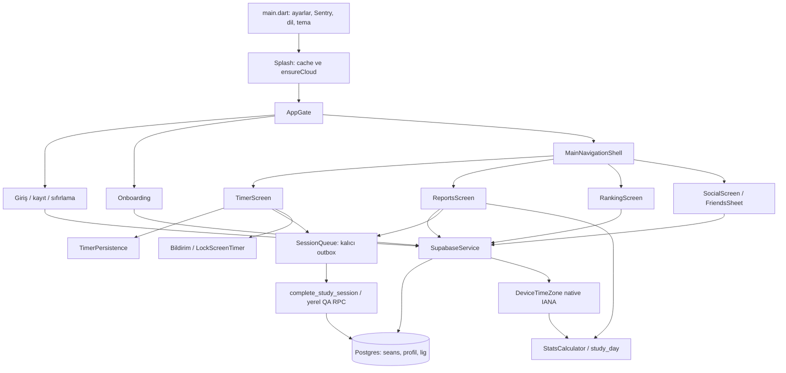

# PomoSprint — proje ve AI oturum devir belgesi

> **1 Kasım canlı geçişi ve sonuç diyaloğu:** Kullanıcının “sen yap” talimatıyla 27/28/29/30/32 Safari SQL Editor'de tek işlem halinde kuruldu; canlı DRYRUN ve kurulum 14/14, bağımsız postflight ve anonim katalog API doğrulaması geçti. 31 kurulmadı. Yeni aylık lig 1 Aralık 00.00 İstanbul'da açılır; doğal cron ve gerçek kullanıcı Deneme turu bu çalışmada sınanmadı. [Canlı kanıt](analiz/ATOMIK_DENEME_ADAYI_2026-11-01.md). Net giriş ekranı [yerelde](analiz/QA_RAPORLAR_2026-11-01.md) güncellendi; son mobil arayüzler için imzalı dağıtım hâlâ gerekir.

> **1 Kasım son görsel düzenleme:** Rapor sekmeleri eşit ve kısa etiketli, tamamlanan deneme yeşil onaylı; içgörü ve metrik kartları sadeleştirildi. Test ve yayın sınırları [rapor QA kaydında](analiz/QA_RAPORLAR_2026-11-01.md).

> **1 Kasım son rapor çalışması:** Deneme raporları ve net düzenleme Raporlar içine alındı, haftalık analiz sınav türüne göre ayrıntılandırıldı, Deneme ligi Sıralama tasarımına uyarlandı ve rapor yenileme hataları düzeltildi. [QA](analiz/QA_RAPORLAR_2026-11-01.md). Kullanıcı alan denemesini daha sonra planlamak üzere kaldırdı; [önizleme raporu](analiz/BRANS_PROTOTIP_2026-11-01.md) tarihseldir. Gerçek alan denemesi veya ödülü uygulanmış değildir.

> **1 Kasım önceki QA:** [Deneme/rapor/bağlantı QA](analiz/QA_2026-11-01.md) ve [sunucu kontrolü](analiz/SUNUCU_RAPORU_2026-11-01.md) canlı geçişten öncedir. Canlı doğrulanmamış seans ödül riski [güvenlik notunda](analiz/OFFLINE_ODUL_GUVENLIK_NOTU_2026-11-01.md) sürer, 30 bunu tek başına çözmez ve 31 kullanıcı kararı bekler. Etkinlik planlayıcı/bölüm denemeleri yalnız öneri olarak belgelendi.

> **28 Ekim en yeni devam noktası — KPSS / §42:** Uygulama, site metni ve proposed SQL yerelde 20 sınav/test ve YKS/LGS/TUS/DUS/KPSS olmak üzere 5 aileye genişletildi; KPSS **canlıya uygulanmadı**. Son onaylı site `6cfd9b5` / Worker `ad2fc988-4462-40ae-9333-ab0107e2138b` olup KPSS içermez. Bundan sonraki deploy için yeniden açık kullanıcı onayı gerekir. [KPSS raporu](analiz/QA_KPSS_2026-10-28.md). Aşağıdaki gece/DUS/yayın notları tarihsel kanıttır; yeni KPSS native testi bu not yazılırken henüz tamamlanmadı.

> **Güncel çalışma — 27/28 Ekim 2026 gece / §39:** `codex/gece-2026-10-27` dalında TUS, Deneme, birleşik raporlar ve aylık kategori/global lig geliştiriliyor. Yeni sunucu paketleri ve site **yalnız yereldedir; canlıya uygulanmadı, push/deploy yapılmadı**. Aşağıdaki 9 Ekim devam noktası tarihsel kayıttır. Önce [istek listesi](analiz/ISTEKLER.md), [ilerleme](analiz/CODEX_ILERLEME.md), [yeni API](supabase/proposed/EXAM_API_CONTRACT.md) ve [paket sırası](supabase/proposed/NIGHT_20261028_README.md) okunmalı. Güncel test sayıları ve cihaz kanıtları ilerleme kaydındadır; geçmiş sonuçları yeni test gibi aktarma.

**Tarihsel devam noktası — 9 Ekim 2026 / §37:** Proje kökü `/Users/almano/Desktop/Projects/Pomodoro`. Ronin kaldırıldı; 21 özel avatarın her biri 500 kum. Canlı SQL kullanıcı tarafından uygulandı ve 20/20 salt okuma kontrolüyle doğrulandı. Dört hesap ve dokuz seans korundu. Tüm simülatörler ve yerel Docker test verisi silindi; açık uygulama veya hazır QA hesabı yok. Eski QUICK/demo/gece komutlarını çalıştırma. Son sonuç 1291 PASS, isteğe bağlı 5 ekran görüntüsü testi atlaması ve temiz analizdir; güncel kapsam [temizlik QA](analiz/QA_RELEASE_CLEANUP_2026-10-09.md) raporundadır. Önceki ham kanıtlar kullanıcı talebiyle kaldırıldı; aşağıdaki tarihli sonuçlar geçmişin kaydıdır. §33 güvenlik/operasyon ve mağaza/fiziksel cihaz işleri halen açıktır.

## 1. Yeni oturumda önce bunu bil

1. Önce bu belgeyi, sonra görevin alanı için [AGENTS.md](AGENTS.md) bölümünü oku. `git status --short` ve `git log -5 --oneline` çalıştır. Çok sayıda değişiklik henüz commit edilmedi; bunlar mevcut çalışmanın parçasıdır. `git reset`, toplu `git restore` veya temizlikle geri alma.
2. Kullanıcı Türkçe iletişim kuruyor. Yapılabilir işi tamamlamanı, uygulamayı gerçekten çalıştırmanı, hata bulursan düzeltmeni ve sonuçları raporlamanı istiyor. Sadece test kodu üretmek isteği karşılamıyor.
3. Şu an fiziksel cihaz kullanılmıyor. Kullanıcı fiziksel cihaz doğrulamasını sonraya bıraktı. iOS simülatörü ve Android emülatörü üzerinde çalış.
4. Test hesapları ve test seansları varsayılan olarak **yerel Supabase** içindir. Kök `.env` normal uygulamayı canlıya bağlar. §26'da açık canlıya alma talebiyle yalnız bir üretim QA hesabı oluşturuldu, tamamlanmadan iptal akışları kontrol edilip hesap temizlendi; normal kullanıcı verisi kullanılmadı. Bu istisnayı sonraki testlere otomatik yetki sayma. Yerel test için URL/anon birlikte `--dart-define` ile ver.
5. **Gerçek süreler korunur:** normal debug/profile/release derlemelerinde odak 25/50 dakika, Maraton molası 300 saniye ve onay penceresi 60 saniyedir. Eski hızlı sayaç derleme bayrakları işlevsizdir; geceki gerçek süre testleri hızlandırılmaz. Tarihsel veriyle yapılan kontrollü fixture kontrolleri, gerçek bekleme kanıtından açıkça ayrı raporlanır.
6. Cihaz/süreç ve açık hesap durumu oturuma özgüdür. 5 Ekim sonunda QA1 açık bırakılmıştı; 7 Ekim yeni koşuları kendi run ID hesaplarını kullanır. Eski ekran görüntüsünü bugünkü DB sonucu sayma; yeni oturumda emulator/simulator/Docker süreçlerini ve giriş hesabını kontrol et.
7. “Testler geçti” mağazaya hazır demek değildir. Fiziksel bildirim/kilit ekranı, gerçek Google/Apple girişi ve ayrı operasyon/yayın işleri bekliyor.

### Kaynaklar ve çelişkileri çözme

- Canlı DB sözleşmesi için gerçeğin kaynağı canlı tanımdır; bu belgedeki geçmiş sonuç canlıya yeni bir doğrulama değildir.
- `AGENTS.md`: çalışma kuralları, detaylı RPC/kolon/hata sözleşmeleri, SQL değişiklik akışı.
- Bu belge: son oturumun devri, bağımlılıklar, çalıştırma ve sonuçların özeti.
- [7 Ekim yayın QA raporu](analiz/QA_RELEASE_2026-10-07.md): Maraton öncesi yayın hazırlığı testleri, düzeltmeler ve açık yayın işleri. Kanıtlar `analiz/qa_evidence_20261007/` içinde.
- [7 Ekim Maraton UI/onay QA](analiz/QA_MARATON_PRESENCE_2026-10-07.md): en yeni ilerleme kartı, zorunlu mola onayı, istemci/sunucu güvenliği ve bu turda gerçekten koşulan kontroller.
- [İlk Maraton QA](analiz/QA_MARATON_2026-10-07.md): önceki otomatik Maraton, puan matrisi, 1129 Flutter, mobil/SQL/release kanıtları; §18’deki yeni onayın testi olarak kullanma.
- [QA_FOLLOWUP raporu](analiz/QA_FOLLOWUP_2026-10-05.txt): tarihsel saat dilimi/arkadaş yönetimi/yasal onay test sonuçları.
- [QA_FULL raporu](analiz/QA_FULL_2026-10-05.txt): önceki geniş kapsamlı testler. Burada “saat dilimi eşleme yok” ve “silme/engelleme düğmeleri yok” ifadeleri tarihsel bulgulardır; takip turunda tamamlandı.
- `PROJECT_CONTEXT.md`, `analiz/` içindeki eski raporlar ve kod yorumları eski olabilir. Daha eski bir metne dayanarak düzeltilmiş özelliği geri alma.
- `supabase/proposed/` adı “hepsi uygulanmamış” anlamına gelmez: bazı paketler 5 Ekim'de canlıya uygulandı (§8).

## 2. Ürün ve teknoloji

PomoSprint, oyunlaştırılmış bir çalışma sayacı. 25 ve 50 dakikalık tek seanslar ve 2/3/4 odaklık Maraton vardır. Maratonda aralara5dk mola girer; ardından60sn içinde “Buradayım” onayı gerekir. Her odak ayrı kayıt, mola/onay bekleme çalışma süresine eklenmez. Kategoriler, raporlar, seri, puan, sanal kum, lig ve arkadaşlar seansa bağlıdır. Maraton'un üç sunucu paketi **8 Ekim'de canlıya uygulandı**; normal üretim uygulamasında planlama/başlangıç/restore/iptal doğrulandı. Ayrıntı `AGENTS.md §5.7`, §26 ve [canlı QA](analiz/QA_MARATHON_LIVE_2026-10-08.md). §18'in canlı-paket-bekliyor notları tarihseldir.

| Alan | Teknoloji / görev |
|---|---|
| Mobil | Flutter; desteklenen ürün platformları iOS ve Android |
| Kontrol edilen yerel araçlar | Flutter 3.44.8 / Dart 3.12.2; `pubspec.yaml` Dart `^3.12.2` |
| Paket / ürün | Dart paketi `pomodoro`, görünen ad `PomoSprint`, sürüm `1.0.0+1` |
| Platform kimliği | `com.pomosprint.app`; widget uzantısı `com.pomosprint.app.TimerWidget` |
| Sunucu | Supabase Auth + Postgres + RLS + SECURITY DEFINER RPC + cron + Edge Functions |
| Canlı proje | `Pomodoro App`, ref `eoosnyakvxmifmexpgxa`, `eu-north-1` |
| Site | `pomosprint.app`, `landing/`, Cloudflare Workers static assets |
| Yerel veri | SharedPreferences, aktif seans, kullanıcı/kategori önbelleği, kalıcı outbox |
| Hata raporu | Sentry; yerel URL/anon define verildiğinde DSN ayrıca verilmezse kapalı |
| UI / animasyon | Material, Lottie `assets/sand_timer.json`, avatar varlıkları |
| Auth | E-posta/parola, Google native idToken, iOS Apple native idToken |
| Bildirim | `flutter_local_notifications`, Android sistem kronometresi/alarm, iOS ActivityKit |
| Zaman | `timezone`, native IANA kanal, `ServerClock`, 04:00 çalışma günü |

Bağımlılık sürümleri `pubspec.yaml`'daki aralıklardır; çözülmüş gerçek paket sürümleri `pubspec.lock`'tadır. `google_sign_in` hâlâ 6.x API'sinde; 7.x göçü yapılmadı. Yeni saat dilimi okuması yeni paket gerektirmedi; Kotlin/Swift MethodChannel kullanıldı. `macos/`, `linux/`, `windows/`, `web/` ürün olarak doğrulanmış platformlar değil; mevcut şablonlara dayanıp masaüstü/web çalışıyor deme.

## 3. Mimari ve bağımlılık haritası



### Açılış ve kullanıcı durumu

`main.dart` `.env` yükler; `BackendConfig` bağlantı kaynağını çözer; Sentry, dil ve tema kurulur; bildirim servisi izin istemeden başlatılır; `SplashScreen` gösterilir. Splash önce cache'i, sonra `ensureCloud` ve profili yükler. Bulut kurulamazsa giriş/kabuk yeniden deneme yapabilir.

`SupabaseService.currentUser`, `ValueNotifier<UserModel?>`, kullanıcı durumunun tek kaynağıdır. `AppGate` bundan karar verir:

- Kullanıcı null → Login.
- `onboardingCompletedAt` null → PostAuthOnboarding.
- Tamamlanmış profil → MainNavigationShell.

Ekranlar kendi kopya kullanıcı durumunu tutup ayrı Login/Shell geçişi yapmamalı. Servis auth/async işlemlerde kullanıcı epoch/id kontrolüyle eski hesabın yanıtının yeni hesaba yazılmasını önler. 7 Ekim düzeltmesiyle sahip değişiminde kökün üzerindeki eski Profil/Koleksiyon/dialog/sheet route’ları frame sonunda AppGate tarafından kapatılır; aynı sahibin profil yenilemesi route kapatmaz. Onboarding/Shell UID ile anahtarlanır. Hesap silme başarısı ayrıca pop/onLogout yapmaz; servis → AppGate yönlendirmesi tek merkezdir. Çıkış, Apple yetki iptali ve oturum düşmesi tam çıkış kancalarından geçer.

### Kabuk ve yenileme

Kabuk dört sekmeyi `IndexedStack` içinde yaşatır: Pomo, Raporlar, Sıralama, Sosyal. Gizli sekmede `TickerMode` kapalıdır; periyodik işleri durdur. Yerel `addStatsChangedListener` puan/arkadaş gibi değişikliklerde ekranları tazeler; global `ranking_updates` Realtime kanalı kullanılmıyor.

Sosyal veri normalde görünürken 30 saniyede bir okunur. Kayıtlı yerel kısa QA modunda 2 saniyedir; dönüşte hemen tazelenir. Bu **push üzerinden gerçek zamanlı yayın değildir**. 5 saniyelik seansı 30 saniyelik poll ile kaçırmamak için QA aralığı kısa tutuldu.

## 4. Klasör ve sorumluluk haritası

| Yer | Sorumluluk / ilk bakılacak dosya |
|---|---|
| `lib/main.dart`, `lib/theme.dart` | Başlatma, uygulama adı, görünüm |
| `lib/app/app_gate.dart` | Tek auth/onboarding yönlendirme kapısı |
| `lib/app/main_shell.dart` | Sekmeler, bağlantı, kuyruk banner'ı, odak RPC'si, ön plana dönüş |
| `lib/app/connection_watcher.dart` | Bağlantı değişikliği ve tekrar deneme |
| `lib/app/category_cache.dart`, `session_feedback.dart` | Kategori cache'i, seans sonuç diyalogları |
| `lib/screens/timer_screen.dart` | Sayaç/duraklatma/geri yükleme durum makinesi |
| `lib/services/timer_persistence.dart` | `ActiveTimerSession`, diske kayıt, saatten kalan süre hesabı |
| `lib/services/session_queue.dart` | `PendingSession`, kalıcı outbox, tekrar/idempotency/ret sınıflandırması |
| `lib/services/supabase_service.dart` | Auth, profil, seans, kategori, lig, arkadaş, avatar veri katmanı |
| `lib/services/backend_config.dart`, `local_test_mode.dart` | Canlı/yerel bağlantı çözümü ve QA sınırları |
| `lib/services/server_clock.dart`, `device_time_zone.dart` | Sunucu-cihaz saat farkı ve native IANA adı |
| `lib/services/notification_service.dart`, `lock_screen_timer.dart` | İzin, bitiş bildirimi, sistem geri sayımı |
| `lib/screens/reports_screen.dart` | Seans/kategori/outbox okuma ve raporların veri kaynağı |
| `history_screen.dart`, `monthly_tracking_screen.dart` | Haftalık ve aylık detay; history dosya adı yanıltıcıdır |
| `lib/utils/stats_calculator.dart`, `study_day.dart`, `category_names.dart` | Metrikler, 04:00/DST takvimi, TR/EN kategori eşlemesi |
| `ranking_screen.dart`, `lib/widgets/social/ranking_models.dart` | Lig/Aylık/Arkadaşlar sıralaması ve satır modelleri |
| `social_screen.dart`, `friends_sheet.dart`, `user_safety.dart`, `user_report_dialog.dart` | Canlı arkadaş, gelen/giden istek, silme/engelleme/gizleme ve uygulama içi neden/not ile bildirme |
| `profile_screen.dart`, `character_collection_screen.dart` | Ayarlar, şifre/hesap silme, avatar mağazası/kuşanma |
| `login_screen.dart`, `register_screen.dart`, `forgot_password_screen.dart` | Giriş, kayıt, ayrı reset formu ve gönderildi ekranı |
| `post_auth_onboarding_screen.dart`, `services/onboarding_categories.dart` | Altı adım ve mevcut kategorilerle uzlaştırma |
| `categories_management_screen.dart`, `models/category_model.dart` | Kategori ekleme/ad/sıra/arşiv/limit |
| `lib/l10n/` | TR/EN ARB ve üretilen localization Dart dosyaları |
| `lib/utils/responsive.dart`, `test/responsive_*` | Telefon/tablet/yatay düzen ve taşma kontrolleri |
| `lib/dev/` | Girişsiz kilit ekranı önizlemesi, yerel QA başlatıcı, süreç ölüm fikstürü; normal main import etmez |
| `test/` | Birim/widget; `support/fake_supabase_service.dart` sahte servis |
| `integration_test/` | Yerel gerçek backend'e bağlı uygulama UI E2E |
| `android/`, `ios/` | Native ayarlar, kanal kodları, bildirim ve widget hedefleri |
| `supabase/` | Eski migration'lar, yeni paketler, dryrun/down, Edge Functions, Auth e-posta şablonları |
| `tool/local_supabase/` | İzole Docker Supabase, snapshot/seed, parite, test hesapları ve E2E araçları |
| `scripts/` | Ağsız JS testleri, güvenlik regresyonu, bülten, mağaza derleme/Sentry |
| `landing/` | Statik site, yasal/reset/onay/abonelikten çıkma sayfaları |
| `analiz/` | Geçmiş denetimler, QA raporları, kalıcı log ve ekran görüntüleri |
| `.vscode/launch.json` | Normal, profile, yerel, kayıtlı hızlı ve kaydetmeyen hızlı çalıştırma seçenekleri |
| `.claude/`, `.specify/`, `specs/` | Yardımcı ajan/spec yapılandırmaları; kaynak kodun yerine geçmez |

## 5. Kritik akışlar ve kurallar

### 5.1 Seans: sayaç → disk → outbox → sunucu → rapor

1. Başlatma sırasında `clientUuid` ve `startedAt` bir kez üretilir. Üç saniyelik hazırlık, çalışma, tek duraklatma ve devam boyunca seans kimliği korunur.
2. Kalan süre tick sayısını azaltarak değil `remainingSecondsAt(now)` ile hesaplanır. Durum geçişleri diske yazılır.
3. Shell sosyal görünürlük için `start_study_session`; duraklat/bitir/sıfırla/çıkış için `cancel_study_session` kullanır. Bu odak göstergesi, puan kazandıran kalıcı seans kaydı değildir.
4. Bitiş `submitCompletedSession` ile önce outbox'a yazar, sonra gönderir. RPC sonucu `Success`, `Queued`, `Rejected` olarak UI'ya gelir.
5. Sunucu kategori sahipliği, zaman, çakışma ve mükerrer kayıt kontrolünü yapar. Puan/kum/seri/lig yalnızca sunucudan alınır.
6. Yanıt kaybolursa aynı `client_uuid` ile yeniden gönderilir. Duplicate tekrar ödül vermez. Açılış sync'i ve timer submit'i yarışırsa `_settledOutcomes` ilk turun sonucunu korur.
7. Kalıcı ret sessiz silinmez: son 50 reddedilen kayıt ve tek seferlik kullanıcı bildirimi vardır. Geçici ağ/auth hatası kuyrukta kalır.
8. Uygulama kapalıyken biten seans açılışta tamamlanır. 24 saatten eski duraklatılmış aktif kayıt kaldırılır. Server gönderim penceresi ve outbox ret kuralları ayrıca `AGENTS.md` §5'te.
9. Duraklatma hakkı bir. Süren seans sırasında 25/50 seçimini değiştirmek sıfırlamaya bağlıdır. Çıkışta cihazda seans saklanabilir; aynı hesap yeniden girdiğinde devam eder, başka hesaba taşınmaz.

**Mevcut normal sunucu sözleşmesi:** 25/50 dk, baz puan 5/12; duraklatınca baz puan 4/9; seri bonusları 3/7/14 gün için %10/%20/%30, yukarı yuvarlama; seans başına 20 kum. Aynı çalışma günündeki 16 seans tavanından sonra puan/kum/lig artmaz ama dakika kaydı devam eder. `get_points_config` ve canlı RPC gerçek kaynaktır; formülü UI'ya kopyalama.

`complete_study_session` parametreleri: `p_client_uuid`, `p_category_id`, `p_duration_minutes`, `p_was_paused`, `p_is_verified` (ön planda geçen saniye; bool değil), `p_started_at`. Sonuçta `base_points`, `bonus_points`, `total_points`, `coins_earned`, `streak`, `bonus_pct`, `duplicate`, `daily_limit_reached` bulunur. Zaman kuralları arasında gelecekte başlama yasağı, 24 saatlik pencere ve normal gövdede bitiş toleransı vardır. Bunları “debug için” canlıda değiştirme.

### 5.2 Rapor ve çalışma günü

- Günün sınırı profil IANA diliminde **04:00**; hafta Pazartesi–Pazar. `studyDayOf`, `studyDayStart`, `mondayOf`, `addDays` ortak yardımcıları kullanılır. DST için `Duration(days: 1)` ile takvim ilerletme.
- `DeviceTimeZone` native `com.pomosprint.app/device_timezone` kanalında `getTimeZone` okur. iOS `TimeZone.current.identifier`, Android `TimeZone.getDefault().id`. Geçerli ad profil yüklenirken ve kabuk ön plana döndüğünde kendi `profiles.timezone` kolonuna yazılır; bilinmeyen ad/ağ hatasında eski profil korunur.
- Seanslar ve bekleyen outbox `mergeStatSessions` ile birleşir. Sunucuda aynı `client_uuid` varsa yerel kopya ayrıca sayılmaz. `overlap` bekleyenleri toplamı şişirmez. Sunucu saati düzeltmesi outbox gün hesabına uygulanır.
- Kategori toplamı UUID ile gruplanır; ad değişince geçmiş iki kategoriye bölünmez. Arşivli kategori geçmiş raporda kalır. 50 dk iki pomodoro sayılır.
- Günlük hedef profilde `daily_goal_minutes`, varsayılan 200. Dağılım yüzdeleri toplam 100'e yuvarlanır; hedef ilerleme etiketi 100'ü aşabilir, halka 100'de durur.
- Aylık sıralama ve aylık rapor, 5 Ekim'de uygulanan sunucu paketiyle `started_at`/profil dilimi/04:00 kuralını paylaşır.

### 5.3 Arkadaş, sosyal ve güvenlik

Kod ekleme → `add_friend_by_code`; kabul/ret → `respond_friend_request`; listeler → `get_my_friends`, `get_incoming_friend_requests`, `get_outgoing_friend_requests`; canlı odak → `get_live_friends`.

Takip turunda UI'ya bağlananlar: `remove_friend(p_friend_id)`, `cancel_friend_request(p_to_user_id)`, `block_user(p_user_id)`, `unblock_user(p_user_id)`, `get_my_blocks()`. İşlem onayı var; yanıt beklerken düğmeler kapalı, ağ hatasında kayıt korunur ve tekrar deneme mümkün. Başarı sosyal/sıralama verisini tazeler. Engeli kaldırmak arkadaşlığı otomatik kurmaz.

Yerel **Gizle** (`hidden_users_uid_<uid>`) ve sunucudaki **Engelle** ayrı işlevlerdir. Ranking model sunucunun `is_blocked` işaretini de okur; sıra/puan satırı bozulmadan maskelenir. Kendi satırında güvenlik menüsü olmaz. “Ben” eşlemesi isimle değil `is_me` ile yapılır.

7 Ekim'de kimliği bilinen satırlar için uygulama içi neden/not formu `submit_user_report(p_target_user_id, p_place, p_reason, p_details)` RPC'sine bağlandı. Lig/aylık/arkadaş sıralaması, canlı liste ve arkadaş isteklerinden çalışır. Neden zorunlu, not isteğe bağlı/en çok 500 karakter; mükerrer, hız sınırı, ağ hatası ve hesap değişimi korunur. Kimliksiz eski sunucu satırında destek e-postası yedeği vardır. RPC açık raporu 24 saat içinde çoğaltmaz, 24 saatte en çok 10 yeni bildirim kabul eder; detaylar `AGENTS.md` sözleşmesindedir. Sunucuda 14 ops operatör fonksiyonu canlı/yerel eşleşti; otomatik test için operatör/üretim değişikliği yapma.

Arkadaş listesindeki eski paralel yanıt yalnız en güncel isteğin sonucuysa uygulanır. Profil sosyal görünürlük anahtarı ilk okuma/kaydetme boyunca kapalıdır; tek işlem ve gerçek önceki değere hata geri dönüşü vardır. Gizlenen kullanıcı cache’i yüklenirken sahip değişimi/logout/silme eski sonucu yeniden yayınlayamaz.

### 5.4 Auth, reset ve yasal onay

- Kayıt zorunlu Kullanım Şartları kabulü ve KVKK/Gizlilik okuma teyidi ister. Pazarlama onayı isteğe bağlı, önceden işaretli değil. `RegistrationConsent` metadata üretir.
- “Şifremi Unuttum” artık ayrı e-posta formunu açar. Kullanıcı adresi girip doğrulama/sıfırlama maili gönderir; başarı ayrı “mailinize gönderildi” ekranına gider. Parola değiştirme linki web reset sayfasında tamamlanır; uygulamada kod girme akışı eklenmedi.
- Supabase auth implicit; özel eski uygulama URL şeması kaldırılmıştır. Web `/reset-password` `access_token`/recovery veya `token_hash` akışını işler; `/confirmed` onay dönüşüdür.
- Google/Apple kod akışı: native idToken → Supabase auth → **`accept_legal_documents`** → duplicate identity temizliği/profil → AppGate. İki belge sürümü tek `kLegalDocumentsVersion` sabitinden (`2026-10-07`) gider. 7 Ekim canlı salt-okuma: Google provider açık; Apple provider kapalı ve client ID boş. Apple düğmesinin bulunması çalışan Apple girişi kanıtı değildir; provider/capability ve signed cihaz doğrulaması yayın engelidir.
- Onay `consents` ledger'ına `terms`/`privacy_notice`, `source=app_legal_acceptance` olarak yazılır; tekrar çağrı çoğaltmaz. Kayıt başarısızsa sosyal girişten sonra tam çıkış yapılır. Restored eski oturumlara kullanıcı eylemi olmadan geriye dönük onay yazılmaz. Bu metadata yazımı veya pazarlama aboneliği değildir.
- Auth istekleri 25 saniye zaman aşımlı. Canlı Auth şifre kuralı 7 Ekim’de salt okunarak doğrulandı: en az 8 karakter, ASCII küçük/büyük harf ve rakam. Mobil ortak helper/ARB/kayıt/şifre değiştirme ve web reset JS/HTML/TR/EN doğrulaması 8’e; yerel Auth minimumu 8’e hizalandı; sunucu kuralı değiştirilmedi. Yerel karakter politikası mevcut QA fikstürleri için boş kalır; config değişikliği sırasında çalışan ana yerel Auth restart edilmedi. Yeni şifre doğrulaması mevcut hesaba girişte eski parolayı istemciden reddetmez. Kayıt/şifre değiştirme isteği sürerken geri çıkış engellenir.
- Onboarding: yaş (13+), hedef/segment, kategoriler, sosyal görünürlük açık seçimi, oyun kuralları, günlük hedef, ekran rehberi (7.adım; Pomo/Maraton/Raporlar/Sıralama/Sosyal/Profil). Hedefte Devam, rehberde Bitir; kayıt yalnız Bitir’de. Segmentler `lgs/yks/kpss/language/university/work`; Diğer null. Kategori önerileri hedefe göre seçilir; kullanıcı seçimi ve taslak korunur.

### 5.5 Kategoriler, avatar ve lig

- Ücretsiz kategori limiti 8, premium 15; asıl kural sunucuda. Kategori silinmez, arşivlenir. `setup_onboarding_categories` mevcutlarla uzlaştırır; güncel JSON sayaçlı yanıt ve eski void yanıt istemcide desteklenir.
- UUID olmayan yer tutucu kategoriler RPC'ye gönderilmez; kuyruk ad eşlemesiyle gerçek kategori bulur. TR/EN ad eşlemesi `categoryMatchKey` üzerinden.
- Sıralama istemcide satır başına `sort_order` update ile; toplu `reorder_categories` çağrılmaz. Kısmi hata iyimser UI'yı geri alıp listeyi yeniden okur. Sunucuda `proposed/16` uygulanmış olduğundan eski yorumdaki sıra çakışması iddiasını yeniden doğrulamadan güncel hata sayma.
- Avatar katalog `avatars`; sahiplik `avatar_unlocks` veya ücretsiz kural; `purchase_avatar` ve `set_equipped_avatar` sunucu RPC. Lig ödülü avatarı satın alınmaz. Satın alma yarışında bakiye sunucuda korunur. Premium/IAP edinme yolu bu QA'da eklenmedi.
- Güncel lig5 kademe, oda en fazla25 kişi; ilk puanlı seansla mevcut uygun aynı kademe odaya yerleşilir. Hazırlık sonrasında global14 günlük dönem;25 farklı aktif kullanıcı başlangıcı planlar. Ayrıntılı eşik/yeterlilik §29 ve AGENTS§6.4'te. Sıra `weekly_points DESC, joined_at ASC, user_id`.
- Cron `process_weekly_leagues` global dönem devrini yürütür; gerçek yeni dönem puanı ve carry korunur. Şimdiki kural hazırlıkta hareket/ödül kapalı; min3 aktif terfi, min10 aktif avatar/düşme, kişisel3 gün/300 dakika. Eski1/1/1 ve3/25/25 denemeleri önceki tur tarihçesidir.

### 5.6 Bildirim ve kilit ekranı

İzin açılışta değil ilk BAŞLAT/ayar eyleminde istenir. Tercih `notifications_enabled`; UI tercih ile sistem iznini birlikte gösterir. Android bitiş alarmı ve devam eden bildirim; iOS bitiş bildirimi ve ActivityKit canlı etkinliği kullanılır.

Android sistem kronometresi / `timeoutAfter`, iOS `Text(timerInterval:)` / `staleDate` sayacı sistemde yürütür. Dart'ı arka planda sürekli çalıştıracak foreground service/background mode eklenmedi. Başlat/devam/restore showRunning; pause showPaused; tamamla/sıfırla/çıkış clear çağırır. iOS kanal `com.pomosprint.app/live_activity`; Swift kanal ve widget/Shared ActivityAttributes beraber değişebilir. Widget iOS 16.2+, ana Runner minimum iOS 15.

Simülatör native kayıt/teslim/iptal ve ActivityKit çağrıları geçti. Bu, fiziksel kilit ekranının yerleşimini veya gerçek cihazda tam ses/banner izin akışını doğruladığımız anlamına gelmez.

## 6. Çalışma geçmişi — 5 ve 7 Ekim turları

### 5 Ekim ve önceki kullanıcı arayüzü/kısa seans işleri

- Kum saati animasyonunun boyun/bitiş kısmındaki boşluk için `assets/sand_timer.json` düzeltildi.
- Timer'daki “DERS SEÇ” başlığı ve kalem kaldırıldı; kategoriler ve seçim çipleri korundu.
- Ayrı şifremi unuttum formu ve mail gönderildi ekranı eklendi, TR/EN metinler üretildi. Gerçek yerel mail/reset akışı test edildi.
- Kısa sayacın kayıtlı yerel QA modu kuruldu: yalnızca sayaç kısaltmakla kalmıyor, 25/50 dakikalık alan ve normal sunucu ödülleriyle rapor/sosyal/lig denenebiliyor.
- `record_accelerated` aktif seans ve outbox'ta opsiyonel işaret olarak taşındı. Eski JSON'da false.
- Profil bildirim ayarındaki mounted koruması ve sosyal dönüşte taze veri davranışı düzeltildi.

### 5 Ekim test altyapısı ve iki platform (tarihsel)

- iPhone 16 Plus / iOS 18.6 test hedefi kullanıldı. Eski destination/SDK sorununda istenen platform Xcode sürümüyle simulator runtime arasındaki fark ayrıştırıldı; iOS 26 runtime indirilerek ürün test hedefi değiştirilmedi.
- Android SDK, JDK 17 ve tek ARM64 API36 emülatör ile Android debug, UI ve release doğrulandı. Eski “bu makinede Android SDK yok” bilgisi artık geçersiz.
- UI testlerinde iPhone 16 Pro'nun sabit ekran boyutu varsayımı kaldırıldı; Plus ve Android gerçek boyutlarıyla kontrol edildi.
- Debug Android yerel HTTP izinleri yalnızca debug manifest/network security config içinde eklendi.
- Beş hesaplı UI seans/sosyal/rapor senaryosu iki platformda çalıştırıldı; rapor ve DB değerleri karşılaştırıldı.
- Gerçek yerel API kesintisi, offline outbox, yeniden gönderme, hesap izolasyonu, pause/restore ve ikinci pause reddi test edildi.
- iOS'ta gerçekten OS süreç kapatıp yeniden açma: tek ilave 50 dk/12 puan/20 kum kaydı doğrulandı. Android'de pause/restore ve offline testleri var; ayrı Android OS kill sonucu iddia edilmedi.
- Auth mail, RLS/sosyal güvenlik, kategori/onboarding, avatar satın alma/kuşanma, lig/cron/sıra/dönem/yariş senaryoları yerelde çalıştırıldı. Eski test beklentileri yeni canlı sözleşmeyle uyumlu hâle getirildi; doğru ürün davranışı sırf eski test yeşil olsun diye geri alınmadı.
- Flutter analiz ve regression, JS/Edge ağsız testleri, Android ARM64 ve iOS imzasız release derlemeleri geçti.

### 5 Ekim takip turu (tarihsel)

- Native IANA okuma ve profil saat dilimi sync'i eklendi; New York DST/gün hesabı ve geçersiz ad fallback'i sınandı.
- Giden istek iptali, arkadaş silme, block/unblock ve engellenen kullanıcı UI bağlandı; beklerken tek işlem, hata ve altı ekran boyutu test edildi.
- Google/Apple girişine yasal ledger kayıt adımı bağlandı. Gerçek sağlayıcı girişi denenmeden, onay metadata'sız yerel hesaplarla ledger yazımı/idempotency doğrulandı.
- Tüm paket 1068 başarılı teste çıktı; son ek iOS seans sonucu/rapor/lig kontrolü de geçti.

5 Ekim çalışması `8a98dab`, doküman takibi `1ab8160` commit’lerinde kayıtlıdır. 7 Ekim turunun düzeltme/test/dokümanları bu yazım sırasında commit edilmedi; `git status` ile koru.

### 7 Ekim sürüm hazırlığı turu

- Flutter analiz temiz; screenshot senaryoları dahil tüm birim/widget 1091/1091, 0 atlama; New York DST alt kümesi 93/93.
- Gerçek iOS `a,b,c,d` normal koşu ve düzeltme sonrası `e,m,n` 3/3 geçti. İlk `e` silme koşusu gerçek Navigator hatası gösterdi; AppGate tek yönlendirme düzeltmesiyle tekrar yeşil oldu. Hızlandırılmış `f,k,g,h,i,l,m` 7/7 geçti; `q` yalnızca geçici toplu import dosyasıydı.
- Yeni uygulama içi bildirim, 8 karakter şifre kuralı ve async/navigation/account isolation düzeltmeleri yapıldı. iOS privacy manifest özel kategori/bildirim notu için hesaba bağlı `OtherUserContent` içerir; tracking yok, amaç AppFunctionality; plist lint geçti. Mobil inceleme ve resmi platform koşulları mobil raporda (ham çıktı §37 temizliğinde kaldırıldı).
- Güncel canlı katalog 409 kayıt, 14 ops fonksiyonu ve izole backend 9 paket 466/466 doğrulandı. Üretim yazımı/posta gönderimi yok.
- Site/Edge ilk düzeltme sonrası 61/61; son tüm Node paketi 99/99 (welcome 15/15, unsubscribe 24/24, delete-account 25/25 alt kümeleri); waitlist onayı, gövde timeout, unsubscribe hata/yeniden deneme ve 8 karakter reset sınırı düzeltildi. TR/EN yasal kaynaklar 7 Ekim’e güncellendi; deploy yapılmadı.
- Android gerçek UI temel koşusu 6/6, tam koşusu 8/8 geçti. İki platformda gerçek OS süreç sonlandırma/restore tek UUID'yi tek seans olarak kaydetti. Gerçek Android mağaza pipeline 64,2 MB AAB üretti ve imza doğrulaması geçti; mağazaya yüklenmedi. Yerel QA release APK'sı 28,0 MB derlendi; normal main ile emülatörde release giriş/rapor/sekme/sayaç/native bildirim, duraklat/sıfırla ve soğuk açılış kontrolleri geçti; bu koşuda çökme yok. iOS obfuscated imzasız release geçti (28,4 MB uygulama); imzalı IPA kişisel takım/provisioning engelinde kaldı. Son durum [ana QA raporunda](analiz/QA_RELEASE_2026-10-07.md). Önceki 5 Ekim derlemesi bugünkü artifact kanıtı değildir.

## 7. Normal çalışma ve emekliye ayrılan QA modları

`flutter run`, profile ve release her zaman gerçek25/50dk; Maraton mola300/onay60sn. `QUICK_TIMER`, `QUICK_TIMER_SAVE` ve eski yerel kısa mola define’ları etkisizdir. VS Code’da yalnız normal `lib/main.dart` profilleri vardır. `lib/dev/`, `local_test_mode.dart`, `quick_recording.py`, demo/gece/kısa kayıt runner’ları §37’de kaldırıldı.

Explicit `TimerScreen(quickTimer:true)` yalnız anlamlı widget testlerinde süre simülasyonudur; yeni ürün özelliği veya kullanıcı modu değildir. Eski hızlandırılmış aktif timer restore’da temizlenir; `recordAccelerated` outbox kalıcı `invalid_data` ret listesine alınır ve sunucuya gönderilmez. Gerçek kayıtlar korunur. İstemci yalnız normal `complete_study_session`/`complete_marathon_study_session` RPC’lerini seçer.

## 8. DB durumu, güvenlik ve yayın sınırları

Kök `supabase/migrations/` canlı şemanın tam/birebir migration geçmişi değildir. `supabase db push` veya kökte `db reset` yapma. `proposed` dosyaları ön koşullu tarihsel paketlerdir; tekrar olduğu gibi uygulamak güncel fonksiyonu geriletebilir.

**Mevcut repo/AGENTS geçmişine göre canlı:**

- `20261003150000_live_audit_fixes` 3 Ekim'de uygulandı.
- 5 Ekim sırası: **12 → 15 → 16 → 19 A → 13 → 14 → 20 → 21 → 22 → 23 → 24 → 25 → 26** uygulandı ve o işlemde DRYRUN/md5/katalog doğrulandı.
- 8 Ekim: **20261007150000 → 20261007160000 → 20261007170000** Maraton zinciri tek atomik transaction ile uygulandı; ardından ayrı incelenen **20261007110000_report_submission_lock** kuruldu. Güncel ön/son doğrulamalar §26'dadır; yeniden uygulama.
- 8 Ekim sonraki lig talebi: **20261008190000_league_launch_policy** uygulandı; canlı öncesi/sonrası55/55 rollback, yeni MD5/ACL/veri doğrulaması §29. Yeni normal MD5 `72023f3f4d8636363cf0231f42d4c7e1`; Maraton gövdeleri değişmedi. Yeniden uygulama.
- 19 B (onay alanı zorunlu waitlist) uygulanmadı; önce site payload güncellenmeli.
- 01–11 paketlerinin tamamı uygulanmış sayılmaz. Bazı eski öneriler sonraki paketlerle geçersiz kaldı.
- Eski `20260928120000_security_hardening_up` uygulanmadı; `session_not_elapsed` canlı kuralı diye kabul etme.
- `reorder_categories`, `set_my_timezone`, `get_my_category_limit` canlıda yok. Son timezone işi doğrudan izinli kendi `profiles.timezone` UPDATE ile çalışıyor.

7 Ekim’de canlı DB/Auth/Edge kataloğu yeniden **salt okunarak** doğrulandı: 409 katalog kaydı 5 Ekim baseline ile aynı; 14 ops fonksiyonu yerel/canlı eşleşiyor ve beklenmedik API EXECUTE grant yok. Kanıtlar `analiz/qa_evidence_20261007/backend/` içinde. İzole test veritabanında 9 paket 466/466 kontrol geçti; ana yerel şema ve üretim değişmedi. Gerçek cron zamanlaması yerine gerçek `process_weekly_leagues` gövdesi kontrollü çağrıyla test edildi. Yeni DB işi için o andaki `pg_get_functiondef`, kolon/yetki/RLS/trigger/cron/migration geçmişini yine salt okunarak doğrula.

SQL işi: `supabase/README.md` ve `AGENTS.md §2.4` akışını izle; canlı gövdeye göre migration, birebir eski gövdeli rollback, geri alınan DRYRUN üret. Genel yöntem kullanıcı SQL Editor'dür. §26'nın açık canlıya alma/üretim hazırlığı talebinde yalnız üç Maraton ve bir şikâyet kilidi paketi mevcut CLI Management API ile uygulandı. Ön/son parmak izi/yetki/veri kontrolü geçti. Bu oturuma özgü istisnayı başka canlı işlemlere otomatik yetki sayma; kök `db push/reset` hâlâ kullanılmaz.

Korunan para/puan/seri kolonlarına istemciden yazılmaz. Başkasının `profiles` satırı doğrudan okunmaz; yetkili RPC kullanılır. `study_sessions` istemciden INSERT/UPDATE değil RPC ile yazılır. RLS ve SECURITY DEFINER yetkileri korunur; yeni kolon/RPC'de GRANT/REVOKE unutma.

**Sırlar:** kök `.env` uygulama asset'idir; yalnızca public Supabase değerleri ve Sentry DSN. `scripts/.env`, service role, Resend anahtarı, Sentry auth token, Apple `.p8` ve Edge secrets bu belgeye/loga/repoya kopyalanmaz. Yerel demo anon anahtarı sır değildir, fakat canlı ve yerel anahtarlar karıştırılmaz.

## 9. Yerel ortamı yeniden açmak

§36’da tüm simülatörler, §37’de yalnız `pomosprint-local` Docker test proje verisi ve `.runtime` fixture kimlikleri silindi. Diğer Docker projeleri korundu. Yeniden oluşturmayı kullanıcı istediğinde yap; şimdi hazır cihaz/QA kullanıcı/önizleme yok.

Yerel şema/test altyapısı [yerel Supabase rehberinde](tool/local_supabase/README.md) bulunur. Snapshot tarihli ve yeni canlı katalogla aynı değildir; kör migration/db push/reset yapma. Yeni yerel hesaplar yalnız izole loopback backend’de oluşturulmalı; kişisel canlı kimlikler buraya taşınmaz. Normal `.env` canlı Supabase’e bağlı ve korunmuştur.

Güncel cihaza normal uygulama için `flutter devices` ardından `flutter run -d <güncel-cihaz-id> -t lib/main.dart`. Eski BEA/HMV UUID’leri silindi; Xcode SDK ile simülatör runtime sürümünün ayrı olduğunu unutma. Native tekrar bu temizlikte yapılmadı.

## 10. Tarihsel test senaryoları ve sonuçlar (7 Ekim)

### 7 Ekim 2026 güncel sonuçlar

| Kontrol | Sonuç / kapsam |
|---|---|
| `flutter analyze` | No issues found |
| Tüm birim/widget, `SCREENSHOTS=true` | **1091/1091 geçti**, 0 atlama; yeni mobil düzeltmeler dahil |
| New York DST rapor/gün alt kümesi | **93/93 geçti** |
| Report/silme/race odaklı küme | 86/86 geçti; tam kümenin alt kümesidir |
| Gerçek iOS normal UI | `a,b,c,d` geçti; ilk `e` gerçek route yarışını gösterdi, düzeltme sonrası `e,m,n` 3/3 geçti |
| iOS kayıtlı hızlı toplu koşu | `f,k,g,h,i,l,m` 7/7 geçti; geçici `q` import dosyasıyla çalıştırıldı, seans için 25/50 dakika beklenmedi |
| İzole backend | 9 paket, **466/466**: seans 101, kategori 164, lig/avatar SQL 98, avatar HTTP 26, sosyal 26, Auth/mail 9, yarış 7, ay/gizlilik/onay/silme 14, report 21 |
| Güncel canlı salt-okuma | 409 katalog kaydı baseline ile aynı; 14 ops fonksiyonu canlı/yerel eşleşiyor |
| Site/Edge/e-posta ağsız | **99/99** son tüm Node paketi; site ilk turu 61/61; son welcome 15/15, unsubscribe 24/24, delete-account 25/25; partial sync/statik varlık denetimi temiz |
| Android gerçek UI | Temel koşu **6/6**, tam koşu **8/8** geçti; beş hesap, kesinti, native bildirim ve uygulama içi report formu dahil |
| iOS/Android gerçek OS süreç sonlandırma | İki platformda aynı UUID ile tek 50 dk seans/12 puan/20 kum; ikinci açılışta kayıt yine tek |
| Android mağaza AAB | **64,2 MB**, gerçek pipeline ve mağaza imza doğrulaması geçti; mağazaya yüklenmedi |
| iOS release / imzalı IPA | Obfuscated imzasız release **28,4 MB** uygulama olarak derlendi; imzalı IPA kişisel takımın Sign In with Apple / Time Sensitive Notifications ve provisioning kısıtında kaldı |
| Android yerel QA release APK / çalışma kontrolü | **28,0 MB** derlendi; normal main ile emülatörde release giriş/rapor/sekme/sayaç/native bildirim, duraklat/sıfırla ve soğuk açılış kontrolleri geçti; bu koşuda çökme yok. Son artifact/runtime için [ana raporu](analiz/QA_RELEASE_2026-10-07.md) oku |
| Fiziksel cihaz / gerçek provider login | Doğrulanmadı; Apple provider ayrıca canlıda kapalı |

Alt küme/tekrar koşular 1091’e eklenip bağımsız toplam yapılmamalı. Backend 466 ve Node 99 ayrı araçların farklı kontrolleridir; tek “uygulama testi” toplamına dönüştürme. 5 Ekim’deki 1068+5 atlama, Android APK 29.5 MB/iOS unsigned 30.4 MB ve önceki OS kill sonuçları tarihsel kanıttır; 7 Ekim derleme sonuçlarının yerine geçmez.

### Tarihsel tekrar komutları — §37 sonrasında kullanma

Eski hızlı/demo/native yardımcıları kaldırıldı. Güncel komutlar README ve yerel rehberdedir; bu örnekler yalnız geçmişi açıklar.

```sh
flutter analyze
flutter test --concurrency=2 --dart-define=SCREENSHOTS=true
TZ=America/New_York flutter test \
  test/reports_correctness_test.dart test/reports_findings_test.dart \
  test/stats_calculator_test.dart test/study_day_test.dart --concurrency=2
```

ARB değişirse önce `flutter gen-l10n`. JS/Edge/site betiği değişirse `scripts/` içinde `npm test`. Site ortak parçası değişirse `python3 landing/tools/sync_partials.py --check`.

UI E2E normal main + yerel gerçek API kullanır. Yeni run ID seç; eski run ID tekrar kayıt çakışmasına neden olabilir. Sim runner varsayılanı başka iPhone 16 Pro UDID'sidir; **Plus için SIM_UDID açık ver**.

```sh
QUICK_TIMER=true QUICK_TIMER_SAVE=true \
SIM_UDID=BEA55019-D5C3-420F-90F2-0B0CBD5690CF \
E2E_RUN_ID=yeni_kosu E2E_SHOT_DIR=/tmp/pomosprint-ios-qa \
tool/local_supabase/e2e/sim/run_sim_e2e.sh f l

QUICK_TIMER=true QUICK_TIMER_SAVE=true \
E2E_RUN_ID=yeni_android_kosu E2E_SHOT_DIR=/tmp/pomosprint-android-qa \
tool/local_supabase/e2e/sim/run_android_e2e.sh f l
```

| Harf / test | Senaryo |
|---|---|
| `a_register_onboarding` | UI kayıt, zorunlu onay, yaş/hedef/kategori/görünürlük/hedef |
| `b_timer_layout` | Gerçek ekran boyutunda timer, kategori, süre/başlat/gezinti |
| `c_session_points` | Önceden süresi dolmuş normal kayıt restore; tek seans/puan/kum/rapor/lig |
| `d_friends_visibility` | Arkadaş isteği/kabul ve görünürlük |
| `e_settings_delete` | Profil/yasal/yerel hesap silme |
| `f_quick_multi_account` | 5 hesap, UI BAŞLAT, gerçek 5/10 sn bekleme, 25/50 dk kayıt, sosyal/rapor/lig |
| `g_review_flows` | Reset ve diğer gözden geçirme UI akışları |
| `h_offline_lifecycle` | Gerçek yerel Kong kesintisi, disk outbox, retry, hesap izolasyonu |
| `i_pause_resume` | Tek duraklatma, restore/devam, UUID korunması, 50 dk/9 puan/20 kum |
| `j_android_notifications` | Android gerçek sistem izni/bildirim/alarm teslimi/iptal |
| `k_ios_native` | iOS provisional bildirim ve gerçek ActivityKit kanal çağrıları |
| `l_followup_management` | Saat dilimi, DST/cache/DB, cancel/remove/block/unblock UI, onay idempotency |
| `m_release_journey` | Kategori ekle/ad/arşiv/limit, arşivli rapor geçmişi, tema/dil, avatar bakiye hatası, overlay açıkken çıkış |
| `n_user_report` | Gerçek UI→yerel RPC bildirim, payload/tek kayıt/mükerrer ve hesap izolasyonu |
| `o_marathon` | 25/50dk × 2/3/4 plan, ayrı seans/rapor/lig/ödül ve arkadaşın odak/mola görünürlüğü; yerel Maraton paketleri ve kayıtlı QA gerekir |
| `p_marathon_compat` | Maraton paketleri kaldırılmış eski sunucuda seçeneklerin kapalı, normal seans/rapor/eski sosyal yedeğinin çalışması |

Önceki yayın hazırlığı turunun `o/q/r` toplu import yardımcıları geçiciydi ve kaldırıldı. Ardından eklenen `o_marathon_test.dart` ve `p_marathon_compat_test.dart` kalıcı, ayrı senaryolardır; aynı harf eski yardımcı dosyasının hâlâ kullanıldığı anlamına gelmez. Güncel kalıcı testler yukarıdaki `a`–`p` dosyalarıdır; Maraton ortamı ve yeniden koşma için §15 ile [yerel Supabase rehberini](tool/local_supabase/README.md) izle.

`h` için `E2E_ALLOW_OUTAGE=true` gerekir; sadece yerel API geçici durdurulur ve finally açılır. Native `j` yalnızca Android, `k` yalnızca iOS'ta çalıştır. Cihaz screenshot'ı macOS proje klasörüne yazamıyorsa `/tmp` E2E_SHOT_DIR kullanıp sonradan proje içine kopyala. Test hostu `e2e_host.py` loopback'tedir; Android erişimi ayrı host define ile ayarlanır.

Diğer gerçek yerel kontroller:

```sh
python3 tool/local_supabase/e2e/auth_mail_test.py
python3 tool/local_supabase/e2e/social_safety_test.py
```

`tool/local_supabase/e2e/t1_seans_puan`, `t2_onboarding_categories`, `t3_visibility`, `t4_league_avatar` alan testlerini içerir. Öneri zinciri `proposed_chain_check.sh` ayrı kopya DB'de dryrun/uygula/down kontrolüdür; ana kopyada körlemesine migration çalıştırma. `scripts/security_regression_test.js` **gerçek/canlı hesap açıp silebilir**; yerel testlerle karıştırma, çalıştırma koşulu `AGENTS.md`'de ayrı.

### Kanıt dosyaları

- [Güncel ana QA raporu](analiz/QA_RELEASE_2026-10-07.md); kanıt kökü `analiz/qa_evidence_20261007/`.
- Backend özeti (ham çıktı §37 temizliğinde kaldırıldı), mobil kod incelemesi (ham çıktı §37 temizliğinde kaldırıldı), site raporu (ham çıktı §37 temizliğinde kaldırıldı), e-posta özeti (ham çıktı §37 temizliğinde kaldırıldı).
- [5 Ekim takip raporu](analiz/QA_FOLLOWUP_2026-10-05.txt) / [okunabilir metin](analiz/QA_FOLLOWUP_2026-10-05.txt), tarihsel.
- [Önceki kapsamlı okunabilir rapor](analiz/QA_FULL_2026-10-05.txt) / [okunabilir metin](analiz/QA_FULL_2026-10-05.txt).
- 7 Ekim logları `analiz/qa_evidence_20261007/`; 5 Ekim logları `analiz/qa_followup_evidence_20261005/` ve `analiz/qa_evidence_20261005/`.
- Tarihsel 5 Ekim ekranları `analiz/ekranlar/20261005_followup/ios`, `android`, `session`; önceki `20261005_full_qa/`. 7 Ekim platform görüntüleri ana rapordaki kanıt yollarındadır.
- 5 Ekim elle test görüntüsü `analiz/ekranlar/20261005_followup/ios/elle-test-hazir.png`.
- `build/e2e_sim/` ve `/tmp` geçici, silinebilir/üstüne yazılabilir; kalıcı rapor linki için `analiz/` kanıtlarını tercih et.

### Doğrulanmayanı doğrulanmış sayma

- Gerçek Google/Apple login yerel provider kapalı olduğundan denenmedi. Ledger'ın gerçek yerel RPC'yle yazılması provider auth'un testi değildir.
- New York IANA yanıtı testte kontrollü MethodChannel taklidi; iki platformun gerçek native kanalı Istanbul döndürdü. Sistem ayarından fiziksel seyahat/saat dilimi değişimi yapılmadı.
- iOS provisional bildirim teslimi, tam banner/ses/kilit ekranı kullanıcı onayıyla eşdeğer değildir.
- `c` restore fikstürü gerçek OS kill değildir. 7 Ekim’de ayrıca iOS terminate ve Android force-stop sonrası gerçek restore/tek kayıt iki platformda doğrulandı; güncel kanıt ana QA raporunda. 5 Ekim iOS OS kill ve eski 'Android kill yapılmadı' kayıtları tarihsel kalır.
- 7 Ekim mağaza AAB imzası doğrulandı; mağazaya yükleme ve fiziksel cihaz testi yapılmadı. İmzasız iOS uygulaması mağazaya yüklenebilir IPA değildir; imzalı IPA kişisel takım/provisioning engelinde kaldı.
- Yerel Mailpit başarıları tek başına üretim teslimi değildir. 7 Ekim’de Resend domain/DNS ve geçmiş tek Delivered mail salt okunarak görüldü; yeni reset/kayıt/bülten postası gönderilmedi. SMTP alanları Auth config çıktısında redakte/eksik olduğu için güncel SMTP ayarı doğrulanmış sayılmaz.

## 11. Site, e-posta ve mağaza bağlantıları

`landing/` statik; build yok. Ortak `_partials/` değişince `sync_partials.py` ile sayfalara işler. `_headers` CSP, token sayfalarında no-store/no-referrer. Fontlar ve GSAP self-hosted. CSS/JS değişince ilgili `?v=` cache sürümü artırılır. `.assetsignore` dışındaki dosyalar yayınlanabilir; sır veya test verisi landing içine konmaz.

**Site medya davranışı §28 (güncel lig açıklaması yayını §29):** Telefon ekranı oranı düzeltilip görünürken sessiz autoplay/loop etkinleştirildi; ayrıntı [otomatik video QA](analiz/QA_SITE_AUTOPLAY_2026-10-08.md). MP4 yalnız görünürken yüklenir, manuel tıklama/Space/Enter duraklatması korunur; reduced-motion ve hata fallback'ı gerçek görüntüdür. Cache CSS/ana JS `20261008d`. Native kontrollerin kullanıldığı önceki davranış tarihsel §26'dadır. Site yayını uygulama mağaza yayını değildir.

**Önceki 8 Ekim gerçek site yayını §26:** Yedi gerçek native ekran ve iki kısa video dosyası, güncel Maraton/SSS/yasal kaynaklar ve önceden bekleyen resetJS canlıya çıktı. Nihai site sürümü/medya byte/hash/HTTP ve Safari kanıtı [site QA](analiz/QA_SITE_MEDIA_RELEASE_2026-10-08.md)'dadır. Site deploy'u Edge Function deploy etmez; aşağıdaki7Ekim Edge/gönderen kimliği açık işleri korunur.

Dokunulmaz URL'ler: `/terms`, `/privacy`, `/kvkk`, `/hesap-silme`, `/destek`, `/reset-password`, `/confirmed`, `/unsubscribe` ve EN eşleri. Mağaza kayıtları, eski mobil sürümler, Auth allowlist ve gönderilmiş e-postalar bunlara bağlı.

Auth mail şablonları `supabase/auth-email-templates/`; reset token_hash ve TR/EN bağlantıları burada belgeli. Bunların repo kopyası Auth paneline uygulanmış sayılmaz.

E-posta: Auth mail ve pazarlama hoş geldin/bülteni ayrı akışlar. `send-welcome-email`, `marketing_subscribers` insert trigger’ı, Resend ve gönderici kimliğine bağlı. `unsubscribe` token-only POST; bülten `send_newsletter.js`, önce dry-run.

7 Ekim salt-okuma doğrulaması: Resend `mail.pomosprint.app` verified; DKIM/SPF kayıtları verified, sending açık, receiving kapalı, Ireland/eu-west-1. Son 15 günlük panelde 1 geçmiş parola sıfırlama maili Delivered, 0 bounce/complaint görüldü; yeni posta gönderilmedi. `RESEND_API_KEY` var, `MAIL_SENDER_NAME`/`MAIL_SENDER_ADDRESS` yok. Welcome bu nedenle satırı sahiplenmeden başarısız olur, bülten gönderici kimliği olmadan gönderilmez; Auth kayıt/reset ayrı akıştır. Auth CLI yapılandırması SMTP alanlarını redakte/eksik verdi; geçmiş teslim güncel SMTP alanlarını doğrulamaz. Kanıtlar `analiz/qa_evidence_20261007/backend/email/` içinde.

Canlı welcome v9 ve unsubscribe v10, 7 Ekim yerel düzeltmelerinden eskidir. Welcome identity/network/idempotent-retry 15/15; unsubscribe iki liste/hata-retry düzeltmeleriyle tüm Node paketi 99/99 kaynakta test edildi fakat deploy edilmedi. Gönderici/geliştirici kimliği kullanıcı tarafından verilmeli; AI uydurmaz. Yeni deploy veya posta testi bu belge güncellemesinin parçası değildir.

Mağaza pipeline `scripts/build_release.sh android|ios|all`: obfuscation, split-debug-info, Sentry sembolleri, keystore/provisioning. 7 Ekim Android pipeline ile 64,2 MB AAB üretildi ve mağaza imzası doğrulandı. iOS obfuscated imzasız release geçti (28,4 MB uygulama); imzalı IPA kişisel takımın Sign In with Apple / Time Sensitive Notifications ve provisioning kısıtında kaldı. Android yerel QA release APK'sı 28,0 MB derlendi; gerçek release çalışma kontrolü emülatörde geçti. Son artifact/runtime ve sembol yükleme durumu ana QA raporunda. Deploy/publish yapılmadı.

## 12. Kalan işler ve sonraki oturum için önerilen sıra

### Kullanıcı fiziksel cihazı verdiğinde

1. Gerçek iOS ve Android'de tam bildirim izni (kabul/ret/ayar dönüşü), ses/banner, arka plan bitiş ve iptal.
2. Fiziksel kilit ekranı/Live Activity/Dynamic Island ve Android ongoing sayaç davranışı.
3. Google ve Apple gerçek sağlayıcı girişi, yeni/mevcut hesap, onboarding yönlendirmesi, onay ledger'ı, çıkış/Apple yetki iptali.
4. Sistem saat dilimini değiştirip resume sync, günlük/haftalık/aylık rapor ve sınır günlerinin tutarlılığı.
5. İki cihaz/iki hesapla sosyal görünürlük gecikmesi, arkadaş yönetimi, offline retry ve normal gerçek süreli seans. Yerel hızlandırılmış test sonucu bu son normal süre testi yerine geçmez.

### Ayrı yayın/operasyon işleri

- Canlı migration geçmişi/baseline düzeni; kök CLI push güvenli hâle getirilmeden kullanılmamalı.
- Veri sorumlusu ve gönderici kimlik bilgileri gerçek kullanıcı/kurum bilgisiyle doldurulmalı; AI uydurmaz.
- Welcome sender kimliği 7 Ekim salt-okuma secret adlarında hâlâ yok; Resend domain verified ve geçmiş Auth Delivered kanıtı mevcut. Kaynak welcome/unsubscribe düzeltmeleri deploy edilmedi. SMTP alanları güncel çıktıda doğrulanamadı; eski “Resend/DMARC yok” ifadesini güncel açık iş sayma.
- Canlı Apple provider kapalı/client ID boş; `delete-account` Edge Function yok. Provider/capability/secrets, Apple token revoke ve gerçek signed cihaz login/delete doğrulaması yayın engelidir; SQL fallback hesabı siler fakat revoke yapmaz.
- Waitlist consent payload ve TR/EN yasal kaynaklar8Ekim site yayınıyla canlıya çıktı. `proposed/19` B ve unsubscribe Edge ayrı bekliyor; kaynaksiteyayını bunları uygulamaz. Gerçek geliştirici kimliği placeholder olarak kaldı, kullanıcı en son verecek.
- Uygulama içi report formu tamamlandı ve yerel UI/RPC testleri geçti. Bildirimlerin ops tarafından ele alınması, Store Data Safety/App Privacy etiketleri, exact-alarm beyanı ve signed dağıtım operasyonları ayrıca tamamlanmalı.
- Lig eşikleri 1/1/1 mi 3/25/25 mi, ilk oda 7–14 gün, 24 saat pencere ve unverified cap ürün kararları; test bulgusu diye otomatik değiştirilmez.
- Google plugin 7.x göçü, güvenli token depolama, servis katmanını bölme, eski çeviri yollarını ARB'ye taşıma ayrı teknik işler.
- Git çalışma ağacının gözden geçirilip commit edilmesi ve repo hijyeni; mevcut işi silerek “temiz” hâle getirme.

Kullanıcı sadece doküman istediğinde bu işleri kendiliğinden deploy ederek yapma. “Her şey hazır mı?” sorusuna test kapsamı ve bekleyen yayın maddeleriyle yanıt ver.

## 13. Devir belgesini güncel tutma

Kullanıcının kalıcı isteği: iş ve testler bittikten sonra yapılanları Markdown devir belgelerine kaydet ve kullanıcıya raporla; başka yapay zekâ sohbet geçmişine ihtiyaç duymadan devam edebilsin. Bir özellik/sözleşme/test değiştiğinde ilgili `AGENTS.md` bölümünü ve bu belgedeki güncel durumu birlikte güncelle. En az şunları kaydet:

- Tarih, kullanıcı hedefi, değişen dosyalar ve sonuç davranışı.
- Yerel / canlı / fiziksel kapsamı; gerçekten çalıştırılan test ve kanıt yolu.
- Geçti/kaldı/atlandı/denenmedi ayrımı ve kalan belirsizlik.
- Yeni RPC/kolon/hata metni, migration/down/dryrun durumu.
- Hangi önceki bulgu tamamlandı; eski raporu silmek yerine takip kaydıyla ilişkilendir.
- Elle test için kalan hesap/cihaz/helper ve normal moda geri dönüş komutu.

Yeni sohbete verilebilecek başlangıç talimatı: **“Önce PROJE_DEVIR.md §28 ve AGENTS.md'yi oku; son site kaynağı QA_SITE_AUTOPLAY_2026-10-08.md, backend devri §26'dadır; git status ile commit edilmemiş işleri koru. Site ve Maraton canlı, şikâyet kilidi uygulandı; QA_SITE_MEDIA_RELEASE / QA_MARATHON_LIVE / QA_REPORT_SUBMISSION_LIVE güncel sonuçtur. Simülatör canlı TR giriş ekranında açık; önceki yerel önizleme verisi korunur. Yeni testlerde varsayılan yerel Supabase kullan; fiziksel cihaz, gerçek sağlayıcı/Apple ve yasal kimlik işleri bekliyor. Mevcut canlı migration'ları tekrar uygulama.”**


## 14. Git / bilgisayarlar arası devir

5 Ekim 2026'da mevcut `KrAlmano/PomoSprint` GitHub deposunun gizli olduğu doğrulandı. Yerel `main` dalı uzaktaki `origin/main`'e göre 57 commit ilerideydi; bu 57 commit ile o tarihteki 132 dosya/README/QA değişikliği, sır kalıbı taraması ve `.env` dışlama kontrolünden sonra `8a98dab` commit'iyle `origin/main`'e gönderildi. Push sonrasında yerel `main` ve özel GitHub `main` aynı commit’e geldi, çalışma ağacı temizdi. Ardından `1ab8160` doküman takibi eklendi. 7 Ekim QA paketi `fix: resolve release QA findings and record end-to-end evidence` commit başlığı altında kaynak, test, seçilmiş ekran ve kanıt/devir güncellemelerini içerir. Depo erişimi 7 Ekim yeniden kontrol edildi: authenticated Git erişimi var, anonim GitHub API 404; özel repo durumunun kanıtı `analiz/qa_evidence_20261007/github_access_check.json`. Commit kimliği ve güncel remote senkronu için `git status`/`git log`/uzak branch kontrolü yap. İkili release paketleri ve semboller ignore edilen yerel dizinlerde; Git ile taşınmaz.

Bu bölümün eski 5 Ekim çalışma ağacı listesini saklamıyorum; artık güncel gerçek değil. Sonraki oturumda yine `git status --short` ve `git log -5 --oneline` çalıştır. Yeni doküman değişiklikleri veya başka makinelerdeki commit'ler bu commit'ten sonra gelmiş olabilir. `.env`, `scripts/.env` ve `.claude/settings.local.json` ignore edilir; başka makineye taşıma için secrets olmayan kaynakları push etmek yeterli, yerel secret/settings dosyaları ayrıca güvenli şekilde kurulur. GitHub deposunu başka bilgisayarda clone et ve yeni sohbetten önce `PROJE_DEVIR.md` ile `AGENTS.md`'yi aç.

## 15. İlk Maraton çalışması — 7 Ekim 2026 (tarihsel)

Bu bölüm ilk otomatik Maraton turunun davranış ve kanıtını saklar. Son kullanıcı isteğiyle otomatik devam kaldırıldı; ilerleme animasyonu ve zorunlu mola onayı için **§18 güncel kaynaktır**. Buradaki iki paket/1129 test sayısı yeni üç paketli onayın sonucu değildir.

Kullanıcı ana ekranda 2/3/4 Pomodoro seçip otomatik Maraton istedi. Son puan talebi önceki +4/+6/+10 genel matrisini değiştirdi: **25dk için +2/+3/+5, 50 dk için +4/+6/+10**. Sabit bonus tam planda bir kez, sunucuda verilir; seri çarpanına ve kuma eklenmez. Her odak ayrı normal seans olarak kaydolur; aralarda 5dk mola vardır, mola çalışma dakikası değildir. Sonraki odak ön planda otomatik, kapalı/askıda dönüşte yeni başlangıç anıyla sürer. Sosyalde normal “Odaklanıyor” ve yeni “Molada” filtreleri vardır; normal tazeleme 30sn, push realtime yoktur.

İstemci ve sunucu sözleşmesi `AGENTS.md §5.7` içindedir. Temel yeni dosya `lib/models/marathon_progress.dart`; timer/persistence, Shell, outbox, servis, bildirim ve sosyal kodu güncellendi. Diskte durma isteği saklanır, UUID/aşama/tamamlanan sayı aynı kilitte karşılaştırılarak geç yanıtın yeni odağı ezmesi önlenir. Yerel çıkış ve uzaktan oturum düşmesi native temizlik beklerken otomatik devam kapanır. Başlangıç disk yazısı sırasında izin kaybı veya false/exception yanıtında eski JSON aynı kilitte geri alınır; yeni ekran hiç başlamamış odağı kaydetmez. Geciken prefs testinde doğrudan kullanılan platform arayüzü aynı kilitli sürümle dev dependency yapıldı; üretim paketi eklenmedi. Odak alarmı0, Android ongoing1, mola alarmı2. Yeni SQL paketleri normal seans RPC gövdesini değiştirmez. Lig devrinde bonus normal puanla aynı tek aktif üyeliğe gider; kapanmış dönem bugünkü lige eklenmez.

Son analiz temiz; tam Flutter paketi **1129/1129**, SCREENSHOTS=true, 0 atlama. iPhone 16 Plus/iOS18.6 ve Android16 ARM64 üzerinde altı 25/50×2/3/4 plan, her platformda 6 yeni odak hesabı +1arkadaş ile geçti. Son istemci koduyla iki platformda 25×2/50×4 tekrarı da geçti. Native j/k odak/mola alarm teslim/iptal, tercih ve iOS ActivityKit start/pause/resume geçti. Eski sunucuda gerçek p senaryosu yeni RPC'ler 404 iken Maratonun kapalı, normal seans/rapor/sosyal yedeğin çalıştığını doğruladı. Ödül SQL 59/59, mola SQL 23/23, gerçek iki bağlantı concurrency/rollback 20/20 geçti. Normal RPC hash aynı, forward=DRYRUN, iki down sonrası şema/ACL aynı.

Normal obfuscated release Android ARM64 APK 28,1MB (imza doğrulandı), iOS unsigned uygulama 28,4MB derlendi. Yeni yerel çıktı `release_artifacts/20261007_marathon/`, split semboller `release_symbols/1.0.0+1/marathon_android` / `marathon_ios` içindedir; ikisi ignore edilir. Bu derlemeler mağazaya yüklenmedi, iOS imzalı IPA değildir. Uzun normal release Maraton runtime ve fiziksel cihaz bu turda denenmedi.

Gerçek mobil testte 5/10sn odaklar izinli yerel QA ile 25/50dk kaydoldu. İlk iOS mola 3sn, son Android/iOS tekrarında `LOCAL_QA_MARATHON_BREAK_SECONDS=10` kullanıldı; yalnız kayıtlı yerel debug izin verir, normal derlemeye geçmez. Test bitti: main yerel DB'den QA RPC ve iki paket down ile kaldırıldı, baseline paritesi aynı. İzole SQL clone silindi; simülatör/emülatör kapatıldı. Yerel Supabase/Docker korundu. Yeniden Maraton E2E koşmadan önce rehberdeki iki paketi yalnız yerel kopyaya ve ardından `quick_recording.py` QA wrapper'larını uygula.

**Canlıya iki Maraton SQL paketi henüz uygulanmadı; istemci canlıdaki eksik `get_marathon_config` nedeniyle yeni Maraton seçimlerini kapatır.** Kullanıcı SQL Editor'de [Maraton kurulum rehberi](supabase/tests/20261007_marathon_README.md) ile güncel ön koşulları karşılaştırıp DRYRUN→migration sırasını uygular. Üretimde hesap/posta/SQL/deploy yapılmadı. Hukuki kimlik, Apple Developer/Apple Auth, imzalı TestFlight ve RevenueCat önceki açık işlerdir.

Bu çalışma **5f99f90 sonrasında yerel çalışma ağacında commit/push edilmemiştir**; başka bilgisayarda yalnız clone etmek bu yeni değişiklikleri getirmez. Sonuç/fix ayrıntısı [Maraton QA](analiz/QA_MARATON_2026-10-07.md), taşınabilir kanıtlar `analiz/qa_evidence_20261007/marathon_mobile/` ve `marathon_social/`, seçilmiş ekranlar `analiz/ekranlar/20261007_marathon/` içindedir. Önceki 1091/466/99 yayın toplamlarını yeni 1129'a ekleme; SQL/UI/widget sayıları ayrı kapsamdır.

### 15.1 Yeni yapay zekâ için okuma ve devam sırası

| İhtiyaç | Kaynak / sonraki adım |
|---|---|
| Son yapılanlar, ortam ve bekleyenler | Bu belgenin §15 bölümü; önce `git status --short` ve `git log -5 --oneline` ile mevcut işleri koru |
| Sayaç → disk → kuyruk → RPC → puan/sosyal bağımlılığı | [AGENTS.md](AGENTS.md) §5.7; değişen dosyalar ve sözleşme burada |
| Geçen senaryolar, düzeltilen hatalar ve denenmeyenler | [Maraton QA](analiz/QA_MARATON_2026-10-07.md); mobil kanıtlar (ham çıktı §37 temizliğinde kaldırıldı) ve SQL kanıtları (ham çıktı §37 temizliğinde kaldırıldı) |
| Yerelde Maratonu tekrar çalıştırma | [Yerel Supabase rehberi](tool/local_supabase/README.md): kaldırılmış iki Maraton paketini ve QA wrapper'larını yalnız yerel kopyaya yeniden kur; 5/10sn kayıt için yerel debug koşullarını koru |
| Canlıda özelliği açma | [Maraton SQL rehberi](supabase/tests/20261007_marathon_README.md): güncel canlı ön koşullarını yeniden oku; kullanıcı SQL Editor'de önce mola, sonra ödül için DRYRUN→migration uygular |
| Yayın öncesi devam | §12 ve [yayın QA raporu](analiz/QA_RELEASE_2026-10-07.md): fiziksel cihaz, gerçek giriş sağlayıcıları, uzun normal süreli Maraton ve imzalı dağıtım kapsamını tamamla; hukuki bilgileri kullanıcı en son verecek |

Bu son devir güncellemesi yalnız dokümantasyon içindir; yukarıdaki sonuçlar tamamlanan QA koşularından aktarılmıştır. Bu güncellemede yeni uygulama testi, canlı işlem, commit veya push yapılmadı.

## 16. Simülatör hedef hatası ve açılış düzeltmesi — 7 Ekim 2026

Kullanıcı iPhone 16 Plus'ı açık görmesine rağmen terminalde `Unable to find a destination` ve `iOS 26.5 is not installed` aldı. Simülatör mevcut/Booted idi; terminal Xcode 26.6 seçiyordu, önceki başarılı QA ve VS Code Dart ise Xcode 27 kullanıyordu. Aynı Runner hedef sorgusu iki Xcode ile karşılaştırıldı: 26.6 hata verdi, 27 aynı iOS 18.6 UUID'sini geçerli buldu.

`.vscode/settings.json` yeni entegre terminal ortamı Dart ayarıyla eşitlendi. Kullanıcı `/Users/almano/.zshrc` dosyasına açıklamalı Xcode seçimi eklendi; eski dosya `/tmp/pomosprint-xcode-20261007-zshrc.bak` içine yedeklendi. Ev dizini değişikliği Git'e dahil değildir. Sistem `xcode-select` için yönetici şifresi gerekmesi işi durdurmadı; `DEVELOPER_DIR` ile mevcut çalışan kurulum kullanıldı. Yeni zsh oturumu ve VS Code JSON/yol eşitliği doğrulandı. iOS 18.6 korundu, bileşen indirilmedi ve ürün kodu değiştirilmedi.

`lib/main.dart` yerel Supabase define'larıyla, normal 25/50 dk debug modunda 34,7 sn'de derlendi. Flutter VM/Supabase başlatıldı, gerçek simülatör giriş ekranı görüldü; analiz temiz. Tam Flutter paketi yeniden **1129/1129**, SCREENSHOTS=true, 0 atlama, yaklaşık 64 sn'de geçti; tarihsel sayaç görselleri korundu. `d` ile ayrılınca Runner süreci çalışmaya devam etti. Simülatör/uygulama açık, yerel Docker/Supabase korunmuş durumdadır. Bu koşuda giriş/hesap/seans/e-posta/SQL işlemi ve fiziksel cihaz testi yapılmadı; Maraton sunucu kurulumu önceki baseline durumunda kaldı.

Yeni terminal açılırsa seçim hazırdır. Mevcut terminal için `export DEVELOPER_DIR=/Applications/Xcode.app/Contents/Developer`, ardından `flutter run -d BEA55019-D5C3-420F-90F2-0B0CBD5690CF` kullan. Bu komut `.env` backend'ine bağlanır; yerel QA için URL ve anon define'larını birlikte ver veya VS Code yerel yapılandırmasını seç. Ayrıntı ve kanıtlar [başlatma QA raporunda](analiz/QA_SIMULATOR_LAUNCH_2026-10-07.md). Yeni çalışma hâlâ yerelde, commit/push edilmedi.

## 17. Şifremi Unuttum, yerel/canlı ayrımı ve SMTP — 7 Ekim 2026

Kullanıcı “mail gelmedi, şifre sıfırlanmıyor” dedi ve §16 sonunda bırakılan yerel Supabase uygulamasında denediğini doğruladı. Yerel posta Mailpit'te tutulur, kişisel canlı hesap yerelde yoksa Auth yine başarılı dönebilir; bu canlı parola sıfırlaması değildir. Uygulama `lib/main.dart` normal `.env` backend'iyle, QUICK_TIMER olmadan yeniden başlatıldı. Son env asset'i canlı projenin URL'siyle eşit, derleme16,8sn, Runner açık. Kişisel hesaba ajan giriş yapmadı veya yeni parola belirlemedi.

`BackendConfig.isLocalBackend` / servis salt okunur getter'ı ve iki reset ekranında yerel Mailpit açıklaması eklendi; bool gönderim başından Sent'e korunur. TR normal başlık “E-postanı kontrol et” oldu; TR/EN üretildi. Web token doğrulamasında geçici 5xx / bilinmeyen 429 / bozuk yanıt formu kapatmıyor, kalıcı token/yetki hatası kapanmaya devam ediyor; HTML cache sürümü `20261007b`. Son tam Flutter **1131/1131** (0 atlama, SCREENSHOTS=true, yaklaşık 54 sn), analiz temiz, hedef 23/23, Node 103/103, Auth → Mailpit → REST gerçek parola değişimi 9/9 ve test hesabı 0→0 temizleme geçti. Eski sayaç görselleri korundu; alt kümeleri toplama tekrar ekleme.

Kullanıcı Supabase Safari girişini tamamladı. SMTP paneli salt okundu: custom SMTP açık, `smtp.resend.com:587`, kullanıcı `resend`, gönderen `noreply@mail.pomosprint.app` / PomoSprint, aynı kullanıcı aralığı 60 sn. Parola açılmadı veya değiştirilmedi, ayar kaydedilmedi. Kullanıcı sonraki yanıtında “tamam düzeldi sorun yok düzgün çalışıyor” diyerek reset sorununu çözülmüş olarak kabul etti. Alıcı istemi artık bekleyen iş değildir. Ajan üretime mail isteği göndermedi veya kişisel şifre değiştirmedi; yeni gönderimin teslim metrikleri bağımsız okunmadı.

**Web kaynak canlıdan farklı; yayın hâlâ bekliyor.** Canlı HTML/JS, HTTP 200 ile salt okunup hashler kaydedildi; eski 6 karakter eşiği ve geçici hata → expired kodu mevcut. Cloudflare/Wrangler skill'leri okunup 201 varlıklı yayın dry-run'ı başarılı oldu, gerçek deploy yapılmadı. Yalnız CLI varsayılan Python istemcisi 403 verdi; Safari kullanıcı ajanıyla 200 alındı, TLS kapatılmadı. Bu hata kullanıcı mailinin ulaşmaması nedeni olarak gösterilmedi.

Yerel 9/9 test Safari zinciri değildir: token doğrudan REST ile doğrulanır. Yerel mobil redirect üretim URL'sine sabit, yerel allowlist/site_url ile üretim web config'i farklı; gerçek yerel tarayıcı reset helper'ı ayrı altyapı işi olarak açık kalır. Bu tur SQL/Auth SMTP/Edge/mağaza/Git push yok. Android UI ve yeni mail teslim metrikleri bağımsız test edilmiş sayılmaz. Detay/kanıt [reset QA](analiz/QA_PASSWORD_RESET_2026-10-07.md) ve `analiz/qa_evidence_20261007/password_reset/` içindedir. Kişisel reset şikâyeti kapandı; test edilmiş web kaynağının kontrollü yayını ayrı açık iştir. Kullanıcı yeniden istemedikçe ek mail testi başlatma.

Docker yerel Supabase'in Postgres, Auth, API ve Mailpit test posta kutusunu çalıştırır. Test uygulaması açık yerel URL/anon define'larıyla bunlara bağlanır; gerçek kullanıcı verisi kopyalanmaz. Normal `.env` ile canlı Supabase'e bağlı uygulama Docker'a ihtiyaç duymaz. iOS simülatörünü Xcode çalıştırır. Kullanıcı Docker'ın amacını sordu; açıklama verildi, hizmetleri durdurma talebi alınmadı ve Docker kapatılmadı.

## 18. Maraton ilerleme kartı ve “Buradayım” onayı — 7 Ekim 2026

Kullanıcı ana ekranın Maraton kısmını paylaştığı numaralı ilerleme kartına benzetmemizi, her odak tamamlanınca animasyon göstermemizi ve uzun planı başlatıp ayrılmayı önlemek için her 5 dk moladan sonra en fazla 1 dk içinde “Buradayım” onayı istememizi istedi. 2/3/4 hedef ve 25/50 dk seçenekleri korunur. Sonraki odak **yalnız kullanıcı ön planda dokunup sunucu onay verince** başlar. Onay süresi dolduğunda Maraton durur; tamamlanan ayrı seanslar, normal puan/kum/dakika ve güvenli outbox kayıtları silinmez. Eksik plan ek Maraton bonusu kazanmaz.

### 18.1 UI ve durum makinesi

`MarathonProgressCard` numaralı durakları, tamamlanan onay işaretlerini ve dolan bağlantıları gösterir. Aynı planın tamamlanan sayısı artınca kısa 650 ms animasyon oynar; restore/hesap-plan değişimi veya saniye tick’i kutlamayı yeniden oynatmaz. Hareket azaltma tercihine uyulur, ağır animasyon paketi eklenmedi. Ara durakların 50/75 vb. dakikaları birikmiş **odak** süresidir; molaları içermez. Kart yüksekliği sayaç kontrol alanı hesabına katılır; küçük telefon, yatay ekran, tablet ve büyük yazı düzenleri güncel QA’da kontrol edilir.

Durum sırası `focus → completing → breakTime → awaitingPresence → focus … → finished`. Mola/onay aşamasında odak bildirimi/Canlı Etkinlik temizlenir; mola bitiş bildirimi uygulamayı açıp “Buradayım”a dokunmayı söyler, kendi başına odak başlatmaz. Alarm kimlikleri odak0/Android ongoing1/mola2 kaldı. Sosyalde mola bittiğinde uzatılmış mola veya yeni odak görünürlüğü yazılmaz.

### 18.2 Değişmez pencere ve yarış güvenliği

Sunucu kabul edilen ara odakla **aynı transaction’da** kendi saatinden 300 sn mola +60 sn onay bileti oluşturur. Başarılı seans yanıtındaki `marathon_break_ends_at` ve `marathon_confirmation_deadline`, `ServerClock` farkı çıkarılarak cihaz saatine çevrilir; kullanıcıya gösterilen mola bu değişmez pencereyle başlar. Böylece normal istek gecikmesi yüzünden UI mola bitti derken sunucu hâlâ erken onay reddi üretmez. Duplicate yanıt özgün tarihleri korur.

Önceki odak henüz kabul edilmeyip güvenli kuyruğa alınmışsa, plan kendi özgün `endsAt + breakSeconds +60 sn` penceresini tutar. Kuyruk daha sonra kabul edildi diye UI molası/son tarihi yeniden açılmaz veya uzamaz. Pencere içinde önceki kayıt senkronize edilip geçerli server biletine onay verilemiyorsa sonraki odak başlamaz; önceki kayıt sonraki güvenli senkron için korunur. Yerel pencere bitince aktif plan durur. Bu kural, kapalı uygulamayı çok sonra açıp bütün planı geçmişte tamamlanmış saymayı engeller.

Onay adayı sonraki UUID, sunucu isteğinden **önce** aktif Maraton kaydında `presenceClientUuid` olarak CAS kilidiyle saklanır. Yanıt kaybı, bağlantı tekrarı ve soğuk açılış aynı UUID’yi kullanır; tekrar onay yeni bir bilet veya yeni süre kazanmaz. Callback sonrası ve başlangıç disk yazısında hesap/sahip/auth, ön plan, durdurma isteği ve son tarih yeniden okunur. Süre aşımı/çıkış/askı sırasında gelen geç ACK yeni odağı başlatamaz; yarım disk yazısı önceki JSON’a geri döner. Geçmiş tick, restore veya bildirim bir “Buradayım” dokunması olarak kabul edilmez.

### 18.3 İstemci ve sunucu bağımlılıkları

| Dosya / sözleşme | Sorumluluk |
|---|---|
| `lib/widgets/marathon_progress_card.dart` | Numara/bağlantı/durum/animasyon; seans veya puan üretmez |
| `lib/models/marathon_progress.dart` | `awaitingPresence`, değişmez mola çıpası/60 sn son tarih, aday UUID ve JSON restore |
| `lib/screens/timer_screen.dart`, `timer_persistence.dart` | Mola/onay/timeout, foreground dokunma, CAS, geç ACK/stop/auth yarışları |
| `lib/services/marathon_presence.dart` | Sunucu sözleşmesini doğrulama ve bilet→onay makbuzu denetimi |
| `lib/services/supabase_service.dart`, `session_queue.dart` | Önceki seans senkronu, saat farkı, immutable yanıt tarihleri, ayrı kayıt/bonus sonucu |
| `lib/app/main_shell.dart` | Güncel sahip/auth/ön plan denetimli onay callback’i, sosyal ve bildirim geçişleri |
| `lib/services/notification_service.dart`, TR/EN ARB | Mola bitti/onay gerekiyor metni; tek alarm 2, çeviriler |
| `test/marathon_*`, `integration_test/o_marathon_test.dart`, `q_marathon_presence_test.dart` | Model/persistence/servis/UI/animasyon ve gerçek yerel API senaryoları; sonuç yeni QA’da |

`supportsMarathonPresence` yalnız `available:true`, `break_seconds:300`, `presence_required:true`, `presence_seconds:60`, `presence_start_grace_seconds:10` sunucusunu açar. Onay paketi olmadan eski iki Maraton paketi kurulsa bile yeni Maraton başlatılamaz. Normal tek seans/eski sosyal yedeği çalışmaya devam eder.

`complete_marathon_study_session` mevcut 9 parametreyi korur. `start_marathon_break(run,completed_index,previous_uuid)` **sadece var olan kendi bileti okur**; pencereyi oluşturmaz veya uzatmaz. `confirm_marathon_presence(run,next_index,next_uuid)` önceki indeksler kaydedilmişse, sunucu saatinde `[mola sonu,onay son tarihi)` aralığında bir sonraki UUID’ye onay bağlar. Başarı `{confirmed:true, confirmed_at, next_client_uuid, break_ends_at, confirmation_deadline}`. Aynı UUID tekrarı özgün makbuzu döndürür; farklı UUID çatışır. Onay kuyruğa konmaz ve arkadan otomatik denenmez.

Sunucu sonraki odağın düzeltilmiş başlangıcını onaydan en fazla 10 sn sonra kabul eder; saat hassasiyeti için alt pay 2 sn’dir. Eksik/yanlış/geç onayla tamamlanmış normal çalışma süre/kategori/sahiplik/çakışma/günlük tavan kontrollerinden geçerse **normal seans olarak korunur**, `marathon_presence_invalid:true`, `marathon_invalid:true`, bonus 0 döner. Geçersizlik sonraki odaklarla temizlenemez. Korunan bilet/ayar tablolarına ve eski özel ödül RPC’sine istemci erişemez. İnsan dikkatinin fiziksel cihaz tasdiki yapılmaz; zamanında sunucu onayı ve resmi istemcide ön plan/dokunma denetimi uygulanır.

Bonus matrisi değişmedi: 25 dk × 2/3/4 için **+2/+3/+5**, 50 dk için **+4/+6/+10**; tam geçerli planda bir kez, seriyle çarpılmadan ve ek kum üretmeden. Normal `complete_study_session` hash’i/gövdesi korunur. Yeni onay hataları P0001: `marathon_presence_too_early`, `marathon_presence_expired`, `marathon_presence_conflict`, `marathon_presence_missing_previous`, `marathon_presence_invalid_metadata`.

### 18.4 Test kanıtı ve yayın sınırı

Yeni backend paketi izole `pomosprint_presence_20261007` veritabanında **73/73 DRYRUN +20/20 ek kontrol** geçti. Gerçek iki PostgreSQL bağlantısıyla owner lock, farklı UUID onay yarışı, aynı UUID idempotency ve final duplicate tek bonus doğrulandı. Hesap izolasyonu, korunmuş normal seans, günlük tavan, ACL/private bypass, gerçek 3 sn mola → onay → 5 sn odak → 25 dk kayıt / +2 bonus akışı ve 700 down / üç paket down şema-fonksiyon-ACL eşitliği geçti. Ödül matrisleri kısa test transaction’ında owner tarafından tarihsel makbuz fikstürleri kullanır; gerçek saatli onay akışı ayrıca koşuldu. Backend özeti (ham çıktı §37 temizliğinde kaldırıldı), yeniden üretme rehberi (ham çıktı §37 temizliğinde kaldırıldı).

Tam Flutter paketi **1142 geçiş**, beş isteğe bağlı görüntü testi ayrı define ile **5/5**; toplam **1147** test çalıştırıldı, analiz temiz. Aynı alt kümeleri bu toplama tekrar ekleme. Son gerçek kabuk/font/telefon güvenli alanı testi ayrıca **1/1** geçti: TR/EN ×2/3/4 planında BAŞLAT kaydırmadan görünür. Her platformda altı 25/50×2/3/4 plan, altı yeni odak hesabı +bir arkadaş ve 18 ayrı odak doğru dakika/puan/kum/rapor/lig/boş outbox ile geçti. iOS18.6 gerçek 60 sn yanıtsız onay/restore ve native bildirim/ActivityKit `k`; Android16 native `j` ve iki başarılı 60 sn yanıtsız onay/restore koşusu geçti. İlk Android timeout metni 75 sn içinde bulunamadı; aynı ürün koduyla iki tekrarda görülmedi, nedeni belirlenemedi ve raporda açıkça korunur. §15’in 1129 ve §17’nin 1131 sayıları tarihsel ayrı koşularıdır. Yeni ekran/cihaz kanıtı ve kapsam sınırları [UI/onay QA raporuna](analiz/QA_MARATON_PRESENCE_2026-10-07.md) yazılır. Fiziksel cihaz, normal uzun 25/50 dk onay akışı, mağaza yüklemesi ve imzalı TestFlight bu backend testinin kapsamında değildir.

Canlıya **üç paket de uygulanmadı**: 150000 mola → 160000 ödül → 170000 onay. Kullanıcı [SQL rehberi](supabase/tests/20261007_marathon_README.md) ile güncel canlı ön koşulları yeniden okuyup her pakette DRYRUN→migration sırasını SQL Editor’de uygular. AI canlı SQL çalıştırmaz; yerel başarı canlıda açık özellik anlamına gelmez. Geri alma 700 → 600 → 500; tamamlanan normal kayıt/puanlar kalır, aktif plan/outbox geçişi planlanmalı.

Yerel helper artık özel QA ödül gövdesini de üretir; normal/Maraton QA odakları 5/10 sn’yi 25/50 dk kaydeder. Yalnız sabit Docker konteynerinin owner ayarında `E2E_MARATHON_BREAK_SECONDS` ve `E2E_MARATHON_PRESENCE_SECONDS` kısa süre seçer; dış getconfig 300/60 kalır. `quick_recording.py --remove` QA gövdelerini kaldırıp owner ayarını 300/60’a döndürür. Gerçek mobile başlamadan/bitirince ortamın yerel/canlı ve aktif hesap durumunu raporla; kişisel hesap denemesi için yerel QA’yı normal uygulama gibi açık bırakma.

**Son ortam temizliği:** QA helper kaldırıldı, 700→600→500 down uygulandı; eski sunucuda Android `p` gerçek tek-seans/rapor/sosyal uyumu geçti ve geçici normal QA helper da kaldırıldı. Son yerel şema paritesi aynı, normal RPC hash’i f0f2b9bcc09ae8440a66d889b5f22fcc; QA/onay RPC sayısı 0. Kazanılmış yerel kayıtlar ve bu turdaki 24 test hesabı yerelde korundu. Android emülatörü ve bir Gradle daemon kapandı. iPhone16Plus/iOS18.6 normal `.env` canlı backend, gerçek 25/50 dk ve giriş ekranıyla açık bırakıldı; 17,3 sn derleme, Runner PID 22426 ve ekran görüntüsü doğrulandı. Toplu sonuç özeti (ham çıktı §37 temizliğinde kaldırıldı), normal açılış (ham çıktı §37 temizliğinde kaldırıldı). Bu normal uygulamada canlı Maraton SQL eksik olduğu için özellik kapalıdır.

Yeni sohbete devam talimatı: **Önce §18, AGENTS §5.7 ve yeni Maraton UI/onay QA’yı oku; git status ile commit edilmemiş işi koru. Yerel cihaz sonuçlarının son durumunu rapordan kontrol et. Canlı üç paket ve fiziksel cihaz/yayın işleri bekliyor; eski otomatik Maraton davranışını geri getirme.**


## 19. Terminalden güncel Maraton'u açma — 7 Ekim 2026

Kullanıcı `flutter run` hedef hatasını ve kapalı Maraton'u tekrar bildirdi. Sistem Xcode 26.6 seçiyor; aynı Runner/iOS18.6 hedefi Xcode 27 ile geçerli. Normal `flutter run` canlı `.env` kullanır, canlıda üç paket yoktur. Önceki §18 temizliği yerel paketleri de kaldırmıştı. Mevcut açık terminal yeni VS Code ortam ayarını otomatik alamaz.

**Artık tek komut:** `tool/local_supabase/run_marathon.sh`. Başlatıcı sabit yerel Docker projesi/workdir, paket sırası, test edilmiş gövdeler/ACL ve normal RPC hash'ini doğrular; eksikleri kurar, 5/10 sn kayıt +10 sn mola +60 sn onay helper'ını hazırlar, doğru Xcode ile iPhone 16 Plus/iOS 18.6 açar. `--prepare-only` tekrar çalışır. Yerel hesap define'ları `.runtime/marathon-ios.json` içinde Git dışında ve `600`; kök `.env`/canlı/global Xcode seçimi değişmez. VS Code profili **PomoSprint (Maraton güncel, yerel demo)** aynı hazırlığı çağırır. Eski iki kayıtlı hızlı profile de açık mola 10 define'ı eklendi.

Bu tur: Flutter analiz temiz, 1142 test geçti (5 isteğe bağlı görüntü testi etkin değil); başlatıcı 16/16 güvenlik/okuma kontrolü, iki hazırlık tekrarı ve gerçek iOS açılışı geçti. Gerçek UI'da 25×2 tamamlandı: 2 ayrı UUID, 50 dk, 12 puan (+2 bonus), 40 kum, 1 onay bileti ve aynı rapor toplamı. Derleme 24,3 sn. Tüm altı plan/animasyon/native kapsamı önceki §18'dir; bu tur kapsamına tekrar ekleme.

**Güncel ortam:** Yerel üç paket ve helper açık kaldı; Docker çalışıyor. Ayrı yerel test hesabı, dört seanslı adımlı kart ve TEST rozeti açık bırakıldı; aktif seans yok. `d` ile ayrılınca Runner PID 33614 devam ediyor. Normal kişisel hesap/e-posta için canlı yapılandırmayı kullanmak gerekir; burada dış e-posta gönderilmez. Canlı SQL'i kullanıcı §2.4 akışıyla uygulamalı; fiziksel cihaz/mağaza bekliyor.

Komutlar, nedenler, önceki durumdan fark ve kanıt: [Maraton açılış raporu](analiz/QA_MARATON_LAUNCH_2026-10-07.md). Bu bölüm §18.4'teki temizlenmiş ortamdan daha yenidir.

## 20. Maraton popup, puan ve güvenlik takibi — 7 Ekim 2026

Kullanıcı ana ekranın eski görünümünü ve kum saati ölçüsünü korumak, Maratonu popup’ta planlamak istedi. Ardından puan, erken ayrılma, kapanma, 5+1 dakika, TR/EN yardım ve güvenlik/dependency kontrolünü istedi. Sonraki istekte popup sayıları daireye, ana Maraton girişi düğmeye çevrildi; yalnız molada kahve ve minimal yatay görünüm istendi. Bu takip §18 kart tasarımını ve §19 kart seçilmiş son ekranını değiştirir; sunucu sözleşmesi değişmedi.

### 20.1 Ana ekran ve modal ilişkisi

`timer_screen.dart` büyük `_marathonSelector`’ı kaldırdı. Dolgulu/kenarlıklı 48 dp `marathon-open-planner` ve ayrı dairesel eş yükseklikte `marathon-info` süre seçeneklerinin üstündedir. Popup TR/EN soru başlığının altında eş aralıklı 56 dp dairelerde yalnız 2/3/4 rakamlarını gösterir; seçim alt planı günceller. Kısa yatay/x2 yazıda başlık da kaydırılabilir içeriktedir, Başlat sabit kalır. `marathon_plan_dialog.dart` taslak 2/3/4 ve ortak 25/50 dk seçer; iptal/back hiçbir planı aktif etmez. Dönen seçim yeniden sahip/auth/ön plan/sunucu desteği kontrolünden geçer, 3-2-1 ve güvenli disk yazısından sonra başlar. Başarılı anda `marathon-started-message` TR/EN iyi çalışmalar metnini gösterir. Normal ana BAŞLAT key’i `timer-start-pause`, tek seanstır; iptal edilmiş plan gizli mod olarak kalmaz.

Aktif plan aynı satırda ilerlemeyi gösterir; `marathon-active-progress`, canlı `marathon-progress-dialog` açar. Kart/650 ms animasyon popup’tadır; modaldaki saatler devam eder. `DialogRoute` sahip/dispose temizliği, post-frame revision notifier ve azaltılmış hareket kuralları korunur. Planlayıcı `_submitted`/route-isCurrent guard’ı, yardım ve ilerleme Close route-isCurrent denetimi iki hızlı callback’in alttaki sayfayı kapatmasını engeller.

`_TimerLayout` saat boyutu tam `5f99f90` eski bütçesidir: telefon 220–275 dp, kısa telefon 120–220 eski hesap, yatay eski iki sütun. Maraton kartı yüksekliği hesaba girmez. Üç küçük kontrol aralığı daraltıldı; gerçek fontla 402×874 ve 375×667 duraklatılmış tek seans düğmesi görünür. `marathon_responsive_test`, eski formül ve popup taslağı/iptali/geri yüklenmiş odak için boyut-konum karşılaştırması yapar. Yeni büyük içerik ana ekran hesabına eklenmemeli.

Yatay Pomo’da MainShell bütün sayaç durumlarında üst çubuğu/gezinmeyi ve kuyruk bant görünümünü gizler; kuyruk işi devam eder. Timer yalnız animasyon, zaman ve mevcut başlat/duraklat/bitir/Buradayım kontrollerini gösterir. `_pause` yatayda Devam simgesini örten bilgilendirme toast’ını göstermez, kalıcılık/hak/puan değişmez. Dönüş aynı timer state’i korur. İstenmeyen waving-hand kaldırıldı; onayda duran normal kum saati, yalnız `breakTime`da `MarathonBreakIndicator` vardır. Fincan sabit, 4 sn hafif buhar; reduced-motion/TickerMode durdurur. Yeni dependency yok.

Açık yardımda gerçek iOS dönüşü SnackBar Theme lerp assertion’ı yakaladı. `SnackBarWidthScope` dar/geniş her iki uçta floating davranışı verir; dar genişlik kısıtsız, geniş 480 dp. Açık dialog/aktif SnackBar ara kare testleri eski kodda kırılıp düzeltmeden sonra geçti; native yeniden başlangıç/dönüş de temizdir. Maraton bitirme feedback’i eski toast’ı temizler, normal tek seans reset mesajı aynıdır.

TR/EN ARB ve generated l10n güncellendi. `marathonAutomaticHint`, tüm odakların aynı seçilen sürede olduğunu, 5 dk mola +1 dk Buradayım/internet, erken ayrılma ve korunmuş normal puanı anlatır. `marathonInfoBonusMatrix`, altı int değeri sunucu matrix/yalnız gösterim yedeğinden alır. Gerçek ödül istemci formülünden hesaplanmaz. Yaklaşık plan süresine değişken onay beklemesi ve duraklatma ayrıca eklenebilir.

### 20.2 Puan, kalıcılık ve güvenlik kanıtı

Son tam Flutter **1158/1158**, `SCREENSHOTS=true`, 0 atlama ve temiz analiz; bu popup takibinde toplam on bir yeni test eklenmiştir. İlk tur, duraklatılmış normal iPhone seansında ekran altına taşmayı ve uzun yardım metnine eskimiş birebir matcher’ı yakaladı; ürün aralıkları ve test eşlemesi düzeltildi. Sekiz tarihsel screenshot baytları aynı geri kondu, yeni sayaç/cihaz ekranları ayrı klasördedir. Tekrarlanan popup kapanışı regresyonu mevcut timer senaryosuna eklenmiştir.

Puan matrisi iOS altı planda gerçek UI/DB/rapor/lig ile doğrulandı: 25×2/3/4 →12/18/25 toplam puan, 50×2/3/4 →28/42/58; bonus 2/3/5 ve 4/6/10. Her odak 20 kum, bonus kum üretmez. Mola/onay dakikası çalışma sayılmaz. Yarım plan tamamlanan normal puanları korur; bitmemiş/gelecek odak kaydı veya Maraton bonusu yoktur. Mevcut duraklatılmış normal puan 25=4, 50=9 ve seri/tavan kuralları sunucudadır.

Son native iOS ve Android iki uç plan (25×2/50×4) ve gerçek 60 sn onaysız timeout yeniden geçti. Her platformda 4 QA hesap/7 benzersiz odak, 275 dk/75 puan; profil dakika/puan/kum uyumsuzluğu 0. Gerçek iOS odak/mola/onay süreç sonlandırma ve onayda simulator kapanışı eski pencereyi yenilemedi; tamamlanan odak tek kayıt, kaçan onay bonus 0. Son GUI’de yatay Buradayım ile 50×2 tamamlandı (100 dk/28 puan/40 kum), sonra aktif kayıt boştu. Fiziksel cihaz kapsamı yoktur.

**155 SQL DRYRUN (23+59+73) +25 ek kontrol** ayrı clone’da tekrar geçti. İki gerçek bağlantı yarışında tek onay/tek final/tek bonus, normal RPC md5 eşitliği ve tam rollback ACL/şema doğrulandı. Clone silindi, ana E2E DB’ye dokunmadı. Backend ek kanıt (ham çıktı §37 temizliğinde kaldırıldı). Üretim 300/60 sınırları sunucu saati ve fixture senaryolarıyla denetlendi; cihaz önizleme molası 10 sn, onay gerçek 60 sn. Üretim 5 dk duvar saati boyunca bu tur beklenmedi.

Auth bcrypt cost 10 agregatı, `auth.users` kapalı, public parola kolonu yok, korunan puan/kum direct-write kapalı ve RLS/SECURITY DEFINER/arama yolu yerelde doğrulandı. 132 Pub hosted, 105 Maven, 9 SwiftPM sürüm +9 Git revision OSV sorguları ve npm audit bilinen advisory eşleşmesi 0; bu tüm açıkların yokluğu garantisi değildir. Eski yerel Supabase logunda sekiz credential değeri redakte edildi; geçmiş Git blobları değiştirilmedi. Kök `.env` yalnız üç istemciye açık ayardır. Supabase token JSON’u SharedPreferences’tadır; özel Keychain/Keystore adapter yok, Android backup/transfer dışlama var. İstemci incelemesi (ham çıktı §37 temizliğinde kaldırıldı), repository/native incelemesi (ham çıktı §37 temizliğinde kaldırıldı).

Canlı connector bu tur yoktu; canlı yeniden okunmadı/yazılmadı. Üç Maraton SQL paketi canlıda halen bekliyor. Fiziksel cihaz, manuel OS saati değiştirme, gerçek Apple/Google girişi ve imzalı mağaza dağıtımı bu tur kapsamı dışı. Son cihaz manuel/Android sonuçları ve açık bırakılan ortam [ana popup QA](analiz/QA_MARATON_POPUP_2026-10-07.md) ve `analiz/qa_evidence_20261007/marathon_popup/summary.json` içindedir.

### 20.3 Devam ve çalıştırma

Son uygulama iPhone 16 Plus/iOS18.6 simülatöründe **dikey/TR/boşta** açık bırakıldı; Flutter run detach edildi, uygulama süreci çalışıyor. Yerel önizleme hesabında 7 seans/250 dk/62 puan/140 kum var; aktif kayıt boş. Android emülatörü ve bu koşunun Gradle daemon’ı kapatıldı.

`tool/local_supabase/run_marathon.sh` tek komut: doğru Xcode 27/iOS18.6 +sabit local Docker +5/10 sn kayıt/10 sn mola/60 sn onay. `.runtime/marathon-ios.json` Git dışında/600; normal `.env` ve global xcode-select değişmedi. Üç yerel paket/helper kullanıcı denemesi için bırakılır, baseline paritesi bilinçli farklıdır. Normal `flutter run` canlıya gider ve canlı SQL yoksa Maraton kapalıdır. VS Code “PomoSprint (Maraton güncel, yerel demo)” aynı akıştır. Yeni işte bu kaynakları ve çalışma ağacını koru; canlıya uygulama kullanıcı SQL Editor akışındadır. Commit/push/deploy yapılmadı.

## 21. Beş eşzamanlı iOS simülatörü / sosyal ve Maraton — 7 Ekim 2026

Kullanıcı en az5 hesabı aynı anda4–5 simülatörde çalıştırıp birbirlerini sosyalde nasıl gördüklerini ve alt ajanların da sonuçları denetlemesini istedi. Beş mevcut iOS18.6 telefon gerçekten aynı anda boot edildi:16Plus,16Pro,16ProMax,16,16e. Bir derlenmiş integration-test .app beşine kuruldu; her native süreç kendi yeni Auth hesabı/API onboarding'i ve gerçek uygulama login UI'siyle açıldı. Her rolün servis UID'si hesap/koordinatör UID'siyle eşlendi. Tek singleton üzerinde sırayla hesap değiştirmek yapılmadı.

### 21.1 Test altyapısı ve bağımlılıklar

- `integration_test/r_concurrent_social_test.dart`: runtime nonce ile slot alır; gerçek servislerle10 arkadaş isteği ve10 kabul oluşturur, gerçek Sosyal UI ve authenticated RPC tam isim/ID/status/kategori kümelerini kontrol eder. Tüm beş istemci hazır olmadan aşama ilerlemez. Ardından gerçek popup→2 seans→25/50→Başlat→mola→Buradayım→final akışını çalıştırır, ownrapor/puan/kum/boş outbox/aktif kayıt ve arkadaş sıralamasını denetler. Binding `fullyLive`, HTTP bariyerinde gerçek kare/sayaçları dondurmaz. Ürün kodundan import edilmez.
- `tool/local_supabase/e2e/sim/concurrent_social_host.py`: yalnız loopback54401; `--devices` sırası rezervasyon sırasına eşlenir. Beş nonce/hesap/slot,120 sn aşama bariyeri, slot'a bağlı native screenshot ve değişmez final rapor. Başarı ancak5 ayrı UID+finished barrier+5 pass+noabort. Yerel read-only `/psql` mevcut host'tan miras; outage/adminprovision yok. DB'ye hesap/ilişki/seans yazmaz. Credential/JWT/e-posta kanıtlardan redakte edilir.7/7 protokol testi geçti.
- Aynı binary önce beşine install edildi; root sırayla launch edip her reserved_count artışını bekledi, sonrasında beş süreç eşzamanlı çalıştı. Native framework otomatik başladı; driver gerekmiyor. macOS Flutter logları stdout dosyalarına değil Unified Log'a düştü, her doğru PID'nin teardown/All tests passed satırı ayrıca alındı. Beş eşzamanlı PID/UDID kaydı var.
- İlk1. cihaz girişiminde helper chunked POST gönderdi, host Content-Length beklediği için400 döndü. Hesap oluşmadan durdu; root UTF-8 body byte uzunluğunu ekledi, yeniden18,9 sn derledi. Bu test taşıma hatası ayrı kanıtla saklandı, ürün bug veya başarılı senaryo diye gösterilmedi.
- Ters sıralı iki sosyal istekte eski yanıtın yeni listeyi ezmemesi için `test/social_break_presence_test.dart` içine tek regresyon eklendi. Ürün kodu ve RPC/kolon/hata sözleşmesi değişmedi. Flutter build/analyze/test komutları sırayla çalıştırıldı; beş native uygulama süreci eşzamanlıdır.

### 21.2 Gerçek sonuç ve bağımsız inceleme

Beş ayrı test hesabında tam arkadaş ağı10 çift/20 accepted satır, her hesapta4 arkadaş. Beş kontrollü sosyal evre her hesapta tam UI/RPC ID/status/kategori kümesiyle geçti: herkes odak;2 odak+2 mola+1 durmuş;1. odak hesabı gizli; herkes yeniden odak; tamamlanma sonrası herkes durmuş. Kendi ID'si/duplicate/yanlış kişi yok.17/17 bariyer,25/25 gözlem,65/65 görüntü;5 native framework teardown sonrası da geçti. İlk rezervasyon→son rapor109,596 sn. Sosyal matrisin25/50 dk odak/3 dk mola presence RPC'leri rapor/puan üreten tamamlanmış Pomodoro değildir; gerçek UI timer seansları sonraki ayrı evredir.

Gerçek beş2'li Maraton:1/3/5. roller25 dk,2/4. roller50 dk seçti. Kısa odağın gerçek uygulama MainShell/outbox/RPC akışıyla kabulünden sonra Buradayım dokunması yapıldı. Toplam **10 ayrı seans/10 UUID,350 dk,92 puan (78 taban+14 bonus),200 kum**. Her25×2 hesabı12 puan/50 dk/40 kum;50×2 hesabı28 puan/100 dk/40 kum.5 tamamlanmış plan,5 confirmedgate,10 sn yerel mola/60 sn onay; owner/indeks/onay saati eşleşmesi doğru, geçersiz plan0. Final seans `bonus_points` Maraton bonusunu zaten içerir; profile puanına bonus tekrar eklenmedi.

Üç alt ajan bağımsız incelemeyi böldü: native framework/istemci, koordinatör, sosyal kaynak/DB/API. Root beş all-focus fotoğrafını ve karma mola/rapor/sıralama örneklerini görsel okudu. Bağımsız DB rollup profil/lig/dakika/puan/kumla eşleşti;20 friendrows/10pair ve pending0, cleanup0. Beş hesabın ayrı local Auth girişleriyle get_my_friends tam4ID→puan, ownprofile eklenmiş5kişilik map, kendi lig puanı ve get_live_friends_with_breaks boşluğu doğrulandı; e-posta/parola/token rapora yazılmadı. UI sıralaması beş isim/Sen kontrolü ve görsel örnekle, sayısal mutabakat ayrı API/DB ile kanıtlandı.

**Son tam Flutter1159/1159,0 atlama**, SCREENSHOTS=true, temiz analiz5,1 sn; koordinatör7/7 ayrı sayılır. Tarihsel8 screenshot aynı SHA-256 ile geri kondu. Önceki §20'nin1158/155SQL/Android/forcekill sonuçları tarihsel ayrı kapsam; bu tur tekrar koşulmuş sayılmaz.

### 21.3 Yenilenme, kapsam ve açık ortam

Sosyal push/Realtime değil: görünür ve ön planda normal30 sn, kayıtlı yerel QA2 sn polling; tab/foreground dönüşünde hemen okur. Odak filtresinde doğru küme bu koşuda1,673–2,413 sn'de görüldü; ölçü sekme/filtre geçişini içerir. Mola3,041–7,763 sn önceki screenshot/filtre maliyetini de içerir; saf network/push veya üretim performans ölçümü değildir. Force-kill heartbeat yok, sunucudaki odak son tarihe/iptale kadar kalabilir. Kullanıcı yeni bir anlık görünürlük değişikliği istemedi; Realtime/heartbeat eklenmedi.

Yalnız yerel Docker/QA, iOS18.6 ve kısa odak/10 sn mola kullanıldı.60 sn onay korundu; yeni timeout duvar saati testi yapılmadı. Canlı DB sorgusu/yazımı, üretim25/50 dk duvar saati bekleme, fiziksel cihaz, Android beş eşzamanlı cihaz ve yeni bildirim testi yok. Canlı üç Maraton paketi/yayın işleri önceki açık durumdadır.

Beş test hesabı yerelde kaldı. Ek4 simülatör kapatıldı; önceki normal yerel Maraton önizlemesi16Plus'ta dikey/TR/boşta geri açıldı: PID90334,62 puan/140 kum, seans çalışmıyor. Kullanıcı preview hesabı önceki7 seans/250 dk durumundadır, beş yeni hesap kayıtları ona eklenmedi. Docker/üç yerel paket/helper açık; Android açılmadı. `.env`, globalxcode-select ve private600 `.runtime/marathon-ios.json` değişmedi; commit/push/deploy yok.

Yeni konuşmada önce [beş eşzamanlı QA](analiz/QA_CONCURRENT_SOCIAL_2026-10-07.md) ve `analiz/qa_evidence_20261007/concurrent_social/` sonuçlarını oku. Kullanıcı önizleme komutu yine `tool/local_supabase/run_marathon.sh`; kişisel canlı hesap/dışposta bu modda kullanılmaz. `r` ayrı beş slot protokolüdür, tek cihaz `run_sim_e2e.sh r` kullanma. Tek derleme/beşinstall/rezervasyon sıralılaunch ve cleanup adımları raporun tekrar çalışma bölümündedir. Yeni testte eski kanıtları üstüne yazma, beş simülatörü sürekli açık tutma, Flutter araçlarını paralel başlatma.

## 22. Son UI, onboarding ve gerçek beş rol denemesi — 7 Ekim 2026

Bu bölüm §19–21’den yenidir. Kullanıcı Maraton girişini küçültmek ve ?’yi kutuya almak; kişisel sıra/terfi bandını kaldırmak; tüm lig isimlerini Lig olarak göstermek; Sosyal’i tek Odaklanıyor/Molada listesi yapmak; test yazılarını kaldırmak ve yatay duraklatma hakkını geri getirmek istedi. Lig yerleşmesi onboarding’de değil **ilk puanlı seans bitince**, oda **en fazla30 kişi** olarak kalır. Sonrasında yalnız Maraton molasında Molada yazmasını ve onboarding’in tüm sayfaları açıklamasını istedi. Kullanıcı önce testleri durdurdu, sonra beş hesapla arkadaş ekleyip gerçek farklı rollerin denenmesine açıkça “başlat” dedi.

### 22.1 Son ürün ve bağımlılıklar

- `timer_screen.dart`: Maraton kutusu en çok280 dp, görünen yükseklik40 dp; `marathon-open-planner` ve sağdaki18 dp dairesel `marathon-info` aynı `marathon-entry-surface` içinde. Dokunma alanları48 dp; eski kum saati hesabı değişmedi. Yatayda boşta/odak/duraklatılmış görünümde `timer-pause-credit` ve uygun başlat/duraklat/devam/stop var; mola/onayda hak yok. Küçük568×320/x2 yazıda hak bittikten sonraki etiket taşması `FittedBox(scaleDown)` ile giderildi; sınır testi gevşetilmedi.
- `social_screen.dart`, yeni `social/presence_dot.dart`: filtreler kaldırıldı, tek liste. Normal ve Maraton odağı **Odaklanıyor**, yalnız Maraton molası **Molada**. Sağda kırmızı/yeşil8 dp nokta, hafif2 sn opacity/scale; TickerMode/background/reduced-motion kuralları durdurur. “Maraton yapıyor” yok. Bilinmeyen status görünmez; eski sunucunun focus-only yedeği çalışır.
- `social/ranking_widgets.dart`, `social/league_tiers.dart`: MyRankCard kişisel sıra/terfi bandı ve terfi podyum rozeti kaldırıldı; Bronz/Gümüş/Altın/Safir/Elmas **Lig** ve EN League adları. Lig kuralları, gerçek sıralama ve puan hesapları korunur.
- `post_auth_onboarding_screen.dart`:7 adım; yaş→segment→kategori→görünürlük→oyun kuralları→hedef→ekran rehberi. Rehber Pomo, Maraton, Raporlar, Sıralama, Sosyal, Profil’i açıklar. Hedefte Devam, rehberde Bitir; DB kaydı yalnız Bitir’de. Taslak0–6, eski hedef5 değişmez. TR/EN14 yeni anahtar ve generated l10n güncellendi.
- Görünür TEST rozeti/test ifadeleri kaldırıldı; yerel reset ekranı “Yerel e-posta/Local email” ayrımını korur. Kısa kayıt yine yalnız açık loopback yerel debug +QUICK_TIMER +QUICK_TIMER_SAVE ile; canlı/release süre doğrulaması gevşemedi. Yeni dependency/ürün özelliği eklenmedi.

### 22.2 Yeni doğrulamalar

**Tam Flutter1174/1174,0 atlama**, SCREENSHOTS=true, concurrency2; **Node103/103**, analiz temiz5,2 sn. Koordinatör protokolü8/8. Odaklı60/15 gibi kümeler tam pakete dahildir, ayrıca toplanmaz. Tarihsel8 PNG aynı SHA ile geri kondu; güncel görüntüler `analiz/ekranlar/20261007_requested_ui/` içinde.

Gerçek `main()`/servislerle iOS18.6 `a/o`3 framework testi ve Android16 ARM64 `a/o/h/i/j`6 framework testi geçti. Yeni7/7 rehber gerçek kayıt akışında gösterildi. Bu yeni `o` koşularında smoke=true ile yalnız25×2 ve50×4 yeniden yapıldı:50 dk/12 puan/40 kum,200 dk/58 puan/80 kum. Önceki popup QA’da altı kombinasyon iOS’ta, Android takip koşusu iki uç planda denenmişti; daha eski ilk Maraton/onay turlarının platform kapsamları kendi raporlarındadır. Yeni turda widget paketi tüm seçim/bonus matrisini kontrol eder.

Android `h` gerçek yerel API kesintisi sırasında seansı kalıcı outbox’ta ve raporda korudu; widget yeniden kurulumundan sonra API gelince25 dk/5 puan/20 kum tek kaydoldu, iki tekrar sync ödül üretmedi, başka hesapta veri yok. `i` aynı UUID/başlangıç ve tek duraklatma hakkıyla50 dk/9 puan kaydetti. Bunlar aynı OS süreçte widget yeniden kurulumudur; yeni force-kill/cold-start iddiası değildir. `j` gerçek plugin/AlarmManager, host ADB ile izin verilmiş durum, ongoing bildirimi, planlama/iptal,3 sn gerçek teslim, Maraton helper ve tercih/cleanup kontrolüdür. Fiziksel kilit ekranı veya manuel ret/kabul testi sayılmaz.

### 22.3 Beş eşzamanlı gerçek rol ve tüm raporlar

Yeni run ID `requestedui1007_03`. `r_concurrent_social_test.dart` ve `concurrent_social_host.py`21 zorunlu aşamaya genişletildi. Test-only kaynaklar ürün tarafından import edilmez; host yalnız koordinasyon/read-only SQL yapar, ilişki veya seans SQL’i yazmaz. Aynı fresh .app beş iOS18.6 cihazına kuruldu; native PID23245/23287/23320/23374/23423 aynı anda çalıştı. Her cihaz farklı gerçek Auth hesabını UI girişinden açtı. Önce10 arkadaş isteği ve10 kabul tam ağı kurdu; hesap başına4 arkadaş.

İlk roller: Plus50×2 Maraton; Pro normal50; ProMax önceden açık Sosyal’de gerçek odak/mola gözlemi;16 arkadaş Sıralama’da gerçek pull-to-refresh ve ara/son puan kontrolü;16e gerçek native844×390 yatay dönüş, duraklat/devam/iptal ve ayrı yeni normal50. İptal UUID’si0 kayıt/0 puan/0 eşleme; tamamlanan ayrı duraklatılmamış50 dk UUID’si12 puan. İlk Maraton onayı gerçek sunucu son tarihine göre zamanında verildi.

Sonraki kontrollü5 sosyal/gizlilik evresi bütün hesaplarda tam UI/RPC UID/status/kategori kümesiyle geçti; bu presence matrisi tamamlanmış seans üretmez. Ardından tüm beş hesap gerçek popup→2 seans→mola→Buradayım→final yaptı. Hem rol hem beşli onay bariyerleri en erken özgün60 sn deadline’ının12 sn öncesiyle sınırlıdır; ürün penceresi veya saati değiştirilmez.

| Hesap | Yeni gerçek kayıt | Nominal dakika | Puan | Kum | Tam Maraton |
|---|---:|---:|---:|---:|---:|
| 1 | 4 | 150 | 40 | 80 | 2 |
| 2 | 3 | 150 | 40 | 60 | 1 |
| 3 | 2 | 50 | 12 | 40 | 1 |
| 4 | 2 | 100 | 28 | 40 | 1 |
| 5 | 3 | 100 | 24 | 60 | 1 |
| Toplam | **14** | **550** | **144** | **280** | **6** |

126 normal+18 ek puan,12 Maraton eşlemesi,6 zamanında sunucu bileti,14 benzersiz UUID.50 dk2 Pomodoro olduğundan rapordaki toplam22 birimdir. Profil/seans/lig toplamları aynı; final bonus ikinci kez eklenmedi. Her hesapta **Günlük/Haftalık/Aylık** gerçek UI owner/UUID/kategori/dakika ve görünür metrikleri denetlendi; ayrı Auth API okumaları15/15 rapor gözlemini doğruladı.

**21/21 bariyer,56/56 native screenshot,5/5 native framework** (her PID’de teardown ve All tests passed), host149,177 sn, abort/exception0. Bağımsız **DB43/43/API5/5**, arkadaş20 accepted/10 çift, pending0, own outbox/aktif timer/sosyal cleanup boş. Root15 rapor görüntüsü ve gerçek rol/dönüş/sıralamayı görsel okudu; alt ajan kaynak hash/log/SQL/API ve görsel örnekleri ayrıca denetledi. Native yeni toplam3+6+5=14 framework geçişidir. Dil nativeTR; EN rehber/metin/layout tam widget testlerinde.

### 22.4 Lig odası ve hesap izolasyonu

Ayrı32 yeni gerçek Auth hesabı API onboarding sonrası ligsiz kaldı.32 ilk puanlı seans aynı bariyerden gönderildi; mevcut3 kişilik oda27 yeni üye ile30 oldu, kalan5 ayrı odaya gitti. Her hesap bir aktif üyelik, oda max30, globalçoklu aktif üyelik0. **15/15** kapasite/izolasyon/idempotency kontrolü geçti;32 kayıt/800 dk/160 puan/640 kum bu ayrı gruptur, yukarıdaki14 kayıtla birleştirme.

32 authenticated ownseans/lig okumaları doğru; yabancı sahip filtresi boş, foreign kategori reddi, aynı UUID farklı iki hesapta ayrı iki kayıt, aynıowner concurrentduplicate tekrarlarında yeni kayıt/puan/kum yok, iç yerleştirici doğrudan çağrılamıyor. Normal RPC/ensure/weeklyhash+ACL önceki7 Ekim canlı katalog kaydıyla aynı; yeni canlı katalog okuması sayılmaz. Sunucu league SQL’i değiştirmek gerekmedi.

### 22.5 Derleme, canlı sınırlar ve devam ortamı

Güncel normal `lib/main.dart`, QA define olmadan release derlemeleri geçti: Android üç ABI universal APK73,8 MB/73,7 sn, mevcut özel `key.properties` yapılandırması; iOS **no-codesign** uygulaması30,6 MB/53 sn. Bunlar mağaza yüklemesi ve fiziksel çalışma kanıtı değildir. Hashler `requested_ui/release_artifacts.json`, loglar aynı klasörde. Debug önizleme FLTGoogleSignInPlugin UIScene/deprecated lifecycle uyarısı verir; mevcut derleme/yerel auth geçmiştir, gerçek Google/Apple girişi fiziksel kapsamda bekler.

Bu tur yalnız public canlı capabilityRPC sorgulandı: `get_marathon_config`404/PGRST202, `get_app_config`200/ligmin1/1/1. Maraton500→600→700 üç paket hâlâ kullanıcı SQL Editor/DRYRUN akışını bekler. Canlı katalog, yeni bcrypt/dependencyadvisory taraması veya canlı seans/posta testleri yapılmadı; önceki güvenlik/yayın turlarını yeni test gibi sunma. Fiziksel cihaz, providerlogin, Apple imzalama/TestFlight/mağaza dağıtımı ve ertelenmiş geliştirici/yasal bilgiler açık işlerdir.

Sosyal normal30 sn/yerel QA2 sn polling, tab/foreground dönüşü hemen okuma; push/heartbeat eklenmedi. Kontrollü25 gözlemde UI1,277–1,928 sn; yalnız yerel ölçü, üretim anlık push garantisi değildir. Sıralama pull-to-refresh ile okunmuştur. Üretim odak25/50 dk, mola300 sn; bu turun odak5/10 ve mola10 sn, onay60 sn’dir.

**Son açık ortam:** iPhone16Plus/iOS18.6 güncel yerel launcher’dan yeniden derlendi (30,9 sn), Flutter `d` ile ayrıldı; nativePID31010, dikey/TR/**Pomo/boşta**, doğru önizleme UID, aktif kayıt yok/outbox0. Ekranda test rozeti yok; sayaç00:05/00:10. Önizleme hesabı şimdi **8 seans/275 dk/67 puan/160 kum**; son25 dk kaydıUTC17:46:50’dir, kullanıcı resumeUTC18:33 ve yeni beş hesap koşusundan öncedir. Önceki7/250/62/140 tarihsel durum; yeni cohort bu hesaba karışmadı (`cohort_disjoint=true`). Veriler silinmedi/düzeltilmedi. Yardım ? popup’ı manuel okunup kapatıldı.

Ek4 simülatör, host, Android emülatörü ve bu işin iki Gradle daemon’ı kapalı; Docker/üç yerel paket/helper kullanıcı denemesi için açık. Ek4 cihazın kurulu uygulaması integration-test binary’sidir; onları normal kullanım için yeniden açacaksan normal uygulamayı yeniden kur. Plus’taki uygulama normal yerel launcher’dır. `.env`, globalxcode-select ve Git dışı600 `.runtime/marathon-ios.json` ayarları korundu. Komut **`tool/local_supabase/run_marathon.sh`**; normal `flutter run` canlıya gider ve canlı paketler yokken Maraton kapalıdır. Commit/push/deploy/canlı SQL yapılmadı.

Yeni AI önce [son ayrıntılı QA](analiz/QA_REQUESTED_UI_2026-10-07.md), `analiz/qa_evidence_20261007/requested_ui/concurrent/README.md`, `restored_preview.json` ve `release_artifacts.json` okusun. Yeni beş cihaz koşusunda aynıevidenceüzerine yazma, runID/klasörü değiştir, tek Flutterbuild→beşinstall→sıralıreservationlaunch kullan; beş uygulama eşzamanlı, Flutter araçları sıralıdır. Helper kaynakları kanıt klasöründe korunur; çalışma konumu `build/requested_ui_concurrent/` olmalıdır. Önceki02 pause0client/0account ayrı kanıttır, kullanıcı “başlat” devam yetkisi `user_resume.json` içindedir.


## 23. Gerçek süreye dönüş ve gece testi — 7/8 Ekim 2026 (tarihsel süreç; nihai sonuç §24)

Kullanıcı önceki test bitince 25/50 dakika modlarını geri açmayı ve **8 Ekim 2026 07.00 Türkiye saati**ne kadar gerçek sürelerle çalışmayı istedi. Hedef UTC 04.00; çalışma günü sınırı Türkiye04.00/UTC 01.00. §22’nin kısa süreli native sonuçları tamamlanmıştır; bu bölümün gece sonuçları henüz tamamlanmış sayılmaz. Durum [gece QA raporunda](analiz/QA_OVERNIGHT_REAL_2026-10-08.md) ve `analiz/qa_evidence_20261008/overnight_real/` içinde tutulur.

`prepare_marathon.py` ve `run_marathon.sh` şimdi `QUICK_TIMER=false`, `QUICK_TIMER_SAVE=false`, mola 300/onay 60 üretir; eski kısa mola define’ını siler. `local_qa_launcher.dart` otomatik yerel giriş için debug + explicit loopback şartını doğrular, kısa sayaç şartını aramaz. Kök .env/canlı/global Xcode değişmez. Gerçek sayaç normal RPC ile kaydolur; QA helper kullanımı bu koşuda yoktur. Hazırlayıcı `quick_recording.py --remove` çağırır; QA complete yardımcıları yerelde kaldırılmıştır. Hazırlığı tekrar çalıştırmak onları geri kurmaz.

Hazırlıkta analiz temiz, hazırlayıcı başarılı, iPhone16Plus native erişilebilirlikte **25 dakika 0 saniye** ve **50 dakika 0 saniye** ayrı görüldü; ekran görüntüleri `analiz/ekranlar/20261008_overnight_real/preview-real-{25,50}.png`. Plus normal önizlemede boşta25 dk seçili; önceki ayrı yerel hesap8 seans/275 dk/67 puan/160 kum, aktif/outbox0. Normal önizleme binary’si `build/overnight_real_20261007/user_preview_real.app` ile korunur.

Plan: iOS18.6 Pro + Android16 üzerinde iki native uygulama, üç bağımsız Auth/API gözlem hesabı; toplam beş ayrı yerel kimlik. Gerçek odaklar, duraklatma, 25×2/50×2 Maraton, 300 sn mola+60 sn onay/zaman aşımı, iptal, raporlar, arkadaşlar ve 04.00gün geçişi izlenecek. Kanıt yalnız gerçekten tamamlanan UUID’lerden hesaplanır; beklenen core ile ek normal odaklar ayrılır. Makine yükünü düşük tutmak için iki aktör çalışır, Plus önizleme açık kalır. Yeni iş gerçek kalan süre+tamamlama bütçesi07.00’ye sığıyorsa başlatılır.

**Yeni oturum devamı:** Önce gece host/native süreçlerinin durumunu ve raporların timestamp’ini oku. Koşu başlamadan veya07.00 dolmadan tamamlandı deme; yeni run açıp süren hesabı karıştırma. Eski hızlı runner/helper süreyi10 sn yapabilir; gece boyunca çalıştırma. Canlı SQL/deploy, fiziksel cihaz ve mağaza işleri bu yerel gece koşusuyla tamamlanmaz.


**23.20 TR başlangıç devri:** İlk `overnight1007_01` girişimi beş gerçek Auth hesabı ve arkadaş ağını kurdu; ilk görüntüde relative path hatası nedeniyle iki fixture durdu, tamamlanmış odak0. Tüm sahip süreç/cihaz temizliği geçti; hata kanıtı ana `overnight_real/` klasöründe korunur. Host/runner/rollup yolları `.resolve()` ile düzeltildi.

Aktif koşu **`overnight1007_02`**, manager **PID56768**, kanıt **`analiz/qa_evidence_20261008/overnight_real/run02/`**, görüntüler `analiz/ekranlar/20261008_overnight_real/run02/`. Native binary’lerin derlenmiş `E2E_RUN_ID=overnight1007_01` değeri yalnız mikrotimestamp’li hesap etiketi içindir; gerçek cohort nonce/slot/UID’den gelir. İkinci grubun beş UID’si ayrı, herkesin4 arkadaşı; üç başlangıç bariyeri ve bağımsız API5/5 geçti. iOS25×2 Maratonun ilk odağı ve Android normal25dk gerçek sayıyor. 23.16 TR heartbeat’lerinde kalan1388/1386sn, recordAccelerated=false, pending0; henüz tamamlanmış25dk yok.

`overnight_runner.py --detach` ayrı oturumdur, sohbetin açık kalmasına bağlı değildir. Kendi `caffeinate -i` sürecini yalnız hedef süre için tutar; son doğrulamayı03.55–03.58UTC’de yapar,04.00UTC/07.00TR’de iki aktör uygulamayı durdurup Pro/Android/host/caffeinate temizler. Plus gerçek25dk önizlemesine dokunmaz. `overnight_rollup.py` native framework/UUID/normalRPC/API/çalışma günü/puan/kum ve gerçek300/60 sonuçlarından QA Markdown’ı otomatik üretir; hata veya eksik kontrolü başarı saymaz. Native süreç ölümü/arka plan bu yeni koşuda yapılmış sayılmaz. Sonuç için statik başlangıç paragrafı yerine **`run02/terminal_summary.json`, `final_rollup.json`, `cleanup.json` ve güncellenen QA raporunu** oku. `current_run.json` aktif run işaretçisidir. Canlı ve fiziksel cihaz işleri açık kalır.


<!-- overnight-final:overnight1007_02 -->
### 23.1 Otomatik gece sonucu — overnight1007_02

UTC 2026-10-07T20:27:35.883308+00:00: **TAM GEÇİŞ DOĞRULANAMADI**, 24/41 son kontrol. Gerçek DB toplamı 0 seans/0 dk/0 puan/0 kum. Manager sonu: `KeyboardInterrupt: interrupted signal 15`. Önceki başlangıç paragrafı tarihsel kalır; nihai kanıt `analiz/qa_evidence_20261008/overnight_real/run02/final_rollup.json` ve [gece QA](analiz/QA_OVERNIGHT_REAL_2026-10-08.md) içindedir. Fiziksel cihaz/canlı SQL/mağaza işleri tamamlanmış sayılmaz.


<!-- overnight-final:overnight1007_03 -->
### 23.1 Otomatik gece sonucu — overnight1007_03

UTC 2026-10-07T20:39:35.657635+00:00: **TAM GEÇİŞ DOĞRULANAMADI**, 24/41 son kontrol. Gerçek DB toplamı 0 seans/0 dk/0 puan/0 kum. Manager sonu: `KeyboardInterrupt: interrupted signal 15`. Önceki başlangıç paragrafı tarihsel kalır; nihai kanıt `analiz/qa_evidence_20261008/overnight_real/run03/final_rollup.json` ve [gece QA](analiz/QA_OVERNIGHT_REAL_2026-10-08.md) içindedir. Fiziksel cihaz/canlı SQL/mağaza işleri tamamlanmış sayılmaz.


### 23.2 Güncel koşu: overnight1007_04 — başlangıç doğrulandı, gece sürüyor

Bu bölüm önceki 02/03 aktif başlangıç paragraflarından yenidir. Önceki iki koşu Android yazılım çizicisinin aşırı işlemci yükü nedeniyle ilk 25 dk bitmeden durduruldu: her biri 0 kayıt, sahip süreç/cihaz temizliği doğrulandı; raporları run02/run03 içinde korunur. Süreleri hızlandırarak sonuç üretilmedi.

**Gerçek çalışan koşu `overnight1007_04`, manager PID 75449**, kanıt `analiz/qa_evidence_20261008/overnight_real/run04/`, görüntü `analiz/ekranlar/20261008_overnight_real/run04/`. Ana `current_run.json` bu koşuyu gösterir. Aktörler UTC20.47 civarında başladı; iOS Pro gerçek25×2 Maraton ilk odağı, Android normal25 dk ilk odağı. Beş farklı Auth UID ve tam arkadaş ağı, üç başlangıç bariyeri, bağımsız API5/5 doğrulandı. UTC20.57 kalanı902/903sn; recordAccelerated=false, pending0, API/config-watch hatası0. İlk25dk tamamlanması UTC21.12 civarı beklenir; bu başlangıç kaydında tamamlanmış seans0. Gerçek ilerleyen durum dosyası ve son rapor statik bu paragraftan yenidir.

Kaynak yükü için Android süreç özelinde LP_NUM_THREADS=2, iki guest çekirdeği/2048MB kullanır. Son gece testinde `onlyPumps` frame policy uzun odak beklerken yaklaşık saniyede bir kare, etkileşimde daha sık kare çizer; kurulu Flutter Live binding gerçek Timer/DateTime ile bekler. Fake saat, süre atlatma veya normal ürün animasyonu değişikliği yoktur. Son örnekte emülatör CPU yaklaşık %50–60; bu sabit performans garantisi değildir. 02/03 başarısız girişimleri gizlenmedi. Önceki geçiş ortası yatay PNG yerine son koşuda yerleşim tamamlandıktan sonra screenshot alındı; kum saati/sayaç/duraklatma hakkı/duraklat ve stop görsel okundu.

Yeni binary'ler **`build/overnight_real_20261007/native_paced_real_test.app` ve `.apk`**, derlenmiş E2E_RUN_ID de04. iOS23,4sn/Android27,7sn, son analyze temiz4,6sn; önceki tam Flutter1174/1174 (0skip), host18/18. Artefakt Dart kanıt kopyaları `.dart.txt` uzantılıdır; evidence altında `.dart` yapma, proje analizinde yanlış relatif import hatası üretir. Flutter araçlarını paralel başlatma; rootun son Gradle daemon'ı durduruldu. Başka projeye ait HMV_QA_API36/emulator5580 bu görevindir sanıp kapatma.

Plus normal uygulaması `preview-normal-final.png` ile yeniden görsel okundu:25:00 seçili, Maraton popup girişi,67 puan/160 kum, boşta. Gece test binary'si Plus'a kurulmadı. Hazırlayıcı QA helper'ları artık `--remove` ile kaldırır; tekrar `--prepare-only` doğrulandı,300/60 ve normal RPC md5 `f0f2b9bcc09ae8440a66d889b5f22fcc` korunur. `.env` ve özel600 define dosyasını rapora/snapshot'a kopyalama.

Manager bağımsız işletim sistemi sürecinde, hedef **8 Ekim07.00TR/04.00UTC**; son UI doğrulamalarını03.55–03.58UTC'de yapar,04.00UTC'de aktörleri durdurup sahip Pro/Android/host/caffeinate süreçlerini temizler. Plus normal önizlemesi ve Docker korunur. `overnight_rollup.py` bitişte son UUID/dinamik gün/puan/Maraton/bağımsızAuth/framework/cleanup kontrollerinden QA Markdown ve bu dosyaya gerçek sonucu yazar; eksik/hatalı koşuyu başarılı saymaz. Yeni oturum önce `current_run.json`, `run04/terminal_summary.json`, `final_rollup.json`, `cleanup.json` ve [gece QA](analiz/QA_OVERNIGHT_REAL_2026-10-08.md) okusun. Otomatik sohbet mesajı yoktur. Gece boyunca yeni runner/rapid helper açıp300sn mola ayarını bozma.


**Ara gözetim — 01.15 TR:** iOS gerçek25×2 Maraton tamamlandı:2 UUID/50dk/12puan/40kum; +2 bonus yalnız son odakta. Android normal25dk ve Maratonun ilk50dk odağı kabul edildi:2 UUID/75dk/17puan/40kum; gerçek300sn mola ve zamanında Buradayım sonrası ikinci50dk sürüyor. Beş hesaplı API örnekleri ve token yenilemesi hatasız; tam gece henüz tamamlanmadı.

Test aracının zaten görünür düğmede ensureVisible ile kontrolleri kaydırdığı bulundu; yalnız integration_test/support/e2e.dart değişti. Ürün kum saati/yerleşimi değişmedi. Ayrı iPhone16e native tekrarında5 durumda (boşta/odak/duraklat/devam/ikinci duraklat ret) kategori tam görünür, kontrol kaydırması0, aynı UUID korundu; gerçek50dk modundaki kontrol iptali0kayıt/0puan/0kum/outbox0 ile geçti. İlk tekrarın uzun JSON logu iOS tarafından kırpıldığı için loglar kısa başlık+5phase satırına bölünüp native tekrar edildi; bu telemetry hatası ürün hatası değildir. Kanıt visible_tap/result.json ve native_ios.log. Ana run04 binary’si derlenmiş eski helper ile sürüyor.

Düzeltme sonrası1169 test geçti,5 ekran-görüntüsü vakası varsayılan kapalı olduğu için ayrı --dart-define=SCREENSHOTS=true ile5/5 geçti:1174 farklı vaka yeniden doğrulandı. Analiz temiz. 44 tarihselPNG özgün hash’leri korundu. Son rapora API/config örneklerinin başlangıçtan07TR’ye kadar zaman kapsamını zorunlu denetleyen kontroller eklendi; yalnız bir başarılı örnek bütün geceyi geçti saydırmaz. Bunlar yerel test aracı/dokümantasyon değişiklikleridir; canlı DB/dağıtım yapılmadı.


**Son rapor güvenilirliği — 01.15 TR:** Salt okuma peer review, sonuç aracında eksik kanıt dizilerinin boş döngüyle geçebilme riskini buldu. Son kontrol artık (1) gerçek cleanup zamanı hedef07TR’ye ulaşmış olmalı, (2) her kabul UUID’si için ayrı gerçek elapsed1500/3000sn kanıtı olmalı, (3) final günlük/haftalık/aylık üç ekran tam ledger’ı taşımalı, (4) çekirdek sonuç slot1=5/150dk/31puan,slot2=5/200dk/49puan ile bağımsız eşleşmeli. Eksik/kısa/çift UUID ve erken/naive cleanup içeren14 sentetik offline vaka geçti; bu native gece sonucu değildir. Aktif binary/ürün/DB değişmedi. Kanıt run04/rollup_guard_regression.json.


**Ara gözetim — 02.10 TR:** Android50×2 gerçek Maraton tamamlandı;125dk/33puan/60kum (normal25=5,Maraton12+12+4). İptal edilen normal50 UUID’si0kayıt. iOS yanıtsız300+60sn penceresinde Maraton durdu, yalnız ilk25 normal5puan korundu; toplam4kayıt/125dk/26puan/80kum. İkinciodak/bonus yok. Gerçek Günlük/Haftalık/Aylık native UUID/dakika/kategori kontrolleri geçti; kök ajan Günlük26/80'i görsel, Haftalık26/80'i özgün PNG üst220px CoreGraphics kırpımı ve Vision OCR ile ayrıca doğruladı. Görüntü aracının değişmeyen bölgeyi göstermemesi ürün arayüzünün kaybolması değildi. Günlük125dk/120dk=%104,Haftalık125dk/840dk=%14 doğru. AylıkPNG yalnız görünür bölüm için kanıt, tam toplam native assertion ile. Ürün hatası bulunmadı; yeni filler odakları sürüyor ve tam gece sonucu henüz yok.


**Kanıt koruması — 02.31 TR:**40çekim olayı36benzersizPNG yoluna yazılmış;4önceki aynı adlı görüntü üzerine yazıldığı için geri getirilemiyor. Bu olaylar ayrı korunmuş görsel sayılmadı. Test-only overnight_screenshot_archive.py PID36270,5sn yalnızfilesystem/state okuyup yeniPNG’leri timestamp+SHA ile run04/archived_screenshots/ altında korur; anaPNG/host/native/DB değişmez. İlk36dosya current_as_seen,4eskiolay unrecoverable; terminal veya04:02UTC’de kendi biter. Son rapor olay sayısını dosya/arşiv sayısından ayırır. Native UUID/süre/puan assertion kanıtları üzerine yazılmadı.


<!-- overnight-final:overnight1007_04 -->
### Otomatik gece sonucu — overnight1007_04

UTC 2026-10-08T01:30:49.962008+00:00: **TAM GEÇİŞ DOĞRULANAMADI**, 53/72 son kontrol. Gerçek DB toplamı 14 seans/500 dk/114 puan/280 kum. Manager sonu: `RuntimeError: native slot 1 failed`. Önceki başlangıç paragrafı tarihsel kalır; nihai kanıt `analiz/qa_evidence_20261008/overnight_real/run04/final_rollup.json` ve [gece QA](analiz/QA_OVERNIGHT_REAL_2026-10-08.md) içindedir. Fiziksel cihaz/canlı SQL/mağaza işleri tamamlanmış sayılmaz.


### 23.3 Gece test aracındaki aylık matcher düzeltmesi ve devamı — 04:35 TR

Run04 toplam14gerçekseans/500dk/114puan/280kum ile01:30:49UTC’de durdu; anaUI bulucu804 aylık250 toplamını tek günlükısıharitası etiketinde arıyordu. Günler225/25 olduğundan bulamadı; aylıkDB/UUID/kategori kontrolü zaten doğru geçti. Ürün kaynakları değişmedi. Tam geçişFALSE, erken-deadline guardı doğruFALSE. Snapshotrapor QA_OVERNIGHT_RUN04_PARTIAL_2026-10-08.md ve run04kanıtları silinmedi.

Root sabit 07 TR hedefiyle E2E_CONTINUATION=true açık ayrı run05 başlattı; yepyeni5Auth kimliği,iki native gerçek25×2Mara+normal50 (çekirdek kişi3/100dk/24puan),bireriptal,ekgerçekodaklar. Aylık matcher gün başına ayrıdoğrulanır. Run05 günsınırı/timeout tekrarlandı sayılmaz; rollupmode continuation yalnızkendi kapsamını denetler. .env/DB/normaluygulama/Plusönizleme değişmez.

**DevamGO04:39TR:**run05managerPID78915,modecontinuation,deadline04UTC/07TR,current_run.json05. TR/ENmonthlyregresyon2/2 veanalyze8.2sntemiz;iOS46.6/Android48.5snseri buildPASS. Eski04frozenbinary/kanıtlar korundu; yenihelperkaydırmafixi veaylıkgün-semantiği nativebinary’de.


**Devam doğrulaması — 04:46 TR:** Tam Flutter paketi `SCREENSHOTS=true`, `concurrency=1` ile 211 saniyede geçti: 1176 test, 0 atlama. İki yeni TR/EN aylık ısı haritası regresyonu dahil; önceki 44 PNG özgün hash ile korundu. Kanıt run05/flutter_full_revalidation.json ve flutter_full_screenshots_enabled.log. Run05 iki native gerçek sayaçla sürüyor; tam gece sonucu henüz yok.


<!-- overnight-final:overnight1008_05 -->
### Otomatik gece sonucu — overnight1008_05

UTC 2026-10-08T04:00:12.198675+00:00: **GEÇTİ**, 80/80 son kontrol. Gerçek DB toplamı 8 seans/250 dk/58 puan/160 kum. Manager sonu: `hard_deadline`. Önceki başlangıç paragrafı tarihsel kalır; nihai kanıt `analiz/qa_evidence_20261008/overnight_real/run05/final_rollup.json` ve [gece QA](analiz/QA_OVERNIGHT_REAL_2026-10-08.md) içindedir. Fiziksel cihaz/canlı SQL/mağaza işleri tamamlanmış sayılmaz.


## 24. Sabah 07:00 sonucu ve son devir — 8 Ekim 2026

**Güncel durum:** `analiz/qa_evidence_20261008/overnight_real/current_run.json` finished/all_passed=true, koşu `overnight1008_05`. Manager 04:00:12 UTC / 07:00:12 TR'de hard_deadline ile kapandı. Native iOS/Android framework ve teardown ile son süre/UUID/rapor/API/config/cleanup kontrolleri **80/80**, ayrı yerel lig/sahiplik **18/18** geçti. PID 78915/78926/79167/80030/79996 artık yok; boşta Gradle 78144 da kapatıldı. Başka çalışmanın HMV cihazları korunur.

Run04 kısmi sonucu **14 gerçek kayıt/500 dk/114 puan/280 kum**, 53/72 ve tam geçiş false olarak korunur. Aylık test bulucu 250 dakikayı tek günlük etiket sanıyordu; ürünün 225/25 günlük dağılımı doğruydu. Yalnız test matcher ve görünür düğme helper'ı düzeltildi. Yeni iki TR/EN vaka dahil son tam Flutter **1176/1176**, 0 atlama, SCREENSHOTS=true, 211 sn; analiz temiz. Devam ayrı beş UID, iki native + üç Auth/API gözlemcisidir. Önceki 04:00 TR sınırı ve timeout yeniden yapılmış sayılmaz.

Run05 her aktörde **4 kayıt/125 dk/29 puan/80 kum**, toplam **8/250/58/160** üretti: gerçek 25×2 Maraton (+2 yalnız son odakta), normal50, iptal ve normal25. 300 sn mola/60 sn onay ve üç rapor sekmesi 100/125/final125 aşamalarında doğru. Her UUID 1500/3000 sn sunucu aralığı ve gerçek geçen süreyle doğrulandı. API 138/config 28 örneği gereken kapsamı sağladı. Her molayı dört arkadaş break, diğer aktörü focus olarak gördü. Yeni Molada UI PNG'si yok; API kanıtını görsel sayma. Son sıralama PNG'lerinde yenileme/test pointer var, tamamen durmuş görüntü değil. Arşiv 46/46 PNG hash PASS, kayıp 0; ana 44 yolun iki tekrarı ayrı korunur. Run04'teki dört tarihsel kayıp geri getirilmedi.

İki ayrı grubun **22 kayıt/750 dk/172 puan/440 kum** toplamı ayrıca yerel tek SELECT ile doğrulandı: profil/kayıt eşit, 22 farklı UUID, kategori sahibi hatası 0. Toplam 10 Auth kimliği, 4 kayıt sahibi; beş native uygulama iddiası yok. Lig odası max30, çift aktif üyelik0; run05 aktörleri 20 üyeli aynı Bronz odada birer üyelikle, üç gözlemci ligsiz, herkes dört arkadaş.

**Kullanıcıya kalan ortam:** iPhone16Plus/iOS18.6 normal uygulaması 25:00/67 puan/160 kum, Pomo/TR/boşta. Görüntü 07:01 TR'de root tarafından okundu; TEST yok. Gerçek25/50 dk,300/60 sn,QA helper0. Docker/üç yerel paket açık. Güncel komut `tool/local_supabase/run_marathon.sh`; kök `.env`, canlı ve global Xcode seçimi değişmedi. Bu gece fiziksel/OS kill-background/provider/imzalı mağaza/canlı SQL-deploy yok; yayın bekleyenleri önceki QA_RELEASE ve §22'de kalır. Commit/push yok.

Yeni oturum önce [nihai gece raporu](analiz/QA_OVERNIGHT_REAL_2026-10-08.md), [devam raporu](analiz/QA_OVERNIGHT_CONTINUATION_2026-10-08.md), run05 `final_rollup.json`, `terminal_summary.json`, `cleanup.json`, `root_post_verification.json`, `league_final_readonly_result.json` ve üst `combined_actual_totals.json` okusun. §23.2/23.3 çalışan PID ve başlangıç paragrafları tarihseldir; yeniden gece koşusu veya hızlı helper açma. Native kaynaklar frozen `.dart.txt` kopyalarıyla eşlenir. Tam teknik kanıt ve sınırlar nihai rapordadır.

## 25. Supabase / Resend Free plan kapasitesi — 8 Ekim 2026

Kullanıcı ücretsiz Supabase ve Resend planlarının uygulamayı kesintiye uğratıp uğratmayacağını, güncel sınırları ve yükseltme ihtiyacını sordu. **Mevcut kullanım sınırların çok altında; küçük kapalı beta Free ile devam edebilir. Genel yayından önce Supabase Pro, hareketsizlikten durmama ve günlük yedek geri yükleme imkânı için önerilir. Resend Free şu an yeterli; yoğun kayıt duyurusu veya bülten öncesinde günlük mail bütçesi yeniden hesaplanmalı.** Bu sonuç büyük kullanıcı kapasitesi veya kesintisiz yayın garantisi değildir.

Bu tur yalnız resmi kaynak araştırması, Safari panel okumaları, mevcut kimlikle doğrulanmış Resend **GET /usage** ve **GET /domains** okumaları ve repo veri/e-posta akışının incelenmesidir. Yeni mail veya hesap üretilmedi; canlı SQL, kod değişikliği, uygulama testi, deploy, plan satın alma/yükseltme, ödeme, SMTP veya rate-limit ayarı yapılmadı. Sırlar kanıt dosyalarına kopyalanmadı. Önceki uygulama testi ve açık yerel önizleme durumu §24'tedir; kapasite incelemesi bunları yeniden test etmiş sayılmaz.

### 25.1 Hesaba özgü gözlem ve kapsam

| Ölçüm | 8 Ekim gözlemi | Sınır / kapsam |
|---|---:|---|
| `Pomodoro App` gerçek DB boyutu | **28,91 MB** | 500 MB / proje; yaklaşık %6 |
| Uncached egress | **0,076 GB** | 5 GB / dönem; organizasyon toplamı |
| Cached egress | 0 GB | Ayrı 5 GB / dönem; organizasyon toplamı |
| Aylık aktif kullanıcı | **36** | 50.000; organizasyon toplamı |
| Edge Function çağrısı | **9** | 500.000; organizasyon toplamı |
| Storage / Realtime peak / mesaj | Panelde 0 GB / 0 / 0 | Yuvarlanmış Storage; 1 GB / 200 bağlantı / 2 milyon mesaj |
| Resend günlük kullanım | **0 / 100 mail** | UTC takvim günü |
| Resend aylık kullanım | **2 / 3.000 mail** | Resend fatura dönemi |
| Resend domain | **1 / 3**, `mail.pomosprint.app` verified | Doğru proje bağlantısıyla doğrulandı |
| Supabase Auth gönderim | **30 mail/saat** | Proje genelinde kayıt/reset vb. toplamı |
| SMTP tekrar aralığı | **60 saniye** | Aynı kullanıcıya iki mail arası |

Supabase organizasyonu `KrAlmano's Org`, plan Free; panel dönemi **27 Eylül–27 Ekim 2026**, filtre **All projects**. İkinci proje bulunduğu için egress/MAU/Edge/Storage/Realtime toplamları yalnız PomoSprint'e atfedilmedi. DB boyutu ise `eoosnyakvxmifmexpgxa` projesine aittir. Panel quota aşılmadığını ve sayaçların bir saate kadar gecikebileceğini belirtiyor. İlk `Unhealthy` görüntüsü açık yenilemeden sonra **Healthy**, son 60 dakikada 10 istek / %100 başarı oldu; ilk durumun nedeni teşhis edilmedi. Backup etiketi **No backups**.

Custom SMTP yeniden salt okunarak doğrulandı: `smtp.resend.com:587`, kullanıcı `resend`, gönderen `noreply@mail.pomosprint.app` / PomoSprint. Parola açılmadı, Save kullanılmadı. Safari'de ilk açık Resend hesabı başka bir hesaptı ve 0 domain gösteriyordu; onun sıfır kullanımı PomoSprint kullanımına katılmadı. Doğru mevcut proje kimliğiyle iki GET **200** ve domain eşleşmesi elde edildi. Günlük sıfırlanma UTC gece yarısı, Türkiye'de **03:00**; API aylık son tarihi `2026-10-28T22:29:59.495Z` gösteriyor. İki sağlayıcının fatura dönemleri aynı kabul edilmez. Resend hız limiti **10 istek/saniye**; bülten script'indeki eski 2 istek/saniye yorumu güncel sağlayıcı sınırı değildir, bu tur düzeltilmedi.

### 25.2 Sınırlar, e-posta bütçesi ve yükseltme kararı

[Supabase resmi fiyatlandırma](https://supabase.com/pricing): Free 500 MB gerçek DB/proje; Pro başlangıç **$25/ay**, 8 GB disk/proje ve 7 günlük otomatik DB yedeği. Free DB ölçümü ile Pro disk ölçümü farklıdır. Free'de 7 günlük düşük aktivite nedeniyle pause olabilir; mevcut yerel Docker testleri üretim aktivitesi oluşturmaz ve yerel QA kopyası otomatik üretim yedeği değildir. DB sınırı aşıldığında yazma engeli seans/profil güncellemelerini etkileyebilir; diğer kota aşımlarında da kısıt uygulanabilir. Plan yükseltmesi tüm performans/kesinti/yayın risklerini çözmez; resmi ayrıntılar [kapasite raporunda](analiz/QA_FREE_PLAN_CAPACITY_2026-10-08.md) bağlantılıdır.

[Resend resmi fiyatlandırma](https://resend.com/pricing) ve [quota sözleşmesi](https://resend.com/docs/knowledge-base/account-quotas-and-limits): transactional Free **100/gün, 3.000/dönem**, Pro başlangıç **$20/ay, 50.000/dönem**, günlük kota yok. Gönderilen/alınan ve her alıcı ayrı sayılır. Marketing ayrı contact ürünüdür; mevcut bülten script'i Marketing/Broadcast yolunu kullanmaz. Auth kayıt/reset custom SMTP, welcome Edge `/emails`, bülten `resend.batch.send` ile **aynı transactional kotayı** tüketir. **100 alıcılı tek bülten günlük kotayı doldurup kayıt/reset mailine yer bırakmayabilir.** Script'te kota ön kontrolü veya Auth için rezerv yok; bunlar bu tur kurulmadı. Resend Pro'ya geçmek Supabase Auth'un ayrı **30 mail/saat** sınırını otomatik artırmaz.

Welcome, 7 Ekim canlı v9 incelemesinde gönderen kimliği eksik olduğundan mailden önce 500 ile kapalıydı; bu tur tekrar çağrılmadı. Repo claim/idempotency/timeout düzeltmeleri canlıya uygulanmış sayılmaz. Kullanıcı gerçek gönderen/geliştirici kimliğini en son verecek; tekrar istenmedi. Auth resetin çalışması welcome'ın açık olduğu anlamına gelmez; yeni inbox/spam/teslim veya bounce/şikâyet testi yapılmadı.

Sayaç saniyede DB yazmıyor. Sosyal normalde yalnız görünür/ön planda 30 saniyelik HTTP okumadır; Realtime mesaj kotası değildir. Rapor/sıralamadaki 30 saniye sürekli poll yerine bayatlık eşiğidir; rapor önceki ayın başından günümüze kendi kayıtlarını 1000'lik sayfalarla çeker. Avatar görselleri uygulama paketindedir, DB katalog metaverisi cache'lenir. Kaynak satırları ve açık varsayımla trafik hesabı rapordadır; gerçek trafik ölçümü diye yorumlanmaz. Canlı mola RPC'sinin eksikliği önceki doğrulamada biliniyor; eskiye fallback her sosyal turda ek istek oluşturabilir. Bu tur canlı RPC kataloğu yeniden denetlenmedi.

Somut erken inceleme eşikleri: Resend günlük **70–80**, aylık **2.100–2.400** mail veya toplu duyuru öncesi; DB **350–400 MB**, uncached egress **3,5–4 GB/dönem** yaklaşımı. Bunlar resmi limit veya kurulmuş alarm değil, önerilen hareket payıdır. Welcome açılıp 50 izinli kayıt için birer onay+welcome gönderilirse 100 mail olur; reset/resend için pay kalmaz. Bir Micro Supabase Pro + Resend Pro başlangıç bütçesi **$45/ay**, ek compute/kullanım/vergiler hariç. Supabase Pro'nun $10 compute kredisi tek Micro'yu karşılar; organizasyondaki ikinci aktif Micro ek yaklaşık $10/ay oluşturabilir, bu tur ikinci projenin aktif/paused durumu okunmadı. Spend Cap compute/PITR/kimi eklentileri kapsamaz ve mutlak $25 fatura tavanı değildir. Plan satın alınmadı.

### 25.3 Yeni oturumun devam noktası

Önce [ayrıntılı Free kapasite raporu](analiz/QA_FREE_PLAN_CAPACITY_2026-10-08.md), Supabase panel gözlemleri (ham çıktı §37 temizliğinde kaldırıldı) ve Resend kullanım GET kanıtı (ham çıktı §37 temizliğinde kaldırıldı) oku. Sayılar 8 Ekim anlık gözlemidir; sonraki karar için yeniden salt okunmalı. Mevcut doğru Resend GET yolu yeterlidir, kullanıcının Safari hesabını değiştirmesi gerekmez. Kod/RPC/kolon/hata sözleşmesi değişmedi. Genel yayın öncesi pause/yedek ve e-posta bütçesini değerlendir; Maraton canlı migration, Apple imzalama/provider, fiziksel cihaz ve yasal kimlik işleri ayrı beklemeye devam eder. Bu doküman güncellemesi commit/push veya dağıtım değildir.

## 26. Gerçek site medyası, canlı Maraton ve yayın doğrulaması — 8 Ekim 2026

**Bu bölüm §22–25'in tarihsel açık ortam/canlı migration notlarından yenidir.** Kullanıcı mevcut siteyi gerçek simülatör görüntüleriyle güncelleyip yayınlamamızı, Maraton'u canlı sunucuda açmamızı ve son olarak görsel/açıklama satırlarını dönüşümlü düzenlememizi istedi. Site kaynakları ve canlı Maraton aşağıdaki kapsamda doğrulandı; Apple/fiziksel cihaz/yasal kimlik nedeniyle uygulama mağazaya yüklenmeye hazır sayılmadı.

### 26.1 Site ve medya

`landing/` mevcut Cloudflare Workers static-assets sitesidir; başka hosting/plan/DNS kurulmadı. Ana sayfada gerçek Pomo/Raporlar/Sosyal galerisi ve ayrı **Maraton açıklaması + sessiz planlama videosu** bulunur. Özellikler sayfası ardışık yedi satırdır: Pomo (görsel solda), Maraton (görsel sağda), Günlük (solda), Haftalık (sağda), Aylık (solda), Sosyal (sağda), Sıralama (solda). Mobilde açıklama ve medya tek sütundur; çevrimdışı/kategori/dil açıklamaları aşağıdaki üç kompakt karttadır. Eski çizilmiş telefon içerikleri yerine yedi gerçek WebP kullanılır. Video dosyası sayısı **iki**, video öğesi sayısı **üç**tür: Maraton dosyası ana sayfa ve Özellikler'de paylaşılır. CSS/anaJS cache sürümü `20261008b`.

Çekimler tek iPhone16Plus/iOS18.6 üzerinde, yalnız yerel örnek hesaplarla alındı. `landing/screenshots/` yedi540×1170WebP; `landing/videos/` ikiH264/24fps/sessiz/faststartMP4 ve poster içerir. Pomo23,25sn/218.007bayt, Maraton21,667sn/149.897bayt; tüm yeni medya yaklaşık618KB. Maraton videosu planlama seçimlerini gösterir, tamamlanmış uzun Maraton videosu değildir. Deniz raporları20örnek/650dk/163puan/400kum gösterir: tarihli fixture kayıtlarıdır, bu turda650dk beklenmiş test sayılmaz. Bugün4örnek/125dk. Sosyal görüntü eski ayrı yerel önizlemeden MertMolada/EceOdaklanıyor içerir. Ham capture'lar `build/landing_media_20261008/raw/`; özel hesap dosyaları/public olmayan kaynaklar yayınlanmaz. Önceki yerel gece cohort'u ve67/160önizlemesi korunur.

Videolar otomatik başlamaz: nativecontrols/muted/playsinline/preloadnone, hata durumunda gerçek ekran fallback'ı, görünmeyen/arka plan videolarında durdurma. İlk yayında MP4 Range isteğinin200dönmesi bulundu. Worker yalnız iki sürümlü küçükMP4GET için sınırlandırılmış256KiBokuma ve tekRange206/416 sunar; normalGET/HEAD/304/404 ve güvenlik başlıkları korunur. Safari'de Range düzeltmesi yayını sırasında canlı21sn Maraton ve23sn Pomo sonuna oynadı; Maraton timeline21→10sn geri sarma ve yeniden oynatma görüldü. Nihai dönüşümlü sürümde ana sayfa Maraton videosu14/21sn ilerledi, arka plan sonrası Play/14sn durumu görüldü; yeni tam21sn/seek turu diye sayılmadı. Canlımasaüstü Maraton satırı ve390×844özellikler açıklama→poster/caption, ana sayfa açıklama→CTA→poster tek sütun/taşmasız görüldü. Statik/mobile görsel kontroller ve son canlı doğrulamalar [site QA](analiz/QA_SITE_MEDIA_RELEASE_2026-10-08.md) içindedir.

İlk yayın `8e30ae76-7258-45d9-a71e-30dcae08cb3d`, Range düzeltme yayını `3aefb719-f008-4c44-b6a7-31319c7e7963`; **nihai dönüşümlü düzen yayını `2e2d842b-2b03-4779-94d8-e9ff5a71c8c5`**,79varlık/19yeni/60mevcut, exit0. Kanıt `site_refresh/deploy_alternating_flow.log`. Önceden düzeltilen resetJS bu site yayınıyla canlıya çıktı; SHA256yerel/canlı eşleşir. Reset/confirmed/unsubscribe no-store/noindex/no-referrer+CSP korunur. Bu yeni inbox/parola değişikliği denemesi değildir. Welcome/unsubscribe Edge kaynaklarının tamamı bu tur deploy edilmedi.

### 26.2 Canlı Maraton sözleşmesi

Kullanıcının bu oturumdaki açık canlı açılış talebi, genel SQL Editor yöntemine **yalnız bu dört önceden hazırlanmış, incelenmiş ve geri alınabilir paket için** yetki verdi; geniş `db push/reset` yapılmadı. Üç Maraton migration'ı **20261007150000 → 20261007160000 → 20261007170000** tek atomik transaction içinde canlıya uygulandı. Önce canlı155/155rollbackDRYRUN; sonra96/96rollbackdavranış,13/13saltokunur sözleşme/güvenlik ve2/2anonHTTP kontrolü geçti. Beklenen `DRYRUN_RESULT` hatası transaction'ın geri alınmasıdır, başarısız kalıcı migration değildir.

`get_marathon_config`: `available:true`, gerçek25/50dk, mola300sn, onay60sn, başlangıçgrace10sn. Bonus25×2/3/4:+2/+3/+5;50×2/3/4:+4/+6/+10. Onaysız/erken/geç/yabancıtekrar biletleri reddedilir; geçerli sıradaki odak yalnız ön planda Buradayım+sunucu onayıyla başlar. Tamamlanan ayrı seanslar plan kesilince normal puanlarıyla korunur. Altı bonus/idempotency/zaman/owner/sosyal gizlilik/engelleme/günlük limit/cascade senaryoları kontrol edildi. Dört privateRLS tablo, altı authenticatedRPC, anonkapalı, QAhelpers0. Eski normalcompletevefriends gövdeleri aynı hash'te kaldı. Kanıtlar [canlı Maraton QA](analiz/QA_MARATHON_LIVE_2026-10-08.md) ve `analiz/qa_evidence_20261008/marathon_live/`.

### 26.3 Gerçek üretim istemcisi ve temizlik

Normal `lib/main.dart`, kök canlı `.env`, **dart-define olmadan gerçek25/50dk** iPhone16Plus/iOS18.6'da derlenip açıldı. Yeni ayrı `Yayın Kontrolü` QA hesabında onboarding ve altı plan/süre kombinasyonu,25×2başlat/duraklat/yatay/devam, gerçekOSterminate→launch sonrası sayaç/Maraton/duraklatma hakkı restore, plan iptali, normal50başlat/sıfırla, günlük/haftalık/aylık boş raporlar, ligsiz ilkseans davranışı, boş Sosyal veTR/ENplan+rehber kontrol edildi. Yatayda yalnız animasyon/sayaç/seanskontrolleri/uygun duraklatma hakkı görüldü. Tamamlanmayan plan veya normal seansa ödül yazılmadı; backend aktiffocus sürelerini bağımsız doğruladı.

**Bu tur native25/50dk tam seans veya300+60sn tam mola beklenmedi.** Sunucu fixture testleri rollback'tir; önceki gerçek süreli gece turu §24 ayrı kanıttır. Bu tur yeni beş canlıhesap/arkadaş/gerçek provider/bildirim/inbox testi yapılmış sayılmaz. Analyze temiz, sekiz ilgiliMaraton/sosyalFlutterdosyası **53/53** geçti; son tam1176/1176önceki gece kapsamıdır. Aynı medya değişikliği sonrası tüm ağsızNode/Edge/site **120/120**,0atlama; Range12bunların içindedir. Gerçek yerelworkerd21/21, öncekiRange yayını canlıHTTP57/57, nihai dönüşümlü yayın **59/59** (aynı57+CSS/anaJSbhash2) geçti; eski ve yeni toplamlar toplanmaz. Yeni preflight18HTML/739referans/65hedef,30SRI,58img/3videotag/2dosya,79public/private0veFAQ12/12; kanıtlar site raporundadır.

Üretim QA hesabı logout ve boşfocus/break/outbox/kayıt kontrolleri sonrası AdminAPI ile temizlendi; auth404,profil/kategori0. Özgün canlı **4Auth/profil,9seans,250dk,51puan,150kum** ve satırhash'leri aynıdır. SMTP/Resend/marketing gönderimi olmadı. Gizli login dosyası kaldırıldı; kanıtta token/e-posta/parola yok: native backend gözlemleri (ham çıktı §37 temizliğinde kaldırıldı), native UI kapsamı (ham çıktı §37 temizliğinde kaldırıldı). Root.env ve scripts.env hash'leri değişmedi; durumçubuğuoverride temizlendi.

### 26.4 Şikâyet eşzamanlılık düzeltmesi

Yayın denetiminden kalanP1, aynı kullanıcının eşzamanlı şikâyetlerinde duplicate/rate/insert yarışıdır. İncelenmiş `20261007110000_report_submission_lock` canlıya uygulandı; reporterUUIDbazlı transactionadvisorylock yalnız bu bölgeyi sıraya alır. Eski canlıhash/ACL/down/DRYRUN eşleşmesi kontrol edildi; öncesi23/23rollback,sonrası23/23rollbackdavranış+9/9saltokunur güvenlik geçti. Sözleşme/JSON/RLS/ACL değişmedi. Yeni canlı fonksiyonhash `a7ee1b72778b92b59982e5bba8b86c7a`; migrationkaydı var, gerçekreporttablosu0kaldı ve Maraton300/60etkin. Bu tur yeni canlıparallelHTTPşikâyetyarışı koşturulmadı; 7Ekimyerel7/7yarışkanıtı tarihseldir. [Şikâyet canlı QA](analiz/QA_REPORT_SUBMISSION_LIVE_2026-10-08.md).

### 26.5 Son ortam ve sonraki oturum

**Açık bırakılan uygulama canlı Supabase'e bağlı normalTRgiriş ekranıdır.** Kullanıcı kendi canlı hesabıyla girebilir. Güncel komut:

```sh
DEVELOPER_DIR=/Applications/Xcode.app/Contents/Developer flutter run -d BEA55019-D5C3-420F-90F2-0B0CBD5690CF -t lib/main.dart
```

GlobalXcode/sistemtarayıcısı/SMTP/DNS/planlar değişmedi. Safari'deki çalışma penceresi siteye ayrıldı ve canlıana sayfa/normalgörünümde bırakıldı; Chrome ve kullanıcının diğer sekmelerinin içeriği değiştirilmedi. Bu turun8788/8789preview süreçleri kapandı, ikiportta listener0. Wranglerwatcher geçicidirklasörünün dry-run/deploy sırasında kaldırılması nedeniyle kapanışta ENOENT/exit1 bildirdi; yerelwatcher hatası canlıdeploy başarısızlığı değildir (deployexit0+59/59HTTP). `site_refresh/final_environment.json` kaydı bunu açıkça korur. Başka proje/Docker/emülatörler durdurulmadı. Commit/push yapılmadı; webdeploy GitHubpush değildir. Yeni AI önce bu bölüm, siteQA, canlıMaratonQAveşikâyetQA'yi okusun. **Canlıda uygulanmış bu dört migration'ı yeniden uygulama; kök `supabase db push/reset` kullanma.** Yerel QA kopyası yeni canlı gövdeleriyle yeniden parity gerektirebilir, otomatik birebir kabul edilmez.

Kalan yayın işleri: fizikseliOS/Android/gerçekGoogle-Apple/provider/bildirim testleri, AppleDeveloper/provisioning/AppleAuth-tokenrevoke/imzalıIPA/TestFlight, mağaza veri-bildirim beyanları; kullanıcı tarafından en son verilecek gerçek geliştirici kimliği/adresi; bekleyenwelcome/unsubscribeEdgeve19Bwaitlistops ile kapasite/yedek değerlendirmesi. Bu yetki diğer hazırlanmışSQL/Edge/ödeme/plan değişikliklerine genişletilmedi. Kullanıcı kimlik bilgilerini tekrar isteme; mağaza hazır diye raporlama.


## 27. Özellikler sayfası ve ana sayfanın korunması — 8 Ekim 2026 (tarihsel; güncel site §28)

Kullanıcı ana sayfanın mevcut halini beğendi, yeni açıklamaların Özellikler sayfasında kalmasını ve oradaki hatanın düzeltilmesini istedi. **Bu turdaki web sürümü `2711a1e9-2098-4fe6-ada3-382c58e8d61b`**: 79 varlık, 16 yüklenen, 63 mevcut; deploy çıkış kodu 0. §26.1'in `2e2d842b` sürümü ve 120 Node / 59 HTTP kontrolleri önceki medya yayınıdır. CSS `20261008b` korundu; ortak JS `20261008c` oldu. Ana sayfa önce/sonra yalnız cache tokenı hariç birebir aynı. Yeni ana sayfa bölümü yok.

Yedi dönüşümlü gerçek ekran satırı ve koleksiyon korunur. Maratonun altı bonus değeri açıkça anlatılır. Destek kartları mevcut tasarımla altı kısa başlığa ayrılır: çevrimdışı, kategoriler/hedef, dil/tema, bildirim/kilit ekranı, profil/hesap, sosyal görünürlük/güvenlik. Kodla çapraz kontrol sonucu tema seçimi, parola sağlayıcısı, sosyal görünürlük kapsamı ve mola bitiş bildirimi koşulları netleştirildi; SSS ayar adı JSON-LD ile birlikte güncel.

HTTP 404 veya JS exception yeniden üretilmedi. Safari'de yerel `#support-heading` ankerinin y32 giriş hareketi sonrasında başlığı sabit menünün altına kaydırdığı **gerçek görsel kusur** bulundu. Features'ın başlık/metin/liste/kart/CTA öğeleri şimdi tamamen statik; medya/telefon ve hafif hero hareketi korunur. Home animasyonu koşullu olarak eskisi gibi kalır. Önce/sonra PNG ve yeni canlı masaüstü doğrulaması vardır; kullanıcının belirsiz hata tarifinin kesin kök nedeni olduğu varsayılmaz.

Son Node **125/125**, 0 atlama; ilgili 17/17 bunların içindedir. Beş anlamlı GSAP/fallback/anker/Home davranış vakası eklendi. Preflight: 18 HTML, 739 iç referans, 65 hedef, 30 SRI, 44 ARIA, 58 img, 3 video, SSS 12/12 ve ana sayfa koruma kontrolü temiz. Yayın sonrası 13 gerçek HTTP isteğinde **32/32 kontrol**: Features/JS/SSS/home/CSS tam SHA eşleşmesi, yönlendirme/query/CSP/nosniff, iki MP4 Range206 doğru byte, üç özel yol404. Önceki 59 ile toplanmaz. Safari canlı masaüstü, 320×844 menüden Ana Sayfa→Özellikler, 390×844 bildirim/profil kartları geçti. Yerel 320/390 ve anker önce/sonra kanıtları ayrıdır. Yeni tam video/Chrome/fiziksel cihaz testi sayılmaz.

Depo rehberinin zorunlu Flutter kontrolleri ayrıca tekrarlandı: `flutter analyze` temiz; tam paket **1176/1176**, 0 başarısız/atlanan, `--concurrency=1 --dart-define=SCREENSHOTS=true`, 291,5 sn. Sekiz tarihsel PNG birebir hash ile geri kondu; yeni çıktılar ayrı `generated_flutter_screenshots/` klasöründedir. `flutter_required_checks.json` sonuçları ve geri yükleme hash'lerini içerir. Bu tekrar birim/widget kapsamıdır; yeni native veya backend koşusu değildir.

[Özellikler QA](analiz/QA_SITE_FEATURES_2026-10-08.md), `analiz/qa_evidence_20261008/features_fix_20261008/` içindeki `source_preflight.json`, `http_post_deploy.json`, `node_test_final.log`, `flutter_analyze.log`, `flutter_test.log`, `flutter_required_checks.json`, `deploy.log` ve PNG/AX dosyaları devam noktasıdır. Bu tur mobil/DB/SMTP/plan/DNS değişmedi; §26'nın canlı Maraton/native ve bekleyen mağaza işleri korunur. Safari ayrı çalışma penceresinde normal canlı Özellikler görünümüne döndürüldü. Yerel 8789 önizlemesi kapatıldı; Chrome ve başka proje işleri değiştirilmez. Commit/push yok.

## 28. Telefon çerçevesi ve gerçek kayıtların sessiz döngüsü — 8 Ekim 2026

**Önceki medya Worker `96fb9b24-e276-4a91-986b-e5a48180b4e4`**, 83 public varlık (24 yeni/değişmiş, 59 mevcut), CSS/ana JS `20261008d`. Kullanıcı telefon içinde üst/alt gri boşlukları gösterip videoların GIF gibi sessiz ve sürekli oynatılmasını istedi. Ana sayfa ve Özellikler düzeni, yedi gerçek ekran satırı, altı destek kartı, açıklamalar ve §27 statik metin/anker düzeltmesi korunur. Yeni bölüm, görünür düğme veya uygulama ürünü eklenmedi. Site yayını mağaza yayını değildir; backend devri §26'dadır.

### 28.1 Görüntü oranı ve medya kaynağı

Dış `.phone` 8 px padding ile birlikte 540/1170 oranını taşıyordu: 260 px dış genişlikte iç ekran 244×547,3 olurken gerçek görüntü 244×528,7 idi; `contain` üstte/altta yaklaşık 9,3 px gri boşluk üretiyordu. Oran iç `.phone-screen` üzerine taşındı (`height:auto`,540/1170); dış yüksekliği içerik+padding belirler. `object-fit:contain` korunur; ekran kırpılmaz/gerilmez.

İki yeni gerçek simctl kaydı ve aynı adlı 540×1170 WebP posterleri kullanılır:

| MP 4 | Boyut | Süre | Kare |
|---|---:|---:|---:|
| `landing/videos/timer-demo-20261008d.mp4` | 251085 bayt | 28,166667 sn | 676 |
| `landing/videos/marathon-demo-20261008d.mp4` | 206935 bayt | 26,416667 sn | 634 |

Native iPhone 16 Plus/iOS 18.6 capture 1290×2796, çıktı 540×1170 /24 fps /H.264 /yuv420p /sessiz /faststart'tır. Pomo kaydı 6 gerçek tıklama ile süre/kategori seçimi ve başlat/duraklat/devam; Maraton kaydı 7 gerçek tıklama ile plan/seans/süre seçimi ve başlatmayı gösterir. Tam 25/50 dk veya tam Maraton kaydı değildir. Simctl macOS imlecini capture etmediği için gerçek koordinat/zamanlara hizalı **editorial imleç ve dokunma halkası** compositing ile eklenir; uygulama UI'si gerçektir. Bekleme araları kısaltılır. İlk VFR trim sonrası klip toplamı/tap zamanlaması denetimi başarısızdı; CFR normalize, sıfırlanan PTS ve sabit kare sayılı klip/concat ile düzeltildi. İlk başarısız kanıtlar silinmedi; son format 16/16 ve zamanlama 35/35 geçti.

### 28.2 Oynatma ve Worker bağımlılıkları

Üç HTML video öğesi aynı iki MP 4'ü paylaşır: Home Maraton ve Features Pomo/Maraton. HTML `data-demo-video`, lazy `data-src`, `autoplay muted loop playsinline preload="none"`, aynı boydaki gerçek poster/fallback img içerir; native controls/play overlay yoktur. JS adresi ancak görünürken `src`e taşır. Ekran/sekme dışında pause, geri dönüşte aynı konumdan resume vardır. Video alanı `role=button/tabindex=0`: click veya Space/Enter ile isteğe bağlı duraklat/devam; erişilebilir ad güncellenir ve manuel pause görünürlük dönüşünde ezilmez. Reduced-motion başlangıçta ve canlı tercih değişiminde statik görüntüdür. Autoplay reddi/video hatası yakalanıp gerçek görüntüye düşer; eski/geç play Promise'ı yeni görünürlük veya kullanıcı tercihini bozamaz. IntersectionObserver yoksa ebeveyn ekranın rect'iyle ölçülen fallback vardır; gizli video rect'i kullanılmaz.

Worker yalnız **dört açık MP 4 yolunda** tek byte Range destekler: önceki `videos/{timer,marathon}-20261008.mp4` ve güncel `videos/{timer,marathon}-demo-20261008d.mp4`. **256 KiB/262144 bayt sınırı değişmedi.** Son dosyalar sınırın altındadır; büyük varlıkta iptal/normal streaming fallback, diğer GET/HEAD/304/404 ve ASSETS güvenlik/cache/ETag başlıkları korunur. Yeni kayıt sürümünde allowlist ve gerçek dosya Range regresyonları birlikte güncellenir. Kaynak/private/test/README/kimlik dosyaları public varlık değildir; capture kimlik bilgileri yalnız public olmayan build alanındadır.

### 28.3 Son doğrulama ve kapsam

- Ağsız Node **133/133**, 0 başarısız/atlanan; medya davranışı 11/11, Features görünürlük 5/5 ve waitlist 7/7 bu paketin alt kümeleridir.
- `flutter analyze` temiz; bu tur yeniden koşulan tam Flutter **1176/1176**, 0 başarısız/atlanan, screenshot açık /concurrency 1 /405,35 sn. Sekiz özgün PNG hash ile birebir geri kondu; üretilen PNG'ler kanıt klasöründe ayrı tutulur. Bu birim/widget tekrarının yeni fiziksel/native seans testi olduğu iddia edilmez.
- Medya **16/16**, klip/kare/tap saatleri **35/35**; ilk VFR başarısız tur tarihsel olarak korunur.
- Statik kaynak **18 HTML, 739 referans, 65 hedef, 30 SRI, 44 ARIA, 58 img, 3 video**; partial sync ve diff temiz.
- Yayın sonrası **17 gerçek HTTP isteğinde 52/52 kontrol**: tam body SHA, CSS/main cache adresleri, CSP/cache/nosniff, sorgu koruyan www/.html yönlendirmesi, Range 206 tam byte karşılaştırması ve özel yollar 404. Önceki 32/32 veya 59/59 ile toplanmaz.
- Safari yerel 320/390 geometri ve tıklama duraklat/Space devam geçti. Final canlı Maraton otomatik döngüde **13,080 → 26,146 → 0,228 sn** sarıldı; video muted/loop true, paused false, readyState 4 idi. Görüş dışı Pomo MP 4 adresi boş/0 sn/paused true kaldı. Canlı Features 320×844 gerçek sayaç/imleç ve Home 390×844 ilk imleçli kare/açıklama görsel olarak yatay taşmasız görüldü. Tamamlanmayan Inspector sorgusu DOM scrollWidth ölçümü diye sayılmaz. Restore sonrası canlıya bağlı TR giriş ekranı AX ile doğrulandı; kendi yerel 8789 önizlemesi kapatıldı. Chrome'a dokunulmadı.

### 28.4 Hesap/veri ve devam ortamı

Capture yalnız ayrı yerel Deniz örneğidir. Önce/sonra **20 kayıt/650 dk/163 puan/400 kum aynı**; yeni hesap 0, tamamlanan yeni seans 0, canlı DB yazımı 0, e-posta gönderimi 0. Şifre/SMTP/Resend/provider/plan/DNS veya mobil ürün kodu değişmedi. Yerel native capture süreci sona erdi, önceki `production-before.app` gerçek binary'si Runner/dylib/App.framework hash eşitliğiyle geri yüklendi; durum çubuğu override'ı temizlendi. Üretim TR giriş ekranı root tarafından `production_simulator_login.ax.txt` ile doğrulandı. Kendi 8789 Python önizleme süreci kapatılıp doğrulandı. Safari'nin kendi çalışma penceresi Inspector/RDM kapalı olarak normal canlı Home URL'sinde bırakıldı; başka pencere/proje süreçlerine dokunulmadı. Yerel rapor fixture'ı ve eski gece cohort'u korunur; bunları 650 dakika beklenmiş canlı test sayma.

Yeni AI önce bu bölüm + [otomatik video QA](analiz/QA_SITE_AUTOPLAY_2026-10-08.md), sonra `landing/README.md` / AGENTS §8'i okusun. Kanıt kökü `analiz/qa_evidence_20261008/site_autoplay_20261008/`: `verification_summary.json`, `source_preflight.json`, `media_preflight.json`, `capture_timing_final.json`, `http_post_deploy.json`, `flutter_required_checks.json`, `sample_invariants.json`, `simulator_restore.json`, `production_simulator_login.ax.txt`, `environment_final.json`. Önceki §27/§26 kanıtları ayrı tarihseldir. Commit/push yok; web deploy GitHub push değildir. Kullanıcının ertelenen yasal kimliğini tekrar isteme. Fiziksel iOS/Android, gerçek Google/Apple, AppleDeveloper/provisioning/IPA/TestFlight, mağaza beyanları ve bekleyen Edge/waitlist operasyonları ayrı kalır; bu görsel yayın onları tamamlamadı. Canlıda uygulanmış dört migration'ı yeniden uygulama, kök `db push/reset` kullanma.


## 29. Lig başlangıcı, mevcut odaya yerleşme ve 25 kişi — 8 Ekim 2026

Kullanıcı, ilk kullanıcıların düşük nüfusta sürekli terfi etmesini önlemek, yeni geleni mevcut uygun lige yerleştirmek ve başlangıç oda kapasitesini 25 tutmak istedi. Yeni `20261008190000_league_launch_policy` **canlıda atomik uygulandı**. SHA-256: `dac9176d3a4c960b2908dd3bde9fdf81558c443070d7d352098945ac93e9a277`. Önceki `669863ca` adayı güncel paket değildir. Bu talep yalnız bu lig paketinin uygulanmasına yetki olarak kaydedildi; genel SQL Editor kuralının dar istisnasıdır. Başka SQL, Edge, ödeme veya plan paketi için yetki verilmedi; kök `db push/reset` kullanılmadı.

### 29.1 Ürün ve sunucu kuralları

İlk üyelik, ilk puan kazandıran tamamlanmış seansta açılır. Aynı kademedeki uygun mevcut oda, en dolu oda → en eski başlangıç → UUID sırasıyla kullanılır; uygun odaların 25 kişilik kapasitesi doluysa yeni oda açılır. Yeni kullanıcı varsayılan olarak Bronz'dan başlar; mevcut kullanıcı kendi kademesini korur. Kapasite `app_config.league_room_capacity` ile sunucuda 3–30 aralığına sınırlanır. İleride 30 yapmak istemciyi yeniden derlemeyi gerektirmez; sitedeki statik metin güncellenmelidir. Migration ve dönem devrinde aynı kademe odaları birleştirilir; aktif dönem ortasında oda taşıma yapılmaz.

Canlı halen **preparing** durumundadır. Puan, rapor ve sıralama çalışır; hazırlıkta terfi, düşme veya lig avatarı verilmez. Son 336 saatte kabul edilmiş 25/50 dk seansı bulunan 25 farklı kullanıcı eşiği, sonraki tam 14 günlük dönemi planlar. Aynı kişinin birden çok seansı tek aktif kullanıcı sayılır; günlük puan tavanındaki 0 puanlı geçerli seans da aktiflik hesabına girer. Takvim çıpası 12 Ekim 2026 00:00 `Europe/Istanbul`; aralık sabit 336 saattir ve SQL oturumunun saat diliminden bağımsızdır. Resmi başlangıçta yalnız dönem puanları sıfırlanır; lifetime, kum, dakika, seri, geçmiş, sahip olunan avatarlar ve kademe korunur. İlk resmi dönemin geçerli seansları cron öncesinde de v2 sıralamada görünür; Maraton bonusu `base_points + bonus_points` toplamında bir kez sayılır.

Terfi için en az 3 aktif üye gerekir; kontenjan `floor(aktif / 3)` olur. Ham sıralamada bu kontenjanda bulunan kişiye ayrıca 04:00 çalışma günü sınırıyla 3 farklı gün, 300 dk ve en az 1 puan gerekir. 25 aktif üye → 8 kontenjan, 30 aktif üye → 10 kontenjan; herkes otomatik yükselmez. Yetersiz üst sıranın yeri sıradakine aktarılmaz. Avatar için en az 10 aktif üye, ham ilk 3 ve aynı kişisel yeterlilik gerekir. Birincilik/podyum avatarı eski kademeye göre açılır; kuşanılan avatar değişmez. Düşme için en az 10 aktif üye gerekir; ham sıralamadaki son `floor(aktif / 3)` kişi değerlendirilir. Dönem bitişine 72 saatten kısa süre kala katılan korunur. Bronz aşağı, Elmas yukarı gitmez. Aktif üye, toplam oda mevcudu değil, dönem içinde kabul edilmiş seansı olan kişidir.

Mevcut haftalık cron zamanlaması aynıdır (`1 21 * * 0`). Global dönem geçişi, taşıma öncesi tek snapshot üzerinden ve idempotent olarak işlenir. RLS korumalı `league_competition_state` tablosu ve özel `_league_*` yardımcıları API'ye kapalıdır. Yeni INSERT trigger'ı yalnız global başlangıç durumunu planlar; profil veya oda kilitlemez. Bakım kilit sırası, sıralı profiller → kademe advisory kilitleri → başlangıç durumu şeklindedir. Eşik planlandıktan sonra trigger durum kilidi almadan hızlı döner.

### 29.2 İstemci ve sözleşme

`lib/services/league_backend.dart` yalnız PGRST202 halinde eski RPC'ye döner. `get_league_config` anon için güvenli genel yapılandırma; `get_my_league_ranking_v2` authenticated için JSON dizisi döndürür. Eski TABLE RPC'leri imza ve alanlarını korur. V2; `has_league`, `active_member_count`, `room_capacity`, durum/başlangıç alanları, gömülü `league_config` ve sunucunun `promotion_eligible`, `award_eligible`, `demotion_eligible` bayraklarını taşır. Rehber ve onboarding TR/EN mevcut UI içinde güncellendi; kişisel sıra/terfi bandı geri eklenmedi. Yapılandırma önbelleği 30 sn'dir; saat geri giderse yenilenir. V2 satır durumu ve gömülü yapılandırma önceliklidir. V2 yapılandırması eksikse güvenli 25 kişilik kapasite/10 aktif ödül eşiği kullanılır; uygunluk bayrağı eksikse hak gösterilmez. Gizlenen satırların uygunluk bayrakları korunur.

Hazırlıkta carry puanının kaybı ve geç ilk üyelikte dönem puanı sızıntısı düzeltildi. Normal RPC'ye yalnız ilk üyeliği olmayan kullanıcının önceki resmi döneme ait seansını 0 lig puanıyla kaydeden kontrol eklendi. Lifetime için normal ödül korunur; yanıt `league_period_closed=true` olur. Yeni MD5: `72023f3f4d8636363cf0231f42d4c7e1`. Bu kontrol çıkarılınca eski `f0f2b9bcc09ae8440a66d889b5f22fcc` gövdesi birebir aynıdır. Gerçek süre, overlap, 24 saat, idempotency, puan, kum ve seri formülleri aynıdır. İki Maraton gövdesi birebir korunur; bu tur normal sayaç veya Maraton hızlı moda çevrilmedi.

### 29.3 Test kanıtı ve canlı veri koruması

[QA_LEAGUE_LAUNCH](analiz/QA_LEAGUE_LAUNCH_2026-10-08.md) ve `analiz/qa_evidence_20261008/league_launch/` esas kaynaktır. Tam Flutter **1215/1215**, 0 atlama/hata, 124,41 sn; `SCREENSHOTS=true`, concurrency 1. Analiz temizdir. İlgili 116 ve yeni 39 test, tam paketin alt kümeleridir. Node **133/133**; partial sync ve dry-run temizdir. TR 390×844 ve EN 844×390 boyutlarında, gerçek Roboto/icons ve ×2 yazı boyutuyla alınan dört widget rehber görüntüsü root görsel kontrolünden geçti. Bunlar yeni native rehber dokunma/rotasyon koşusu olarak sayılmaz.

İzole backend **55/55** geçti; down sonrası şema birebir aynı, yeni gerçek RPC seanslarının ödüllerini koruma kontrolü **4/4**. Bağımsız denetimin yerel ana kopya yeni canlıya eşitlendikten sonraki son koşusu **89/89** (85 davranış + 4 gerçek yerel pg_cron kontrolü). Canlı uygulama öncesindeki **86/86** (82 davranış + 4 cron) tarihsel ilk koşudur. 24 mevcut kullanıcıyla iki eşzamanlı ilk üyelik 25+1 oda sonucu verdi; kapasite 30 iken mevcut oda yeniden kullanıldı. Aktiflik, gün, dakika, ödül, düşme, engelleme, ACL ve ilk geç seans sınırları geçti. Tarihsel takvim yardımcısı izole/rollback transaction'da geçici `now() − 1 saat` sınırını kullandı; gerçek sunucu zamanı, süre, overlap ve 24 saat kontrolleri aynıdır, yardımcı geri yüklenir. Bu, doğal 14 günlük bekleme testi sayılmaz.

Canlıda önce **55/55** rollback DRYRUN, sonra yukarıdaki SHA-256 ile aynı dosyanın atomik uygulaması (exit 0), **18/18** veri/ACL ve tekrar **55/55** `BEGIN/scenarios/ROLLBACK` geçti. Kurulum sonrasında 13 veri/gövde hash'i aynı; **4/4** HTTP kontrolü güvenli yapılandırmayı, preparing durumunu, anon sahibine özel sıralama reddini ve özel yardımcıların kapalı olduğunu doğruladı. Son salt okuma katalog denetimi **27/27** geçti (`live_final_catalog_checks.json`). Migration kaydı vardır; QA yardımcısı ve mükerrer aktif üyelik sayısı 0'dır. Önce/sonra 4 profil, 9 seans, 3 üyelik ve 42 avatar açılımı; profil ekonomisi, seans, kategori, arkadaşlık ve avatar hash'leri aynıdır. Kalıcı test hesabı/seansı veya SMTP/Resend e-postası oluşturulmadı. Bu 55, 86 ve 89 sonuçlarını toplayıp yeni kapsam gibi raporlama.

Normal `main.dart`, canlı `.env` ile dart-define olmadan iPhone16Plus/iOS18.6'da derlenip açıldı (exit 0, 16,6 sn); TR giriş ekranının gerçek simctl PNG'si vardır. Android debug APK derlemesi 37,9 sn'de başarılı oldu. Bu tur Android native UI, release veya mağaza testi değildir. CUA Simulator bağlantısı iki kez `cgWindowNotFound` verdi; görünmeyen macOS penceresi nedeniyle UI otomasyonu yapılmadı. Salt okuma simctl capture ile açılış görüldü. Diğer HMV projesinin simülatörü korunur; Chrome kullanılmadı.

### 29.4 Yerel kopya, site ve devam

Ana Docker Supabase yeni canlıyla eşitlendi: **498 katalog satırı/13 kategori birebir** (marketing trigger'ındaki `D` bilinçli normalize edilir; 27 avatar aynıdır). 427 Auth/profil, 552 seans, 2989 avatar açılımı, 2330 kategori, 325 arkadaşlık ve 202 üyelik hash'i aynıdır; maksimum oda mevcudu 30'dan 25'e indi. Ana kopyada eski kalan, fakat daha önce canlıya alınmış rapor kilidi de yalnız yerelde uygulandı; 2 yerel kullanıcı bildirimi aynıdır. Yerelde 202 yakın tarihli QA kullanıcısı nedeniyle **12 Ekim 00:00 TR için scheduled**, canlıda preparing durumu vardır. Bu veri farkıdır, şema farkı değildir. QA yardımcısı sayısı 0'dır. Bu işe ait geçici backend DB/REST temizlendi; başka Docker projeleri korunur. Katalog özeti için ikinci CLI salt okuma süreci login role aşamasında bekleyince yalnız o süreç durduruldu. Özet, ilk canlı okumadaki 498 satırdan aynı C-byte sıralamasıyla MD5 hesaplanarak üretildi ve yöntem açıkça kaydedildi (`local_sync_summary.json`). Son bağımsız 89/89 koşusunda ana yerel scheduled durum, veriler ve job hash'leri aynı kaldı; durum zorla sıfırlanmadı. Geçici review DB/job temizlendi.

**Önceki lig metni site Worker `6bdb8f56-a8c5-4973-8b18-74344edee7f4`**: yalnız index/features/FAQ lig metinleri değişti; 3 yükleme/80 mevcut olmak üzere 83 varlık vardır. FAQ JSON-LD ve görünür cevap birlikte günceldir. §28 telefon oranı, iki MP4, otomatik döngü, CSS/JS `20261008d` ve Range Worker aynı; yeni UI, bölüm veya video yoktur. Dry-run/deploy exit 0; bağımsız **11 HTTP isteğinde 68/68 kontrol** geçti. Üç HTML varsayılan curl gövdesinin hash'i kaynakla aynıdır; SSS12/JSON-LD, medya URL'leri ve MP4 Range 206 baytları doğrudur. Cloudflare'ın bazı User-Agent yanıtlarına eklediği mevcut Analytics betiği kanıtta ayrı açıklanır. Bağımsız HTTP kanıtı `analiz/qa_evidence_20261008/league_launch/site_verification.json` ve aynı dizindeki `review.md` dosyasındadır. Bu tur yeni Safari UI kontrolü yapılmış sayılmaz.

Devamda önce bu bölüm, AGENTS §6.4, lig QA ve SQL README okunmalıdır. **Yeni lig migration'ı dahil canlıdaki beş paketi yeniden uygulama; kök `db push/reset` kullanma.** Lig down betiği yalnız resmi başlangıç geçmeden kullanılabilir; sonrasında bilinçli durur ve incelenmiş telafi gerekir. Bağımsız test aracı, ana yerel kopyanın eski/yeni durumunu gövde parmak izleriyle denetler. Eski baseline'ı yalnız yeni oluşturulan review DB içinde yeniden kurar; ana yerel kopyayı veya canlıyı geri almaz. Çıkışta review DB/job temizlenmelidir.

Açık normal uygulama canlıya bağlı TR giriş ekranındadır; sayaç gerçek 25/50 dk'dır. Fiziksel iOS/Android, gerçek Google/Apple sağlayıcısı ve bildirim kontrolleri; Apple Developer/provisioning/IPA/TestFlight; mağaza beyanları ve kullanıcının en son vereceği geliştirici kimliği/adresi bekler. Kimlik/adres için tekrar soru sorma. Welcome/unsubscribe Edge, 19 B waitlist ve ödeme planları bu tur değişmedi. Commit/push yapılmadı; site yayını GitHub push değildir.


## 30. Beş kupalı avatar, SSS ve destek sadeleştirmesi — 8 Ekim 2026

Kullanıcı iki dekoratif dönen noktayı kaldırıp yalnız kupalı beş avatar istedi; son SSS iletişim sorusunu ve Destek Gizlilik Politikası linkinin parantezli açıklamasını da kaldırmamızı istedi. Yalnız bu site kapsamı ve cache/devir işleri yapıldı. Son canlı Worker **`840fd4f1-0779-493a-ad5b-e41fcd27a3c3`**,83 public varlık; CSS **`20261008e`**, ana JS/MP4 **`20261008d`**. §29 lig kurulumu ve uygulama süre/puan/DB davranışı değişmedi.

### 30.1 Kaynaklar ve görünüm

`landing/features.html` koleksiyon yörüngesi mevcut Bronz/Gümüş/Altın/Safir/Elmas `league_*_monthly.webp` görsellerini kullanır:5img,0 dekoratif dottrack. Görsellerin hepsi görsel olarak kupa tutar; yeni varlık üretilmedi. `landing/css/style.css`18sn ortak yörüngede fazları0/−3,6/−7,2/−10,8/−14,4sn yapar:72° eşit aralık, ters görsel dönüşüyle dik avatar. Reduced-motion sabit72° dağılımı korur. Genel `.orbit-dot/.ot-cycle` Pomodoro Nedir sayfasında kullanılır; onları kaldırma. Kum saati, kesikli halka, mevcut yedi ekran satırı/altı kart ve video/telefon düzeni aynıdır.

`landing/faq.html` son iletişim sorusu hem accordion hem JSON-LD'den kaldırıldı:11 soru/cevap birebir eşleşir. Alt iletişim CTA'sı korunur. `landing/destek.html` ve `landing/en/support.html` yasal listesi yalnız4linktir; gizlilik bağlantısının parantezi yoktur. Gerçek privacy/KVKK metinleri ve yasal kimlik yer tutucuları bu işte değiştirilmedi. `_partials/head.html` CSS e ile senkronlandı; shared head kullanmayan reset-password/confirmed/unsubscribe yardımcı HTML'lerinin CSS tokenı da e'dir. Tüm18 HTML aynı tokenı kullanır; ana JS cache d kalır.

### 30.2 Doğrulama ve gerçek sınırlar

[Site sadeleştirme QA](analiz/QA_SITE_CLEANUP_2026-10-08.md) esas kanıttır. Safari ayrı görev penceresinde yerel masaüstü/320×844 ve canlı masaüstü/320×844 koleksiyon taşmadan5kupayı gösterdi. Yerel mobil SSS son cevap açılır; canlı AX11 soruyu ve son cevap açılımını doğrular, alt iletişim korunur. Yerel mobil/canlı masaüstü Destek yalnız4yasal linktir. Chrome ve diğer Safari pencereleri değiştirilmedi. Bu tur OS reduced-motion ayarı değiştirilmedi; sabit görünüm kaynak/bağımsız incelemeyle denetlendi. Yeni ekran PNG arşivi yok: CUA görüntü/AX gözlemleri `safari_observations.json` ile ayrıdır.

Preflight18HTML/741referans/70hedef/16CSSreferansı/30SRI/42ARIA, hata0; SSS11/schema11 ve ana sayfa içerik ağacı cache dışında aynı. Partial sync ve diff check0; **Node133/133**, **temiz analiz**, **tam Flutter1215/1215**, atlama0, screenshottrue/concurrency1. Flutter260,25sn;44 tarihsel PNG hash'i geri yüklendi. Dry-run/finaldeploy0; önce16asset/67mevcut, helper cache eşitlemesinde3/80.

Final root HTTP **17 GET/52 kontrolün52'si geçti**: HTML/CSS/JS/medya SHA/MIME, iki Range206 tam bayt, güvenlik/cache, yönlendirmeler/private404. Bağımsız son HTTP **21 GET/120 kontrolün120'si geçti**: kupa dosyaları, yörünge5/0, SSS11, iki dil destek, sekiz yasal200 ve helper/CSS e. İlk114/117 yalnız yardımcı HTML ham hash farkıdır; teşhis tek bilinen Cloudflare Analytics satırı gösterdi. Birebir allowlist satırı çıkarılınca kaynak SHA'ları aynı; ham diff/ilk kırmızı/final sonuçlar korunur. Bağımsız ilk+teşhis+son45GET ve en fazla4paralel. Bu edge davranışı değiştirilmedi. İlk Workerf40acb9b52/52 kanıtı tarihsel; final840fd4f1 ayrıca52/52 geçti. İki HTTP süitini tek toplam diye sunma.

### 30.3 Devam ve ortam

Kanıt dizini `analiz/qa_evidence_20261008/site_cleanup_20261008/`: preflight/rootHTTP/independentHTTP JSON ve betikleri, Node/Flutter/deploy günlükleri, `flutter_checks.json`, `protected_before/after.json`, `safari_observations.json`. Worker/mainJS/Wrangler/ikiMP4/kritikDart hash'leri aynı; uygulama/backend/Auth/e-posta verisine bu tur yazım yok. Yeni mobil native derleme/mağaza testi yapılmış sayılmaz. Önceki lig/backend ortamı ve yasal kimlik/mağaza/fiziksel cihaz bekleyenleri §29/§26'da korunur. Yalnız bu görev8792preview kapatıldı, Safari RDM'den çıkıldı ve ayrı görev penceresi canlı Özellikler'de bırakıldı. Başka Docker/simülatör/proje süreçleri korunur; commit/push yapılmadı. Yeni istek olmadan ek ürün özelliği ekleme.


## 31. Son uygulama kontrolü: kapat/aç, offline, rapor ve sıralama — 8 Ekim 2026

Kullanıcı uygulamayı yeniden kapat/aç, internet kesintisi, çevrimdışı kayıt ve sıralamalarda son kez sınamamızı istedi. [QA_APP_FINAL](analiz/QA_APP_FINAL_2026-10-08.md) güncel kapanış kaynağıdır; kanıt kökü `analiz/qa_evidence_20261008/app_final_recheck_20261008/`, native PNG'ler `analiz/ekranlar/20261008_app_final/`. Site §30 ve canlı lig §29 aynıdır; yeni deploy/SQL/Auth/e-posta/commit/push yapılmadı.

### 31.1 Gerçek iki hata ve değişiklikler

`supabase_service.dart:getPendingSessionCount` eski hesap/oturum için await edilen sayıyı yeni hesaba yayımlayabiliyordu. Başlangıç owner + `_userEpoch` dönüşte karşılaştırılır; eski sonuç çağırana döner ama yeni genel göstergeye yazılmaz. Beş yeni regresyon eski kodda4 başarısız/1 başarılı; fix sonrası account38/38. Oturum aynı UID ile yeniden açılmış olsa da epoch gereklidir. Seansın başka sahibin RPC'sine aktarıldığı saptanmadı; bu gösterge yarışıydı.

İlk başarılı config gelmeden offline Puan `?` rehberi eski30 kişi/1 aktif ödül kuralını gösterebiliyordu. Servis başlangıç yedeği artık25kapasite/10aktif ödül/policy1/preparing; başarılı sunucu yanıtı otoritatif, gerçek PGRST202 legacy yolu korunur. TR/EN yeni repro0/2; düzeltme sonrası odak41/41. Native standalone final binary'de offline25 kişilik rehber de görüldü. `test/league_offline_defaults_test.dart` bu regresyonu içerir. İlk yanlış test yolu koşusu ayrı logda araç hatası olarak korunur.

Eski integration c kaldırılmış Sıran bandını bekliyordu; yalnız harness güncellendi. Normal1500sn/26dk önce başlamış fixture korunur; hesap JWT'siyle v2 RPC UID/is_me/5puan/25kapasite ve UI kendi satırı doğrulanır, eski bandın yokluğu aranır. Ürüne yeni UI/özellik/RPC eklenmedi.

### 31.2 Yeni test kanıtı

Son analyze temiz; tam Flutter **1222/1222**,0 hata/atlama, SCREENSHOTS=true/concurrency1,135,62sn. 38/41 bunun alt kümeleridir.44 tarihsel+4lig PNG48/48 SHA ile geri yüklendi; yeni görseller ayrı generated_png'de. Önceki1215 baseline ve Node133 tarihsel/ayrı kanıttır; Node bu uygulama turunda yeniden koşulmadı.

Tek ayrı D31 iPhone16Plus/iOS18.6 cihazında ilk native h/i/d/f4/4 geçti; iki düzeltme hazırlanırken başlayan binary sınırı korunur. Final frozen hash'lerle native c normal QUICK=false/SAVE=false83,61sn ve h yerel recorded-quick99,85sn **2/2** tekrar geçti. c tek25dk/5puan/20kum/1500sn normal RPC restore; h gerçek Kong kesintisi/outbox/pending rapor/tek sync/A→B→A izolasyonu. i tek duraklatma ve50dk/9puan/20kum; d arkadaş isteği/kabul/sosyal/sıralama; f beş hesapta günlük/haftalık/aylık rapor, lig, iki komşulu arkadaş halkası ve sosyal görünürlük. Aynı süreç widget yeniden kurulumu OS kapat/aç değildir. Bu tur beş eşzamanlı simülatör açılmadı.

Bağımsız ayrı review DB'de lig85/85:25+1 eşzamanlı oda, hazırlık/eşik/carry/DST336saat,3gün300dk yeterlilik, aktif kotası, avatar/kademe/idempotency/ACL/v2, Maraton carry ve geç ilk seans. Review DB temizlendi. Önceki89'un4 cron metadata kontrolü bu tur yeniden yapılmadı; doğal14 gün beklenmedi.

İlk on native hesap için SELECT/RLS94/94:8seans/300dk/65puan/160kum. Cold hesabın sıralama/alias/RLS denetimi21/21. Tüm ilk/cold/post gruplar için final salt okuma25/25: **14 hesap/11 kayıt/400dk/87puan/220kum**,11 tek UUID, kategori sahibi/profile-session toplamları aynı. Son c/h hesapları authenticated RLS1/1/0 kendi satırı, foreign0. Bu SQL/UI kontrollerini tek bağımsız uygulama testi toplamı olarak birleştirme.

### 31.3 Ayrı gerçek OS offline deney ve sıralama

Final standalone local debug binary ile cold hesabı: API kapalı50dk mantıksal seans → pending1/DB0/puan0/kum0. OS terminate/launch PID32837→34533, API hâlâ kapalı: hesap/kategori/pending1 korundu, Rapor50dk+offline uyarısı. Cold sıralama bağlantı hatası+Tekrar Dene gösterdi; Puan? rehber25 kişidir. Kong açılıp banner retry: pending0, UUID687cead4-ec94-40e4-945d-87ded3f94411 tek50dk/12puan/20kum. İkinci OS açılışı PID36662 sonrası aynı tek kayıt ve ekonomi kaldı.

Online lig own12puan ve scheduled kartı gösterdi. Yeniden kesinti ve bayat sekmeye dönüşte son liste korunup Güncellenemedi mesajı; Kong açılıp retry ile mesaj kalktı. Aylık UI ilk50'yi gösterir; cold owner ilk okumada84/140, final snapshot84/142 olduğundan listede yoktur. RPC100 kendi UID/is_me/12puan/50dk döndürür. İki diğer Sim Host adı farklıUID ve is_me=false; isimden eşleştirme yoktur. Son own lig odası12/25 (ilk10/25) ve eligibility kapalı. Arkadaşlar cold hesabında0 gerçek arkadaş, mevcut UI kendi profili ayrıca ekler. Bu cold hesapta arkadaşlar native dokunması ayrıca yapılmış sayılmaz; d/f arkadaşlar akışı ayrı kanıttır. İlk50 dışında kişinin eklenmemesi mevcut ürün sınırı, puan kaybı değildir. Sıralama push değildir; refresh/bayat sekmeye dönüş gerekir.

### 31.4 Normal süre ve temiz devam ortamı

Normal standalone local snapshot QUICK_TIMER=false/QUICK_TIMER_SAVE=false tekrar kuruldu; TR Pomo25:00/puan12/kum20 normal ekran görüldü. Native50:00 dokunması son aşamada CUA cgWindowNotFound nedeniyle ayrıca tamamlanmadı; tam1222 pakette1500/3000 ve c native1500 doğrulaması vardır. Başarılı native ekran/simctl PNG otomasyon bağlantı hatasının uygulama çökmesi olmadığını gösterir. Görünmeyen macOS penceresine başka input tekniği uygulanmadı. Normal25/50 varsayılanları/üretim davranışı değiştirilmedi.

Yerel `quick_recording.py --remove`exit0; QAhelper0, normal RPCMD5 `72023f3f4d8636363cf0231f42d4c7e1`, mola300/onay60. Sonparite498satır/13kategori ve27avatar aynı; bilinçli marketing trigger yereldekapalıdır. Host54419/54420 kapalı, Kong açık. Yalnız yeniQA simülatörüD31Shutdown; kişisel BEA iPhone16PlusBooted, Runner+prefs önce/sonraSHAaynı. Final kanıt `environment_final.json`, `native/parity_after.log`, `backend/final_cohort_results.json`.

Kişisel kurulmuş binary'ye hot patch yapılmadı; yeni iki küçük istemci düzeltmesi sonraki normal flutter run derlemesiyle gelir. Kök.env yazılmadı; kayıtlı hızlı yerel QA kullanıcıları normal canlı uygulama gibi açık bırakılmadı. Yerel fixture hesap/kayıtları kanıt için korundu. Başka Docker/proje/simülatör kaynakları kapatılmadı.

SonrakiAI önce §31+nihaiQA, sonra §29lig/§26Maraton veAGENTSsözleşmelerini okusun. Canlı migrationları yeniden uygulama/dbpush/reset kullanma. FizikselAndroid/iOS, bu tur yeniAndroidnative, gerçekGoogle/Apple, tam bildirim/CanlıEtkinlik sunumu, inbox/doğalcanlıligdevri veAppleDeveloper/provisioning/IPA/TestFlight/mağaza işi ayrı kalır. Kullanıcı geliştirici kimliği/adresi en son verecek; tekrar sorma. Bu yerelQA mağazaya yüzde100 hazır onayı değildir.

## 32. Güncel iOS derlemesi, pazarlama ve Almano Apps — 8 Ekim 2026

Ana kullanıcı raporu: [PomoSprint pazarlama ve Almano Apps](analiz/POMOSPRINT_PAZARLAMA_VE_ALMANOAPPS_2026-10-08.md). Araştırma/derleme kanıtları `analiz/qa_evidence_20261008/launch_marketing_20261008/`, yeni ekranlar `analiz/ekranlar/20261008_launch_marketing/` içindedir. Bu tur kullanıcı son Flutter uygulamasını derleyip açmayı ve pazarlama/çok uygulamalı geliştirici markası/şirket kimliği önerisini dosyaya kaydetmeyi istedi; yeni ürün özelliği veya hesap açma talebi yoktu.

### 32.1 Derleme ve açık bırakılan ortam

`flutter run -d BEA55019-D5C3-420F-90F2-0B0CBD5690CF -t lib/main.dart` ile iPhone 16 Plus / iOS 18.6 üzerinde son normal debug uygulaması kaynaktan derlendi ve kuruldu. İlk Xcode derlemesi23,9 sn; son etkileşimli açılış13,5 sn. Böylece §31'deki iki küçük istemci düzeltmesi kullanıcının simülatör binary'sine de geldi. Önceki §31 “binary korundu” notu kendi tarihsel turu içindir; kullanıcı bu tur yeni derlemeyi açıkça yetkilendirdi.

Hızlı bayrak verilmedi: QUICK_TIMER=false, QUICK_TIMER_SAVE=false, normal25/50dk. Kök `.env` hash'i başlangıç/son aynı (`d0559d473c9c6408de386fa99e40430822c35615bafa4f634a8c7ff42b7aa386`); uygulama canlı `eoosnyakvxmifmexpgxa.supabase.co` bağlantısını başlangıç logunda doğruladı. Kayıtlı auth oturumu yoktu; Türkçe giriş ekranı açıldı ve görsel olarak incelendi. Kişisel hesaba giriş, yeni hesap/seans veya canlı yapılandırma yazımı yapılmadı. Kullanıcı normal uygulamada kendi canlı hesabını deneyebilir.

İlk plain-pipe Flutter komutunun stdin'i kapalı olduğundan son açılış TTY ile tekrar yapıldı ve Flutter `d` ile ayrıldı. İlk prosesin araç temizliği sırasında ana ekran görünmesi uygulama çökmesi sayılmadı; son ekran tekrar alınıp TR giriş olarak incelendi, kendi Flutter debug host'u kapanırken Runner PID81512 çalışmaya devam etti. Son ortam `build_final.json`; ilk logdaki son “Lost connection” bu araç kapatma işlemine aittir. Başka projenin HMV simülatörüne dokunulmadı.

Yeni `flutter analyze` exit0,6,9 sn/No issues found. Önceki aynı gün tam1222/1222 test paketi bu tur yeniden koşulmadı; dört frozen source hash'i önceki QA ile aynı. Yeni çalışma açılış kontrolüdür; oturum içi Maraton/rapor/arkadaş/lig için §31 ve `QA_APP_FINAL_2026-10-08.md` kapsamı geçerlidir. GoogleSignInPlugin deprecated lifecycle/gelecekte UIScene uyarısı mevcut build'i engellemedi; bağımlılık yükseltmesi burada yapılmadı. Fiziksel cihaz/Android native/sağlayıcı/mağaza doğrulaması bu tur eklenmedi.

### 32.2 Kaynaklı öneriler ve tamamlanmamış kararlar

İki paralel araştırmacı resmi Apple, Google, GİB, Ticaret Bakanlığı ve mevzuat kaynaklarını okudu. Kaynak notları `developer_brand_research.md` ve `marketing_research.md`; ana rapor kullanıcıya uygun biçimde birleştirildi. Öneri: PomoSprint ürün, Almano Apps çatı geliştirici markası; Instagram ana kanal, haftada üç ortak video TikTok/Shorts'a uyarlanır. 30 günlük plan,15–30 kişilik gönüllü beta,4–6 saat/hafta ve isteğe bağlı sınırlı reklam bütçesi plan hedefidir; fiyat/indirme garantisi değildir.

Hukuki/kimlik ayrımı: Apple bireysel ve sole proprietor yasal kişisel adı gösterir; kayıtlı marka/domain bunu gizlemez. Gerçek tüzel kişilik + organizasyon yolu şirket unvanı için değerlendirilebilir; tek ortaklı limited ile şahıs işletmesi farklıdır. Google marka geliştirici adı seçilebilir ama kişisel yasal kimlik ayrıca açıktır; güncel resmi belge16260648 kişisel→organizasyon dönüşümünü destekler. 2026 GİB infografiği20/B eşiği5.300.000TL ve%15 stopajı doğrular; gerçek kişiler için şartlıdır, limited gelirine uygulanmaz. Kesin ödeme akışı, mevcut bordrolu iş/SGK ve iş sözleşmesi için kişisel inceleme bekler.1.029TL Apple yerel tutarı ve Almano Apps marka/domain/kullanıcı adı müsaitliği doğrulanmadı.

TikTok sıradan Business→web link garanti değil (1000 takipçi veya Registered Business); kendi ürün tanıtımında commercial disclosure gerekir. Shorts açıklama/yorum URL'leri tıklanabilir değil, profil bağlantısı önerildi.1 Ağustos2026 influencer değişikliği açık Reklam/Tanıtım ibaresi ve çocukların verilerle profillenerek hedeflenmesi yasağıyla kaynaklandı. Google yeni kişisel hesap kapalı test12kişi/14gün; yerel simülatör hesapları bu testin yerine geçmez. Ürün konumu, pazarlama SDK'sı, reklam veya yeni özellik değiştirilmedi.

### 32.3 Sonraki oturum

Bağımsız son review Apple/GİB ve ayrı child Google/TikTok/Shorts/2026 reklam kurallarını resmi kaynaklarla doğruladı; önemli ek hata bulunmadı. Kayıt `analiz/qa_evidence_20261008/launch_marketing_20261008/review.md`. Ana raporun tüm yerel bağlantıları mevcut; `git diff --check` temiz. App Runner son kontrolde15 dakika üzerinde çalışmayı sürdürüyordu; bu gözlem uzun dönem çökmesizlik garantisi değildir.

Önce bu bölüm ve ana rapor okunmalı; kullanıcı marka/üyelik/vergi yolunu seçerse o somut iş yapılır. Geliştirici kimliği ve resmî adresi kullanıcı en son verecek; tekrar sorma. Apple üyelik/provisioning/gerçek cihaz/TestFlight ve mağaza işleri tamamlanmış değildir. Almano Apps önerilen isimdir, tescilli veya müsait kabul edilmez. Sosyal hesap/domain/şirket/reklam/mesaj/mağaza yayını/commit/push yapılmadı. Canlı migrationları bu pazarlama araştırması için yeniden çalıştırma.

## 33. Mevcut operasyonel kontroller: Sentry, limit, kapı ve ortam — 8 Ekim 2026

Ana rapor [QA_OPERATIONAL_CONTROLS_2026-10-08.md](analiz/QA_OPERATIONAL_CONTROLS_2026-10-08.md); kanıt `analiz/qa_evidence_20261008/operational_controls/`. Kullanıcı genel beş başlık checklist'ini verdi ve sonra **“bizde uygun olanları test et, genel bir test senaryosu”** diye kapsamı netleştirdi. Bu nedenle yeni Sentry/PostHog/Upstash hesabı, SDK/analytics/consent UI, hosted staging, flag tablosu, API gateway, SQL/deploy veya plan değişikliği yapılmadı. Önceki Sentry/PostHog erişim sorusu bu kapsam için gerekli bekleme değildir; panel testi yapılmış sayılmadı.

### 33.1 Gerçek test sonuçları

Üç paralel alt denetim: mevcut kayıt/onboarding **42/42**; backend/local mode/presence/Maraton **21/21**; site/reset/Worker/Range Node **39/39**. Ayrı kopya `pomosprint_ops_ratelimit_20261008` ve `127.0.0.1:54361` PostgREST gerçek istekleriyle **20 kontrol: 17 geçti, 3 güvenlik koşulu başarısız**. Bu sayı kontrollü yarış bariyeri fixture doğrulamasını da içerir. Ana yerel DB yazılmadı, canlıya istek 0; geçici DB ve REST kaldırıldı. Son parite **498 satır / 13 kategori + 27 avatar** repo canlı referansıyla aynı; bu tur yeni canlı parmak izi okunmadı.

Root ayrı `tool/operational_qa/sentry_audit_test.dart` hazırladı: ürün import etmez, sahte DSN ve bellekteki transport kullanır. Final **5/5 audit probe** başarılı; iki probe eksik güvenlik davranışını yeniden üretir ve güvenlik kabul PASS'ı değildir. İlk harness'teki değişmez integrations listesine `clear` çağrısı düzeltildi, eski log korundu; native/ürün hatası değildi. Son kod SDK `removeIntegration` API'sini kullanır. İlk analyze experimental privacy member uyarısı yalnız audit assertion için gerekçeli ignore ile giderildi; final analyze **5,7 sn / No issues found**. Yeni tam 1222 test koşusu yapılmadı; önceki §31 ayrı kanıttır.

Bağımsız son inceleme (ham çıktı §37 temizliğinde kaldırıldı) ana/alt raporları loglar, ham API sonuçları ve kaynak karmalarıyla karşılaştırdı; rakamlar ve kapsam uyumlu. Kapanış kanıtı `analiz/qa_evidence_20261008/operational_controls/closing_checks.json` dosyasındadır.

### 33.2 Bulgu ve doğru yorum

- Sentry SDK bir yerel event, 8 stack frame, dosya/satır ve güvenli breadcrumb yakalar; üst seviye e-posta maskelenir. `beforeSend`, derin breadcrumb/request body/header/URL içindeki sahte e-posta/token'ı maskelenmeden bırakır. Bu sentetik girdinin tekrar üretimidir; gerçek müşteri sızıntısı veya canlı event gönderimi gözlenmedi. `ServerClockHttpClient` 500'de saat günceller ama otomatik Sentry event sayısı 0; bütün yakalanan API hataları izlenmiş denemez. Native network/crash, gerçek dashboard alert ve release symbolication bu tur test edilmedi. Upload kimlikleri `scripts/.env` içinde yok; semboller önceki release'de yerelde kalmıştı.
- Arkadaş 20/saat, 19+2 yarış/kullanıcı ayrımı/pencere; kod yenileme 1/gün; şikâyet 9+2→10 ve duplicate; RLS/e-posta formatı geçti. `register_session_start` 99+2 count→insert yarışında 101 olur. Mobil istemci bu RPC'yi kullanmaz; kullanıcı seansı çökmesi/puan çoğalması diye yazma. Bekleme listesi doğrudan anon `consent` olmadan 201 ve 12 küçük POST'ta 12×201 kabul eder: JS koruması atlanır, uygulamaya ait sunucu giriş limiti/onay zorunluluğu yok. Bu sınırsız üretim kapasitesi veya mail teslimi deneyi değildir. Site Cloudflare Worker'ı doğrudan Supabase origin API'yi kapsamaz; genel fatura/abuse limiti tamamlanmış değildir.
- Maraton yeni plan uyumluluk kapısı mevcut: `available:false` veya eski sözleşme planı kapatır. Yerel parite `get_marathon_config` gövdesinde `true` sabit, `enabled` ayarı yok; geri yüklenen aktif plan devam eder. Bu operasyonel kill switch değildir ve canlı kapat/aç tatbikatı yapılmadı.
- URL+anon çifti ve ayrı yerel veri iyi; tek define'da fail-closed ve yerel backend seçilince üretim DSN'inin kullanılmaması doğru. 24 `.env` kaynağı / 22 build asset maskeli taramasında ayrıcalıklı sır 0; production PUBLIC URL/anon/DSN QA asset'te paketlenir, runtime override aktiftir. Service-role sızıntısı denmemeli. Hosted staging/flavor/pipeline incelenen yapılandırmada bulunmadı; aynı bundle'daki global kullanıcı cache'i ve UID anahtarlarının ortam namespace'i içermemesi kaynak riskidir. Bu tur kişisel verilerle native ortam değiştirme yapılmadı.
- PostHog/ürün event katmanı ve RevenueCat/IAP yok: kullanıcının son kapsamıyla N/A. 42 kayıt/onboarding testinin yeşil olması event funnel'ı kurulu anlamına gelmez. Yeni araç kurulmadı.

### 33.3 Değişiklik ve sonraki iş

Ürün kaynakları, kök `.env`/hash, canlı DB/ayar/site, kullanıcı oturumu/simülatörü korundu. Yeni dosyalar audit harness ve rapor/kanıtlardır; ürün kodu düzeltildi, alarm kuruldu, kill switch açıldı gibi sunma. Rate agent cloudflare/workers-best-practices skill'lerini okudu ve resmi kaynakları kullanarak dokümantasyon denetimi yaptı; kurulum/deploy/mesaj yok.

Önerilen takip sırası: bekleme listesi sunucu koruması → Sentry derin maskeleme/API hata takibi → 100 kotasının atomikliği → alarm/sembol doğrulaması → operasyonel kill switch ve gerektiğinde hosted staging. Bunlar bu test görevi içinde uygulanmadı. Yeni SQL için canlı tanım/dryrun/down ve AGENTS güvenli akışı gerekir; geçmiş §26/29 dar istisnaları bu yeni paketler için izin değildir. Kullanıcı daha sonra düzeltme isterse ilgili somut iş hazırlanır; PostHog/IAP ihtiyaç doğana kadar N/A kalır.


## 34. Özel Avatarlar — 9 Ekim 2026

**Tarihsel hazırlık ve test kaydı:** Bu bölüm katalog kurulumu öncesindeki durumu anlatır. Kullanıcı daha sonra SQL Editor'de kurulumu tamamladı; güncel canlı doğrulama ve devam noktası §35'tedir. Aşağıdaki “canlıya uygulanmadı” ve yerel parite notları §34'ün önceki aşamasıdır.

Kullanıcı `/Users/almano/Desktop/stitch_hourglass_league_avatar_series 2` içindeki bütün yeni karakterleri ayrı **Özel Avatarlar / Special Avatars** bölümünde, tanesi **500 kum** ve TR/EN adlarla istedi. Kayıtta yalnız mevcut ücretsiz seçenekler kalmalı. Ana rapor [QA_SPECIAL_AVATARS_2026-10-09.md](analiz/QA_SPECIAL_AVATARS_2026-10-09.md), manifest `assets/avatars/special_catalog.json`, kanıt `analiz/qa_evidence_20261009/special_avatars/`.

### 34.1 İstemci ve görseller

22 kaynak PNG, birebir içerik/SHA-256 ile `assets/avatars/special_*.png` içine alındı; 1024×1024 ve toplam 23.954.020 byte. Kaynak çizim değişmedi; `AvatarWidget` mevcut `cacheWidth` ile gösterim boyutunda çözer. `isSpecial` getter'ı `special_` önekiyle sınıflandırır. Gömülü katalogda 22 yeni satır, TR/EN ad ve 500 fiyatı vardır. Özel bölüm normal mağaza ile lig ödülleri arasındadır. Premium hesap için de 500 kum; mevcut Premium ve lig ödülleri kuralları değişmedi.

Kayıt `isFree == isDefault` filtresini kullanır; yalnız mevcut yedi aktif varsayılan görünür. Yeni 22 satır `is_default=false` olduğundan seçilemez. `tomato_basic` pasif kalır. Kayıt etiketleri ekran locale'inden alınır; İngilizce ekranda eski singleton diliyle Türkçe avatar adı gösterme tutarsızlığı giderildi.

Koleksiyon başlatıldığında mevcut tek-istek `refreshAvatarCatalog` tamamlanınca mounted/ownerEpoch kontrolüyle özel ve lig listeleri yenilenir. Geciken katalog açık ekrana gelir; dispose veya hesap değişimi eski katalog/bakiye/sahiplik/satın alma/kuşanma sonucunu uygulamaz. Aynı sahibin bakiye/sahiplik güncellemesi devam eder. İsteğe bağlı `service` parametresi anlamlı gecikmeli yanıt testleri içindir; üretim singleton kullanır.

Bağımsız native görsel inceleme EN iki satırlı `Steampunk Pilot` adıyla fiyatın çakıştığını buldu. Kilit/fiyat yalnız avatar Stack alanına alındı; isim aşağıda ayrı durur. Büyük yazıda avatar alanı, kart yüksekliği ve sütun hesabı içerikle büyür. Sekiz yeni Rect senaryosu bütün 22 karakteri TR/EN × 320 dikey/844 yatay × yazı x1/x2 ölçer; fiyat isimle kesişmez ve avatar sınırında kalır. Önceki iki fotoğraf review/pre_price_layout içinde korunur. Son sekiz native görüntüde UI01 kapandı; EN başlıkta gerçek örtüşme yoktur, SDK AppBar inherited ellipsis sağlar.

### 34.2 Sunucu ve canlı uygulama sınırı

9 Ekim güncel canlı salt okuma: katalog 27, aktif ücretsiz 7; kategori kolonu veya `get_avatar_catalog` RPC yok. Satın alma ve kuşanma mevcut profil row-lock, idempotency ve sahiplik kontrolüyle işler. Yalnız 22 katalog satırı eklemek yeterlidir; yeni şema/RPC/ACL veya kayıt varsayılanı değişimi yoktur.

İleri paket `supabase/migrations/20261009190000_special_avatar_catalog.sql`, down `supabase/rollbacks/20261009190000_special_avatar_catalog_down.sql`; DRYRUN ve [rehber](supabase/tests/20261009_special_avatar_catalog_README.md) `supabase/tests/` içindedir. İleri paket güncel katalog ve beş fonksiyonun hash'i değişirse veya paket zaten uygulanmışsa durur. Down, satın alınmış/kuşanılmış özel avatar varsa veri kaybetmeden reddeder.

**Canlıya uygulanmadı.** AGENTS §2.4 gereği kullanıcı SQL Editor'de önce T01–T10 true DRYRUN, ardından yalnız bu ileri dosyayı çalıştırır. Kök `db push/reset` veya diğer migration'lar çalıştırılmaz. Sonradan canlı toplam49 / özel22 / aktif ücretsiz7 ve her satırda500/false/false/false/true salt okumayla doğrulanmalı. Eski sunucu/cache katalog önceliği korunur; yeni istemci eski canlıya bağlanınca var olmayan özel ürünler zorla listelenmez. Canlı katalog ve yeni normal binary kurulumu tamamlanmadan kullanıcı uygulamasında açılmış sayma.

### 34.3 Gerçek testler ve kapsam

Son fiyat düzeltmesi ardından odaklı **246/246**, tam Flutter **1254 PASS + 5 isteğe bağlı SCREENSHOTS atlaması** ve temiz analiz alındı. Özel avatar dosyasında 37 senaryo vardır. Loglar `targeted_price_final.log`, `full_flutter_price_final.log`, `analyze_price_final.log`; komut/süre `price_final_checks.json`. Önceki 234/1242 ve 238/1246 koşuları ilgili düzeltmeler öncesi tarihsel kanıttır, toplama eklenmez. Beş atlama timer/onboarding/register görsel üretim opt-in'idir; iş mantığı atlaması yoktur.

Backend izole **118/118** gerçek kontrol ve ayrı **10/10 true DRYRUN**: 22 alım/kuşanma/duplicate ve ücretli kayıt metadata sanitization, 499/500 sınırı, Premium aynı fiyat, RLS/doğrudan yazım reddi, eşzamanlı satın alma ve seans +20 kumu, birebir down ve sahiplikten sonra down reddi. Sentetik hesaplar yalnız clone auth.users ve gerçek profil trigger'larıyla oluşturuldu; Auth sağlayıcı/e-posta teslimi sınanmadı.

Final iOS native **1/1**, 82,75 sn: gerçek `main()`, TR/EN, profil→koleksiyon, OS yatay/dikey, 1000→500 gerçek satın alma/duplicate, kuşanma/yeniden profil fetch, kayıt seçicisini kaydırarak yedi ücretsiz/sıfır özel avatar. `QUICK_TIMER=false`, `QUICK_TIMER_SAVE=false`. `native_ios_price_final.log`, `native_price_final_summary.json`, sekiz `native_screenshots/` dosyası günceldir. İlk iki harness denemesi lazy Finder ve SnackBar bekleme nedeniyle kırmızıydı; ürün çökmesi/RPC hatası değildi. Fiyat düzeltmesi öncesi ilk native PASS da tarihsel kalır. Final keyed kart dokunması hit-test uyarısını kaldırdı.

V2 DB kanıtı `backend/native_final_purchase_proof_v2.json`: 500 bakiye, tek coins/500 unlock, kuşanılmış `special_gold_miner`, yedi temel sahiplik aynı. `native_fixture_v1.json` ve önceki kanıt korunur; V2 yalnız clone'da ayrı temiz hesaptır. Ana DB paritesi her kapanışta **498 fingerprint satırı / 13 kategori / 27 avatar** saklanan canlı referansla aynı; bu kapanış yeni tam canlı fingerprint okuması değildir.

Son kaynakla normal **Android debug APK** ve **iOS debug simülatör paketi** başarıyla yeniden derlendi: `android_debug_price_final.log`, `ios_normal_price_final.log` ve `platform_price_final_builds.json`. İki pakette 22 PNG ve manifest kaynakla birebir aynı; `platform_asset_validation.json` hash/boyut kanıtını içerir. Kaynak `.env` ve paketlerdeki `.env` hash'i aynı, içeriği gösterilmedi. Yeni imzalı mağaza paketi veya bu tur Android native dokunma akışı yapılmadı; Android derleme/ortak Flutter testleri doğrulandı. Bağımsız review (ham çıktı §37 temizliğinde kaldırıldı) varlık/model/paket/log ve bütün yeni görselleri denetledi. Hiçbir yeni bağımlılık/servis eklenmedi.

### 34.4 Temiz ortam ve sonraki oturum

Yalnız kendi `pomosprint_special_avatar_20261009` clone'u, REST54362, loopback bridge54363 ve `608B0335-8119-4447-BBED-3F0F6C008337` geçici QA simülatörü kaldırıldı. Backend kapanış V2 ve `root_cleanup.json` kanıttır. QA boyunca ana yerel DB, kişisel BEA simülatörü ve diğer HMV projesinin simülatör/servisleri korundu. Kök `.env` hash'i §32 ile aynı; canlı kullanıcı/seans/ekonomi veya site yazımı yok. Ardından kullanıcının yükleme talebi kapsamında BEA iPhone16Plus/iOS18.6 normal `lib/main.dart` son kaynaktan yeniden kuruldu. Canlı Supabase, QUICK/SAVE=false, TR giriş ekranı; QA fixture kişisel cihaza kurulmadı, veri açıkça silinmedi. `user_normal_launch.log`, `user_normal_install.json` ve `user-normal-live-login-after-detach.png` kanıttır. 22 PNG kurulu bundle'da doğrulandı; Flutter `d` ile ayrıldı ve Runner hâlâ çalışıyor. Yeni canlı hesap/seans veya katalog SQL yazımı yok; HMV'ye dokunulmadı. §32 binary ve bu turun erken QA-kapanış koruması kendi tarihsel aşamalarıdır; en son normal kurulum bu paragraftadır.

Devam: BEA'da yeni normal `lib/main.dart` binary'si gerçek25/50dk ile hazır ve eski27 katalogla uyumludur; yeniden QA fixture kurma. Diğer cihazlara da bu yeni normal istemci gerekir. Görseller bundle asset olduğundan ileri katalog paketi eski binary'ye dosya eklemez; kullanıcı SQL adımında yeni istemci kurulumunu ileri dosyadan önce tamamla. DRYRUN/ileri paket sonucu bildirildiğinde yalnız bu paketin katalog/fiyat/flag/migration durumunu salt okumayla doğrula. Önkoşullar farklıysa eski paketi zorlamadan güncel kaynakla yeniden incele. Yeni koleksiyon açılışında katalog tazelenince özel bölüm görünmeli. Önceki §33 operasyonel açıklar ve fiziksel cihaz/Apple/mağaza/yasal kimlik işleri bu avatar göreviyle kapanmadı. Commit/push/mağaza yayını yapılmadı.

## 35. Özel avatar katalog kurulumu canlıda doğrulandı — 9 Ekim 2026

Kullanıcı SQL Editor'de hazırlanan `20261009190000_special_avatar_catalog` paketini çalıştırıp “Success. No rows returned” sonucunu bildirdi. Bu tur paket yeniden uygulanmadı; yalnız mevcut canlı kurulum okundu. Ana rapor [Özel Avatar QA](analiz/QA_SPECIAL_AVATARS_2026-10-09.md), [SQL kullanım rehberi](supabase/tests/20261009_special_avatar_catalog_README.md), kanıt klasörü `analiz/qa_evidence_20261009/special_avatars/live_confirmation/`.

### 35.1 Canlı veri ve mobil API

Supabase CLI Management API üzerinden `BEGIN READ ONLY` transaction içindeki sorgular **16/16** geçti. Canlı kontrol zamanı `2026-10-09T19:27:00.646262+00:00` (22:27 Türkiye). Katalog toplam49; özel22 ve her biri aktif/500 kum/default=false/premium=false/league=false. Kayıtta kullanılabilen mevcut yedi aktif ücretsiz seçenek korunur. TR/EN adlar, asset anahtarları ve sıralama dahil22 satır manifestle birebir. Migration geçmişinde sürüm bir kez, `special_avatar_catalog` adıyla bulunur. Özet (ham çıktı §37 temizliğinde kaldırıldı) ve ham veri (ham çıktı §37 temizliğinde kaldırıldı).

Mevcut public anon ile iki gerçek REST GET200 yapıldı; anahtar değeri loglanmadı. Tüm katalog49, istemcinin `is_active=true` ve `sort_order` sorgusu48 satır getirir; eski pasif `tomato_basic` dışarıda kalır. Mobil sonuçta22 özel ve7 aktif ücretsiz seçenek;22 satırın bütün seçilen alanları manifestle aynı. **25/25** kontrol geçti; public API kanıtı (ham çıktı §37 temizliğinde kaldırıldı). Bu istekler Auth/signup/purchase/equip/session çağrısı veya veri yazımı değildir.

Eski27 satır `created_at` dahil aynıdır; önceki katalog MD5 `7fe6c00afaba5f7f957540a10f3674bd`, yeni49 satır MD5 `5e80e532aa71a325edd1d76e96183fb5`. Beş mevcut RPC tam gövde/MD5/ACL/owner/SECURITY DEFINER;11 kolon,6 constraint,3 grant,2 RLS ve9 trigger aynı kalır. Bağımsız review (ham çıktı §37 temizliğinde kaldırıldı) ham DB/public veriyi yeniden hesapladı;23 inceleme maddesi aynı kanıttan türetilmiştir ve16/25'e ek bir çalışma testi sayılmaz.

### 35.2 Kapsam ve sonraki oturum

Bu tur ürün/SQL kaynağı, `.env`, uygulama kurulumu ve kişisel simülatör değişmedi. Kullanıcının canlı DRYRUN çıktısı paylaşılmadığından T01–T10 canlı çalıştırıldı diye yazma; §34'teki10/10 izole DRYRUN ayrı tarihsel kanıttır. §34'ün1254 PASS/5 opt-in atlama,246 odaklı,118 backend,1 native ve normal platform build sonuçları bu salt okuma turunda tekrar koşulmadı. Canlı satın alma, kişisel bakiye/cache ekranı veya gerçek cihaz testi yapılmadı.

Normal BEA iPhone16Plus/iOS18.6 son istemci ve22 PNG kurulumu §34'te tamamlandı; o aşamada canlı Supabase, QUICK/SAVE=false ve gerçek25/50dk ile TR girişte bırakılmıştı. Bu tur ekranın hâlâ girişte olduğu iddia edilmez. Kullanıcı Profil'de avatarına dokunup koleksiyonu yeniden açınca `refreshAvatarCatalog`48 aktif satırı getirip özel bölümü yeniler. Kaynakta mounted/ownerEpoch koruması sürer; yeni SQL kurulu binary'ye görsel eklemez, başka cihazlarda da §34 istemci gerekir.

Ana yerel DB54322 salt okuma denemesi connection refused verdi; Docker başlatılmadı, senkronizasyon yapılmadı. Önceki498 satır/13 kategori/27 avatar referansı tarihseldir; yeni canlı49 katalogla güncel yerel parite doğrulanmış değildir. Yeni izole QA gerekiyorsa güncel canlı tanımlar/katalogla güvenli yerel kopya kurulmalı; eski baseline'ı canlıyla aynı sayma.

**İleri paketi veya DRYRUN'u tekrar çalıştırma:** kurulmuş paket hash/tekrar guard'ı bilerek durur. SQL dosyalarındaki hazırlık dönemi “NOT APPLIED LIVE” yorumları incelenmiş paketin SHA ve DRYRUN eşliğini korumak için arşiv halinde bırakıldı; operasyonel gerçek bu§35'tir. Down satın alınmış/kuşanılmış/sonradan değişmiş satır varsa reddeder; sahipliği veya kumu silerek zorlanmaz. Kök `db push/reset` ve başka migration'lar çalıştırılmadı. §33 operasyonel açıkları, fiziksel cihaz/Apple/mağaza/yasal kimlik işleri kapanmadı. Commit/push/mağaza yayını yok.

### 35.3 Kullanıcının simülatör önizlemesi

Kullanıcının sonraki “simülatör çalıştır” talebiyle BEA iPhone16Plus/iOS18.6 penceresi öne getirildi; mevcut güncel normal `com.pomosprint.app` `simctl launch` ile açıldı (PID67737). Türkçe giriş ekranı hem screenshot hem native AX penceresinde doğrulandı. Bağımsız salt dosya kontrolü kurulu manifest/22 PNG ve `.env` hash'lerinin kaynak/önceki normal üretim kurulumuyla aynı olduğunu teyit etti. Yeniden derleme/kurulum, kullanıcı hesabına giriş veya yeni seans yapılmadı; başka HMV cihazına dokunulmadı. Ortam canlı Supabase, gerçek25/50dk; kullanıcı kendi hesabıyla giriş yapıp Profil→avatar→koleksiyondan özel avatarları görebilir. Açılış kanıtı (ham çıktı §37 temizliğinde kaldırıldı), görüntü (ham çıktı §37 temizliğinde kaldırıldı). Bu açılış yeni tam test koşusu değildir.

## 36. Tüm simülatörler kaldırıldı — 9 Ekim 2026

Kullanıcı tüm cihazları/simülatörleri silip sonra yalnız bir cihazla devam etmeyi açıkça istedi. `simctl shutdown all` / `delete all` ile26 kayıtlı cihaz kaldırıldı; final cihaz/runtime image/runtime profile sayıları0/0/0. Eski26 UUID dizini yok; iki kayıt dışı boş0KB dizin yalnız rmdir ile kaldırıldı. Runtime'lar ilk taze envanterde zaten yoktu; ajan üç runtime'ı kendi kaldırdığı iddiasında değildir. Depolama boş alanı işlem boyunca yaklaşık82,01→116,01GB oldu (+34,01GB gözlenen fark; APFS/diğer disk etkinliği etkileyebilir).

[Temizlik raporu](analiz/SIMULATOR_CLEANUP_2026-10-09.md), envanter/kanıt (ham çıktı §37 temizliğinde kaldırıldı). Ürün/SQL ve `.env` hash'leri aynı; canlı Supabase/Docker/site değiştirilmedi. Yerel simülatör uygulamaları ve cihaz verileri silindi; BEA/HMV koruma talimatları bu açık yeni silme yetkisiyle aşılmıştır. §32/34/35'teki “BEA normal uygulama açık” notları artık tarihsel kanıttır; eski BEA UUID'sini kullanma. Yeni derleme veya test koşusu yapılmadı. Yeni cihaz/runtime bu tur kurulmadı; kullanıcı istediğinde yalnız bir cihaz oluşturup yeni UUID ile normal25/50dk istemcisini kur. Mevcut canlı özel avatar kataloğu§35'teki kurulumdur; bu yerel temizlik onu geri almaz.

## 37. Ronin, avatar hizası ve yayın öncesi temizlik — 9 Ekim 2026

Güncel kök `/Users/almano/Desktop/Projects/Pomodoro`; eski Courses yolu taşındı. [Güncel temizlik QA](analiz/QA_RELEASE_CLEANUP_2026-10-09.md) bu turun kalıcı kaydıdır. Kullanıcı Ronin’i, kart kaymalarını ve gereksiz QA veri/kodlarını temizlememizi istedi. Yeni ürün özelliği eklenmedi.

### 37.1 Ürün ve eski kayıt güvenliği

Ronin PNG’si ve Ronin’e ait manifest/gömülü katalog kayıtları kaldırıldı. Eski önbellek veya sunucu satırı retired filtresiyle gizlenir; eski kuşanılmış kimlik temel görselle gösterilir. Kalan 21 özel avatarın her biri 500 kumdur ve TR/EN adları vardır; kaynak PNG hash’leri aynı. Kayıtta 7 aktif ücretsiz seçenek kalır. Koleksiyonun dış `StackFit.expand` düzeni, kısa/uzun ad nedeniyle daralan sütunu kartın tüm alanına yayar. Görsel ve ad ortak merkezde, fiyat ve kilit ayrı alandadır. 21 × 8 = 168 TR/EN, yatay/dikey ve büyük yazı geometri kombinasyonu kontrol edildi; ownerEpoch korunur.

Hızlı ürün başlatma ve kayıt yolu kaldırıldı: `kQuickTimer=false`, QUICK/SAVE/kısa mola define okuması 0, `complete_qa_*` istemci seçimi 0. Her normal derleme 25/50 dk odak ve 300/60 sn mola/onay süresi kullanır. Açıkça verilen kısa widget simülasyonu anlamlı testler içindir. Eski hızlandırılmış aktif sayaç temizlenir; outbox ağ/auth/kategori/RPC işlemlerinden önce kalıcı `invalid_data` ret listesine taşınır. Gerçek seanslar silinmez. Kaldırılan yardımcı veya başlatıcı tekrar eklenmemeli.

### 37.2 Canlı katalog ve mevcut veri

Kullanıcı AGENTS §2.4 akışını seçti; ileri SQL’i SQL Editor’de çalıştırıp Success bildirdi. Ajan yalnız salt okuma **20/20** ile doğruladı: toplam 48 avatar, 47 aktif, 21 özel, 7 ücretsiz; Ronin 0, migration geçmişinde bir kayıt, MD5 `9ad12fc8edb016c69eb45a24f4ac1e11`. Dört Auth kullanıcısı/profil, dokuz seans, 11 kategori ve 42 avatar sahipliği kaydı korundu. Özgün 250 dk, 51 puan, 150 kum ve profil/seans SHA’ları 8 Ekim kanıtıyla birebir aynı; ham kimlik/e-posta/seans satırı saklanmaz. Beş avatar RPC’si ve hesap silme gövdesi/ACL, RLS, FK ve trigger’lar aynı. [SQL rehberi](supabase/tests/20261009_remove_unowned_ronin_README.md); ileri/down/DRYRUN dosyalarının birebir hash’leri korunur, ileri SQL yeniden çalıştırılmaz.

Silinebilecek kesin bir canlı QA hesabı bulunmadı. Mevcut 4 hesap eski ve belirgin QA kanıtı taşımıyor; korundu. Önceden belgelenmiş tek üretim QA UID’si zaten 8 Ekim’de silinmişti; bu tur Auth 404 ve ilişkili satır sayısının 0 olduğu doğrulandı. İleride şüpheli hesap için kesin kanıt ve allowlist gereklidir; boş faaliyet tek başına silme nedeni değildir. Bu tur canlı Auth/profil/seans silinmedi.

### 37.3 Temizlik ve kalan altyapı

Yalnız `pomosprint-local` Docker projesi `stop --no-backup` ile DB/storage/edge veri hacimleri dahil kaldırıldı; diğer 15 container ve veri hacimleri korunur. Tüm eski yerel QA hesap/seans, `.runtime` login/define ve hazır ACCOUNTS envanteri kaldırıldı. Ham tarihsel 1975 dosya / 145,6 MB fixture/JWT/ekran görüntüsü/JSON/log temizlendi. Küçük tarihli raporlar ve devir belgeleri korunur; boşa düşen ham kanıt linkleri düz tarihsel açıklamaya çevrildi.

`lib/dev`, `local_test_mode`, kullanılmayan TextUtil, quick/demo/gece/çoklu cihaz ve snapshot’a bağlı tek seferlik avatar araçları kaldırıldı. Gereksiz macos/linux/windows/web şablonları silindi; Android/iOS/landing korunur. VS Code’da yalnız normal/profile/release main profilleri var. Korunan 13 native senaryo a-e/g/i-n/t’dir; g/i/m artık normal süreli bağımsız akıştır, bu tur native test koşulmadı. 73 kalıcı birim/widget test dosyası, Node ve SQL zincir/izolasyon kaynakları kalır; bunlar ürün asset’leri değildir.

Orijinal Stitch 23,98 MB ve kullanılmayan lig tasarımları 10 MB olarak repo dışındaki `/Users/almano/Desktop/PomoSprint-Tasarim-Arsivi` içinde korunur. 12,74 GB proje çıktısı ve bu projeye ait eski 3,32 GB Xcode cache’i temizlendi. Ölçüm dosya byte’ıdır; fiziksel boş alan artışıyla birebir aynı sayılmaz. Global SDK/pub cache ve diğer projeler korunur. `.env` hash’i aynı; `.git`, imzalama ve aktif site verileri korunur. Commit/push/deploy yok.

### 37.4 Gerçek testler ve devam noktası

Tam Flutter sonucu **1291 PASS ve isteğe bağlı 5 ekran görüntüsü testi atlaması**, fail 0; son analyze temiz. Avatar/legacy 114 PASS bu toplamın alt kümesidir. Eski QUICK/SAVE define’ları true verilerek alınan 60 PASS ayrıca hedefli kanıttır. Node 133/133, sync partials 0 ve runner 50/50 CLI/statik kontrolü geçti; shell syntax temiz. Bu sonuç 50 native test değildir. Ronin SQL’i için 24/24 ve ayrı 12/12 DRYRUN (24 toplamı 12 kontrolü içerir), bağımsız 17 statik inceleme ve canlı 20/20 salt okuma farklı kapsamlardır.

Normal Android release APK 97,2 MB ve iOS **imzasız** release Runner 53,9 MB olarak derlendi; ikisinde de 21 özel PNG, Ronin 0. İlk SwiftPM remote-fetch denemeleri başarısızdı; üretilen SourcePackages state’i eski taşınmış yolu içeriyordu. Workspace çözümlemesi ve temiz cache/pub get sonrasında aynı sabit sürümlerle iOS 55,8 sn PASS; ürün veya bağımlılık sürümü değişmedi. Sonrasında üretilen APK/Runner/cache ve ham loglar depoda tutulmadı. İmzalı IPA, native cihaz veya mağaza doğrulaması yapılmış sayılmaz.

Simülatör/runtime sayısı 0; açık uygulama yok, eski BEA/HMV UUID’leri geçersiz. Kullanıcı daha sonra istediğinde tek yeni cihaz kur ve normal main’i `flutter devices` ile bulduğun güncel ID’de aç. Yerel DB yeniden gerekiyorsa güncel README’yi izle; eski 27 avatar şemasını yeni 48 satırlık canlı katalogla aynı varsayma. §33 operasyonel güvenlik açıkları ve Apple Auth/imzalama/sağlayıcı/fiziksel cihaz/yasal kimlik işleri halen açık; temizlik bunları tamamlamaz. Yeni AI önce bu §37 ve QA raporunu, sonra AGENTS sözleşmesini okumalı.

### 37.5 Ek dosya ve indirme boyutu kontrolü — 10 Ekim 2026

Kullanıcının kalan gereksiz dosyalar ve indirme boyutu sorusu üzerine salt okuma tekrar yapıldı. Önceki temizlikte gitignore altındaki `release_artifacts/` klasöründe kalan 7 Ekim tarihli iki QA APK, imzasız iOS tar ve özet (toplam 68.513.838 byte) önceki açık temizlik yetkisi kapsamında kaldırıldı. Boş `bin/` kaldırıldı. Hata kayıtları için gerekli eski sürüm sembolleri `release_symbols/` içinde korundu; bunlar güncel uygulama/indirme boyutuna dahil değildir. IDE ve ajan araç ayarları korunur. Ürün kaynağı, avatar görselleri, veritabanı ve paket sürümleri değişmedi; yeni derleme/test iddiası yok. Son ölçümler hâlâ Android evrensel release APK 97.195.322 byte ve iOS imzasız `.app` 53.931.923 byte; gerçek mağaza sıkıştırılmış indirme boyutu bu iki sayıdan doğrudan çıkarılamaz.

## 38. Canlı servisler yeniden kontrol edildi — 27 Ekim 2026

Kullanıcı uzun aradan sonra Supabase, Resend, sunucu ve site bağlantılarının kontrolünü istedi. [Güncel servis raporu](analiz/SERVICE_HEALTH_2026-10-27.md), `analiz/qa_evidence_20261027/service_check/` ve bağımsız `review.md` bu turun kanıtıdır. Proje kökü `/Users/almano/Desktop/Projects/Pomodoro`; ürün kodu, canlı veri/ayar, DNS ve deployment değiştirilmedi. Mevcut kirli git ağacı korunur.

SQL READ ONLY bağlantısı ve Auth health/settings HTTP200 başarılı. Katalog 48 toplam, 47 aktif, 21 özel, 7 ücretsiz; Ronin 0 ve checksum 9 Ekim ile aynı. Dört Auth/profil, dokuz seans, 11 kategori ve 42 unlock korunuyor. DB 15,71 MB; negatif ekonomi, geçersiz süre, duplicate UUID ve orphan 0. 25 public tabloda RLS, 17 politika; cron son 7 günde 15/15 başarılı. Lig 25/preparing, en kalabalık oda 3; Maraton available/300 sn mola/60 sn onay ve bonus matrisi doğru. Bu şema/aggregate kontrolü gerçek CRUD, hesap oturumu veya kapsamlı güvenlik testi değildir.

Resend’in 5 GET isteği HTTP200; domain verified ve sending enabled. Günlük 0/100, aylık 2/3000; iki eski 5/7 Ekim mesajı delivered, dönem metriklerinde bounce/complaint/failed 0. SMTP 587 üzerinde TLS 1.3 sertifikalı bağlantı kuruldu. Son `config pull --dry-run --workdir tool/local_supabase` ile host/port/gönderen/max_frequency ve seçili Auth alanları okundu, wrote=false. Credentials, SMTP AUTH, yeni gönderim ve reset denenmedi. Resend kotasının boş olması bugünkü teslimi kanıtlamaz.

Sitede 94 GET/HEAD içinde 219/219 kontrol; 18 sayfa ve 58 asset SHA aynı. TLS/DNS/redirect/güvenlik/404/Range düzgün. İlk 3 assert beklenti hatası aynı yanıtlarla düzeltildi, ürün değişmedi. Cloudflare Worker 840fd4f1… %100 trafik, son yayın 8 Ekim; 26–27 Ekim 24 saatte 878 istek/0 runtime error. Observability null; alarm/log kurulumu doğrulanmış değil. Yeni Node 133/133 ve partial check exit0; Safari ana/özellikler/haberdar ol formu açıldı, form gönderilmedi ve Chrome kullanılmadı.

Bekleyenler değişmedi: welcome identity iki secret yok (bilinçli bekleyen kimlik), Apple provider kapalı, delete-account Edge yok. Sentry/limiter/kill switch/staging §33 açıkları çözülmüş sayılmaz. Sitede 21×500 özel avatar metni eksik; sonraki içerik işi olabilir. Mobil derleme/native E2E/yeni mail veya production yazımı yok; 9 Ekim 1291 Flutter sonucunu bugünkü test diye kullanma. Yeni geliştirme isteği gelene kadar kod/ayar değiştirme.


## 39. 27/28 Ekim 2026 — yerel Deneme, TUS ve aylık lig devri

**Bu gecenin güncel devam noktası bu §39'dur.** Önceki §34–38, kendi tarihlerindeki durumu anlatır; eski “0 simülatör”, katalog sayısı veya test sonucu bugünün durumu değildir. Aktif repo `/Users/almano/Desktop/Projects/Pomodoro`, dal `codex/gece-2026-10-27`; `Desktop/Courses/Projects/Pomodoro` ayrı kopyadır. Son kayıtlı adımlar `b37899e` eksik veri/içgörü, `01bf20f` native sürücüler ve `f2c6a7d` özel site avatarlarıdır. **Push, site deploy'u veya canlı Supabase değişikliği yapılmadı.**

Bu bölüm çalışma sürerken güncellenir; son sonuç için [gece raporunu](analiz/GECE_RAPORU_2026-10-28.md), [ilerleme kaydını](analiz/CODEX_ILERLEME.md) ve [native sonuçları](analiz/QA_NATIVE_GECE_2026-10-28.md) birlikte oku. Kullanıcının çalışma sonu 28 Ekim 07:00 Europe/Istanbul; bu saate kadar yeni soru sorulmadan güvenli varsayımlar belgelenir. `analiz/DENETIM.md` denetçiye aittir: okunur, düzenlenmez veya commit edilmez. `Pomodoro-denetim` klasörüne dokunulmaz.

### Güncel doğrulama ve sıradaki işler

Root'un `full32` kontrolünde analyze temiz, **1416 Flutter testi PASS / 5 isteğe bağlı ekran üretimi atlama**, **158 Node testi PASS**. Bunlar aşağıdaki devam eden native testlerin yerine geçmez.

| Kontrol | Güncel durum / sonraki adım |
|---|---|
| iOS18 gerçek r25 | **Final PASS:** 25 dakika, 5 normal puan, 20 kum, 1 günlük seri; tek seans ve tek lig olayı. Aynı kaydı tekrar gönderme ödülü çoğaltmadı. |
| iOS27 TUS 135 | Ara yeniden açılış PASS; **02:03 İstanbul civarı final bekleniyor**. Ödül/tamamlama henüz PASS diye yazılmaz. |
| Android | q/j/t/o1/o2 PASS. s25 gerçek Maraton devam ediyor; yeni final logu beklenir. |
| w gerçek 25 + HTTP503 | Başlangıç **00:27:23**, doğal bitiş hedefi **00:52:23 İstanbul**. Sonra farklı OS PID, outbox, tek kayıt/ödül ve ortak rapor doğrulaması gerekir; henüz final PASS yok. |
| Site videosu | İlk native y çekimi ve encoding geçti; test crosshair'i nedeniyle temiz yayın adayı değil. y'nin device-pointer helper'ı hazır; w bitince ikinci çekim, encoding ve görsel kontrol yapılacak. |

[Native kapsam planı](analiz/NATIVE_KAPSAM_PLANI_2026-10-28.md) kalan kısa g/l/m/d/e/k gibi yolları ayırır. [Gerçek probe incelemesi](analiz/QA_REAL_PROBE_REVIEW_2026-10-28.md) r/w kanıt sınırlarını, [recovery notu](analiz/QA_PASSWORD_RECOVERY_2026-10-28.md) Mailpit/Auth ile web formu ayrımını açıklar. Bu güncelleme bu kısa native senaryoları tamamlanmış saymaz.

### D-06: yayın sırası

**27 TUS → 28 Deneme → 29 aylık lig → yeni uygulamanın yayını → sitenin yayını.** 30 başlangıç kota paketi bağımsızdır. Her SQL adımında güncel canlı tanım/ACL ön koşulları, izole test, DRYRUN ve kullanıcı SQL Editor işlemi korunur. Site, uygulama/sunucu tarafında kullanıcıya henüz açılmamış Deneme/TUS/yeni lig özelliklerini kullanılabilir gibi yayımlamamalıdır. Bütün paketler şu an yereldir; bu sıra bir uygulanmış canlı yayın kaydı değildir.

### Yeni akış ve veri sahipliği

- Kabuk eski dört sekmenin sırasını korur, beşinci sekme **Deneme** eklenir. `ExamService` hesap kimliği/epoch ile sahipli kayıtları yönetir; `ExamPersistence` aktif/terminal kayıt ve pending işlemi kalıcı tutar. Kayıt sessizce atılmaz. Normal sayaç/Maraton ile Deneme başlangıçları hem istemcide hem sunucuda karşılıklı kilitlenir.
- `exam_catalog` süre ve soru sayısının sunucu kaynağıdır. Yedi tür: TYT165dk, AYT180dk, YDT120dk; LGS Sözel75dk ve Sayısal80dk ayrı; TUS Temel/Klinik135dk. Resmî kaynaklar `analiz/SINAV_KAYNAKLARI_2026-10-28.md` içindedir. Yerel katalog güvenli görüntü yedeğidir; sunucu capability yoksa ödüllü başlangıç açılmaz.
- Deneme başında3-2-1 hazırlık; mola/duraklatma yok. Başlangıç ve bitiş sunucu saatlidir. Tamamlanmadan ödül verilemez; netler sadece kişisel rapor/içgörüdür. `complete_exam_attempt` idempotenttir. Vazgeçilen kayıt geçmişte kalır fakat süre, tamamlanma sayısı, seri ve ödüle **sıfır** katkı verir.
- Tamamlanan Deneme süresi normal profil toplam dakikasına ve profil saat dilimindeki04:00 çalışma günü/serisine eklenir. Deneme puanı/kumu ve ligi ayrı cüzdandadır. Ödül varsayımı: tam5dk başına1deneme puanı, tam25dk başına1deneme kumu; istemci hesaplayıp yazmaz.
- `StatsCalculator` + yeni `StudySessionKind` Pomodoro, Maraton odakları ve tamamlanmış Deneme süresini birleştirir. UUID tekrarları ve offline kuyruk çift sayılmaz. Deneme ders sürelerine dağıtılmaz, ayrı satırdır. Maraton odak sayısı ve tamamlanmış plan sayısı ayrı metriklerdir. Deneme geçmişi okunamazsa önceki sahipli veri korunur ve kısmi veri uyarısı gösterilir.
- `ExamResultsDialog` doğru/yanlış/boş toplamını katalog sınırlarıyla doğrular. YKS/TUS D−Y/4, LGS D−Y/3. Net sonradan düzenlenebilir; ekonomi değişmez. `ExamInsights` yeterli, karşılaştırılabilir veri olmadan artış/azalış veya neden-sonuç iddiası üretmez.

### Lig ve hedef geçişi

`27_tus_segment` → `28_exam_core` → `29_monthly_competitions` sırası tek lig şema geçişini oluşturur; I-04/I-05/I-16 için ayrı ayrı aynı tablo değiştirilmez. Her paketin down/DRYRUN dosyası vardır. `30_session_start_atomic` bağımsız normal başlangıç kota düzeltmesidir; kendi rehberine göre uygulanır.

- Normal/Deneme ligleri **aylık**, İstanbul ayın1'i00:00. Eski14günlük dönemler arşivlenir, geçmiş puan/ödül korunur; yeni sisteme aktivasyon gelecek ay başına planlanır.
- LGS/YKS/TUS/KPSS/dil/üniversite/iş kendi odalarında yarışır; oda en fazla25kişi. Az aktif kullanıcıda hazırlık kurallarıyla kolay ödül sömürüsü sınırlandırılır. Kural değerlerinin kaynağı sunucu config ve API rehberidir.
- Kategoriye ek global sıralama vardır; ikinci kez ödül üretmez. Ay ortası hedef değişikliği gelecek döneme yazılır, mevcut puan korunur. Geç gelen offline tarihsel kayıt süre/geçmişte kalır; kapanmış dönemin terfi/ödülü yeniden hesaplanmaz.
- Eski sunucu normal özellikleri korur, Deneme capability yoksa güvenle kapalıdır. TUS eski constraint'e takılırsa seçimi `OnboardingSegmentIntentStore` hesap anahtarıyla saklar; yeni sunucu kabul ettiğinde yeniden yazar. Başka hesaba taşınmaz.
- Deneme ligi avatar slotları hazırlanmıştır; gerçek görseller kullanıcıdan beklenir. Uydurma avatar ödülü/görseli eklenmez.

### Dil, bildirim ve hata verisi

Kayıt sonrası TR/EN seçimi, ayarlardan değişim, ikiARB anahtar eşitliği ve görünür sabit metin taraması vardır. Sunucu katalog/kategori/lig adları iki dilde çözülür. Dil değişince kalıcı form hataları yeniden çevrilir; planlı bildirim aynı mutlak bitiş zamanında yeni dille yeniden kurulur. Tarayıcı statik tarama tüm dinamik veri akışlarının kanıtı değildir; native iki dil kontrolleri ayrıca raporlanır.

Sentry hata/breadcrumb/transaction verisinde iç içe credential, e-posta, URL query/fragment, request body/header ve kullanıcı alanlarını maskeleyen sınır bulunur. Bu değişiklik remote alert kurulumu veya HTTP500 otomatik yakalama değildir. Yerel Supabase define'ı kullanılırken dış Sentry gönderimi kapalıdır.

### Güvenli test kurulumu ve kanıt sınırı

- Yalnız `tool/local_supabase` Docker ortamı ve açıkça isimli yeniQA hesapları kullanılır; Auth onayı yerel Mailpit'ten yapılır. E2E wrapper local URL+public demo anon key verir; `.env` okunmaz. Ana yerel portlar API54321/DB54322/Mailpit54324; bunlar canlı parity kanıtı değildir.
- iOS18.6: `PomoSprint QA iPhone16`, UUID `8D0EFF44-5AF3-42E6-9F59-92CDFF8C9E5C`; iOS27: `PomoSprint QA iPhone17`, UUID `59F07F60-879F-49CF-9749-51F4BFE8E106`; Android `PomoSprint_QA_API36`. Bu cihazlar bu oturuma aittir. `HocamMacVar · iPhone17` cihazına dokunulmaz.
- iOS komutlarında `DEVELOPER_DIR=/Applications/Xcode.app/Contents/Developer`. Flutter Android JDK17 yolu `~/Library/Java/pomosprint-qa/...` altında, sistem Java'sı değiştirilmedi. Yeni oturumda bu isimlerin/UUIDlerin varlığını yeniden doğrula.
- `integration_test/a...` gerçek kayıt/Mailpit/tüm hedefler; `o...` Deneme/hesap/dil/fixture net düzenleme; `q...`8hesaplı sosyal gözlem (bir native gözlemci+API hesapları); `r...` gerçek süreli iki-process başlangıç/yeniden açma; `s...` opt-in gerçek2×25dk Maraton; `p...` bağımsız kum saati çizim ölçümüdür. Her testin gerçekten koşulmuş sonucu ayrı kayıtlıdır. Fixture tarih değiştirme tam süre bekleme kanıtı değildir.
- Ham ekranlar `analiz/ekran_gece_2026-10-28/`, geçici log/DBmanifestleri `build/` ve `/tmp/` içindedir. Siteye alınan ekranların kaynak/hash listesi `landing/screenshots/README.md`; örnek hesap oldukları açıklanır. Safari yerel preview kullanılır; Chrome kullanıcıya ayrılmıştır. Site deploy edilmedi.

### Açık güvenlik ve yayın işleri

`analiz/QA_GUVENLIK_GECE_2026-10-28.md` normal offline geçmiş-tarihli ödülün sunucu makbuzu olmadan alınabildiğini ve waitlist consent/abuse sınırını belgeler. Deneme aynı açıkla ödül üretmez. Normal offline politikayı sessizce değiştirmek dürüst kullanıcının ödülünü kesebileceğinden kullanıcı kararı bekler; bu rapor bunu çözülmüş saymaz. Apple/Google gerçek cihaz girişi, fiziksel bildirim/CanlıEtkinlik, mağaza hesapları ve veri sorumlusu/gönderen kimliği hâlâ kullanıcı/cihaz gerektirir. Yerel testlerin geçmesi bu işleri tamamlamaz.


## 40. A/B doğrulaması, DUS ve güncel ödüller — 28 Ekim 2026

Bu bölüm, §39'dan sonraki güncel devam noktasıdır. Proje kökü `/Users/almano/Desktop/Projects/Pomodoro`, çalışma dalı `codex/gece-2026-10-27` olarak kalır. Kullanıcı yalnızca bu dala normal push yetkisi verdi; `main`'e push, merge, force push ve canlı deploy yetkisi yoktur. Kök `.env` ve `scripts/.env` açılmadı. 31 kurulmadı; karar kullanıcıya aittir. [Ana rapor](analiz/DOGRULAMA_RAPORU_2026-10-28.md), [ilerleme kaydı](analiz/CODEX_ILERLEME.md) ve [güncel DUS raporu](analiz/QA_DUS_ISTEMCI_2026-10-28.md) birlikte okunmalıdır.

### Kod ve test kontrol noktaları

- `4be1b9c`: A doğrulamasını ve 173 taşınabilir kanıt dosyasını içerir; bu hash GitHub'a gönderildi. Yedi eski katalog snapshot'ı, yeni gerçek 75 dk testi, iki platform/iki dil, 14 OS-offline-reconnect türü ve rapor/lig/sosyal/eski backend kontrolleri bu faza aittir. Önceki iki net düzeltmesi `11ea62c` ve `8446eff` ile kaydedildi.
- `8cb3dc9`: DUS, ortak ödül tablosu, AYT erken bitişi/test seçimi ve özel başlık/not alanlarını içerir. İstemci, sunucu, anlamlı regresyonlar ve native kanıtlar bu kontrol noktasındadır. İlk 32 politikasındaki TYT 150/AYT 175 değerleri, son kullanıcı kararıyla değişti. O fazın kayıtları ve kanıtları tarihsel olarak korunur.
- Son geniş kontrolde analiz temizdi; Flutter 1476 PASS ve yalnızca 5 isteğe bağlı PNG üreticisi atlaması, Node 172/172 sonucu alındı. [Kontrol/paket özeti](analiz/kanit_son_kapilar_2026-10-28/packages_and_gate1.json) arşivdedir. Sonraki site ve kapanış commit'leri `git log` ile ana raporun kapanış kaydından izlenir.

### DUS ve Deneme muhasebesi

| Sınav | Dakika | Kum | Deneme puanı |
|---|---:|---:|---:|
| LGS Sözel | 75 | 60 | 15 |
| LGS Sayısal | 80 | 70 | 16 |
| YDT | 120 | 95 | 24 |
| TUS Temel | 135 | 110 | 27 |
| TUS Klinik | 135 | 110 | 27 |
| DUS | 150 | 120 | 30 |
| TYT | 165 | 130 | 33 |
| AYT | 180 | 145 | 36 |

Kum kuralı, dakika × 0,8 değerinin en yakın 5 katına yuvarlanmasıdır; LGS Sayısal için 70 açık kullanıcı istisnasıdır. Her tam 5 dk için 1 puan verilir. Erken AYT kumu `floor(snapshot_full_coins × gerçek_saniye / planned_seconds)` ile, puanı ise tam puanı aşmayacak şekilde `floor(gerçek_saniye/300)` ile hesaplanır. Yeni 90 dk sonucu 72/18'dir. 1–59 sn için 0 verilir; diğer türler erken bitirilemez. Eski active/completed snapshot'ları ve earned alanları yeni tablodan yeniden hesaplanmaz. Yeni tanımlarda `reward_policy_version=2` bulunur. Normal ve Deneme cüzdanları ile ligleri ayrıdır.

DUS'un resmî 150 dk/120 soru, 40 Temel + 80 Klinik ve 16 ders yapısı [ÖSYM kaynağıyla](analiz/SINAV_KAYNAKLARI_2026-10-28.md) doğrulandı. Ders dağılımı yaklaşık kapsamı gösterir. İstemcide `dus_catalog.dart` ders-kategori yapısının, `exam_reward_policy.dart` ise ödül fallback'inin tek kaynağıdır. Sunucudan gelen açık 0 değeri veya eski ödül snapshot'ı bu fallback ile ezilmez. Onboarding'de TUS'un yanına DUS eklenir. 16 ders önerisi, reddedilmiş hedefi UID'ye bağlı saklama/yeniden yazma ve kategori/global lig davranışı korunur. Diğer eski hedefler silinmedi; dört sınav ailesi YKS/LGS/TUS/DUS'tur.

### Güvenli ayrıntılar ve süre

AYT'de 1–4 test seçilir; yalnızca seçilen derslerin sonuçları gösterilir. Doğru/yanlış değişince boş otomatik hesaplanır ve elle de düzenlenebilir. Tüm tamamlanmış denemelerde isteğe bağlı, 120 Unicode-scalar sınırında başlık ve 2000 karakterlik not vardır. Seçim, özel metin ve değişen netler tek atomik Save ile kaydedilir; metadata-only kayıt da geçerlidir. Net/metadata kaydı yeni ödül üretmez. Eski RPC de yeni kapsamı aşamaz; sonucu dolu bir modül sessizce kaldırılmaz. Revision ve kayıp ACK tekrarlarına karşı korumalar vardır.

Bekleyen erken bitiş, sunucunun kabulü gelmeden kesin süre/ödül olarak gösterilmez. Sunucunun kabul anı esastır; offline istek deadline sonrasında ulaşırsa tam süre sonucuna dönüşebilir. `ends_at`/definition planlanan 180 dk olarak kalır; `finished_at`/elapsed/report/overlap gerçek bitişi kullanır. Erken bitiş, kalan 180 dk boyunca normal seansı engellemez. Journal v2 ile taslak ve gönderilecek işlem birbirinden ayrılır. Bozuk veya bilinmeyen eski ham veri silinmez. Uzun metnin autosave sonrasında aynı uygulamanın okuyucusunu bozması, UI/service/persistence sınırlarıyla düzeltildi. Kişisel metin telemetriye gönderilmez.

### Proposed ve yerel ortamlar

Yeni paket açılmadı: 27 segment constraint'ine DUS, 28'e DUS kataloğu, 29'a segment/target listeleri ve 32'ye yeni ödül/AYT/ayrıntı sözleşmesi eklendi. 30 bağımsız kota düzeltmesidir. İleri/down/DRYRUN/JSON dosyaları güncellendi; temiz kopyada 27 → 28 → 29 → 30 → 32 zinciri kuruldu. 31 hariç tutuldu. Veri oluşmuş bir 32 kurulumunda tam down işlemi veri kaybettirecekse güvenli biçimde reddedilir.

- Önceki A: `postgres`, API 54321. Yeni kaynaklarla aynı kurulum olduğu varsayılmaz.
- DUS review: `pomosprint_review32_dus`, API 54351/REST 54352/Auth 54353. iOS host 54359, Android host 54369.
- DUS site: `pomosprint_site32_dus`, API 54361/REST 54362/Auth 54363. iOS medya host 54379.
- Eski `pomosprint_review32_final`/`pomosprint_site32_final` verileriyle korundu. Eski yedi kişilik site örneğinin yalnızca geçici durumları ve iki aktif TYT'si public RPC ile 0 ödülle kapatıldı. Bakiye/geçmiş/net/arkadaşlık hash'leri korundu; eski çalışmaya ait gateway/container'lar durduruldu.

Araçlar yalnızca açıkça belirtilen review/site sabit profillerini kabul eder; hosted URL veya genel DB override yoktur. Auth auto-confirm kullanılır; welcome tetikleyicisi kapalıdır. Gerçek e-posta gönderilmez. Oracle, `verify_reports_and_exams.py --profile review|site` ile actual/planned/0 dk/snapshot muhasebesini yapar. Varsayılan, eski main A yoludur. Eski 27–30 kaynak paritesi ile yeni DUS referansını karıştırma.

DUS SQL 128/128, altyapı 36/36 ve oracle 34/34 sonucu alındı. 17 gerçek kontrollü QA hesabı 712/712, peer RLS 3/3 kontrolden geçti. Android DUS resmî start/abort TR/EN 14 SQL, yeni AYT tablosu 17 SQL; iOS resmî DUS 14 SQL + 56 oracle; iOS doğal 2 × 60 sn kontrollü DUS 18 SQL + 94 oracle PASS sonucu verdi. Kısa katalog 60 sn/0 ödüldür; sonunda 9000 sn, 30/120 değerleri birebir geri yüklendi. Pozitif 150 dk/120 kum için doğal süre boyunca bekleme iddiası yoktur. Kanıtlar [DUS sunucu](analiz/kanit_dus_2026-10-28/INDEX.md) ve [DUS native](analiz/kanit_dus_native_2026-10-28/INDEX.md) arşivlerindedir.

### Site, derleme ve devam sınırı

Site mevcut yapıyı korur: TR/EN ayrı 30 ekran ve 4 video, tek 540 × 1170 web ölçüsü, aynı 09:41 saati, iPhone/iOS 18.6 ve aynı Deniz hesabı kullanılır. Güncel kurgu örneği 455 dk/29 normal puan/80 kum/66 deneme puanı/260 kum/seri 2 ve 6 insan adlı arkadaştan oluşur; UID ca271e26-fc2c-44b6-b88f-9537f809639c'dir. Eski 300 kumlu çekim yerine 30 + 4 medya yeniden üretildi. Kullanılmayan 27 eski public medya çıkarıldı. Videolar gerçek zamanlıdır; imleç gerçek dokunma kaydından gelir. Kaynak packet SHA/PTS/DTS 4/4, 20 kare görsel QA ve 30 görselin gerçek incelemesi tamamlandı.

Safari 72/72 ve manuel 4 video/FAQ/menü/dil/3 genişlik kontrolleri geçti; 3 gerçek CUA JPEG viewport kanıtı vardır. Chrome, browser access host unavailable nedeniyle çalıştırılamadı; kişisel Chrome sekmelerine girilmedi. Kesin ilk-paint film kaydı yoktur; CSS/okunurluk regresyonu ve gerçek viewport incelemesi vardır. [Medya listesi](landing/screenshots/README.md), [Safari raporu](analiz/ekran_site_2026-10-28/browser/SAFARI_MANUEL_2026-10-28.md) ve [yerel güvenli QA kurulumu](tool/site_qa/README.md) ilgili kaynaklardır.

İmzasız iOS release 55,1 MB ve Android universal release APK 99.289.757 bayt olarak derlendi. Bunlar App Store/Play indirme boyutu veya imza/dağıtım onayı değildir. Normal `lib/main.dart`, iki QA cihazında 25:00 ile açıldı ve yerel API kullanır. Native test sonrası `--no-pub` release denemelerinde devplugin registrant hatası çıktı; normal release üretimiyle çözüldü. Üretilen Java dosyası elle değiştirilmedi. Aynı checkout'ta Flutter build/test/pub/analyze işlemlerini sırayla çalıştır.

Canlı SQL/site/SMTP/Sentry yapılandırması yapılmadı. Fiziksel cihaz/OAuth/bildirim teslimi, mağaza imzalama, yasal/gönderen kimliği ve §33'teki açık operasyonel kararlar ayrı kalır. Yerel testlerin PASS sonucu, genel mağaza yayın onayı değildir.


### §40 ek: son Deneme arayüzü ve yeni çekim

Kullanıcının son isteğiyle uzun giriş/ders listeleri kaldırıldı. Yeni/Geçmiş/Lig kısa sekmeleri, tek net kuralı kutusu, soru/süre etiketleri ve daha küçük katalog kartları kullanılır. İş kuralları değişmedi. `exam-tab-*` ve `exam-filter-*` anahtarları eski uzun yazı bulucularının yerini alır. Hedefli40test ve14dosya analizi geçti; genel turdaki5eski lig etiket bulucusu da aynı doğrulamalar korunarak yeniKey'e geçirildi.

Yeni çekim için önceki DUS site veritabanı `pomosprint_site32_dus_pre_ui` adına veri kaybı olmadan arşivlendi; OID ve74tablonun hashleri aynı kaldı. Aktif `pomosprint_site32_dus` yeniden boş kuruldu. Güncel run `site-oct28-ui`, DenizUID `ca271e26-fc2c-44b6-b88f-9537f809639c`; eski `site-oct28-dus` manifesti arşiv verisini anlatır. Yeni30görsel/4video iki dilde gerçek uygulamadan tekrar çekildi, hesap değerleri455/29/80/66/260/seri2olarak korundu. Kanıtlar `analiz/kanit_deneme_ui_2026-10-28` ve güncel medya manifestlerindedir.


### §40 nihai kontrol noktası

Sade Deneme arayüzü `641cc16`: 19 kaynak/test dosyası, 40 hedefli regresyon ve son tam turda **1482 Flutter PASS / 5 isteğe bağlı PNG atlaması**, analiz temiz, Node **172/172**. Son Android TR/EN AYT turu ayrıca native PASS, SQL21/21, DUS parite5/5. Beş eski lig metin bulucusu sabit anahtara geçti; asıl beklentiler gevşetilmedi. Özgün başarısız log saklanır.

Normal `lib/main.dart` son UI ile iki cihaza yeniden kuruldu; 25:00 görüntüsü ve iOS Deneme ekranı ayrıca incelendi. iOS yerel54361, Android yerel54351 kullanır. Son Android universal release99.289.837 bayt, iOS unsigned55,1MB; mağaza indirme boyutu/gerçek imza kanıtı değildir. Son kapılar [compact-final](analiz/kanit_son_kapilar_2026-10-28/compact-final/README.md) arşivindedir. Safari son72/72 ve50gözlem; Chrome ve kesin ilk-paint doğrulanmadı. Son30görsel/4video kullanılır; eski300kum ve önceki DUSUI çekimleri tarihsel kalır.


Kapanış ikinci kapısı da1482/172temizdir. Geçici build/rawmedia temizliği~6.95GBalan açtı. `build/final_release_20261028` içindeki son paketler yereldir, Gitdışıdır; kalıcı deliller analiz/ altında. iOS18.6/AndroidAPI36QAcihazları ve HocamMacVar kişiselcihazı korundu. review/siteAPIHTTP200;kurulu uygulamalar yerelortamdadır. Son gönderim yalnız çalışma dalına; canlıya kurulum sonraki kullanıcı kararıdır.


## 41. Güncel web sitesi canlı yayını — 28 Ekim 2026

Kullanıcı canlıda eski ekranları görünce tüm siteyi Deneme/DUS ile güncellememizi istedi. Bu yeni yetki yalnız web sitesi için önceki no-deploy sınırını kaldırdı. `1a58014` kaynakları mevcut `pomosprint-website` Worker’ına yayımlandı: `e1bb6541-5794-4241-ab5e-66ded59a9298`, trafik %100, İstanbul21:19:31. Ana sayfa/Özellikler/SSS TR+EN,30ekran/4video,AYT/net/özelnot/Deneme/cüzdan/lig içerikleri artık webde. Ayrıca destek ve gizlilik verienvanteri düzeltilip yanlış yayında/Apple/duraklatma cümleleri temizlendi. Hukukisebep/onaysürümü/kimlik değiştirilmedi.

Node172/172 ve canlı156/156 HTTP kontrolü geçti; 20 HTML’de mevcutCloudflarebeacon+tekLF çıkarılınca içerikbirebir,111statikdosya hamhashbirebir. İlkhamHTMLfarkları korundu. [Nihai yayın raporu](analiz/SITE_YAYIN_RAPORU_2026-10-28.md). DB/31/mobilstore/main/merge/force değişmedi. Uygulama hâlâ yayın hazırlığında; webyayını sunucupaketlerinin kurulduğunu göstermez.


## 42. KPSS hazırlığı — 28 Ekim 2026

Bu bölüm §39–41’in üzerine gelen yerel geliştirmeyi anlatır; yeni canlı kurulum değildir. Son onaylı iki web düzeltmesi `6cfd9b5` kaynağından `ad2fc988-4462-40ae-9333-ab0107e2138b` Worker sürümüne alındı: İngilizce haftalık rapor görüntüsü adasız yeniden çekildi ve üç Auth yardımcı sayfası ortak CSS sürümüne hizalandı. [Dağıtım kanıtı](analiz/iphone_cerceve_2026-10-28/approved-fix-deployment.json). Bu dondurulmuş kaynak KPSS içermez. Kullanıcı yeniden deploy öncesi açık onay istedi; sonraki site/uygulama/proposed değişiklikler yalnız yereldedir.

### Yeni kapsam ve değişmeyen kayıtlar

Önceki 8 sınava 12 KPSS seçeneği eklendi; katalog toplam 20, aile sayısı 5 (YKS/LGS/TUS/DUS/KPSS). Üç GY–GK seçeneği öğrenim düzeyine göre ayrıdır: Lisans, Ön Lisans, Ortaöğretim. Her biri 60 Genel Yetenek + 60 Genel Kültür, toplam 120 soru / 130 dakika / 105 kum / 26 Deneme puanıdır. Dokuz Alan Bilgisi testi ayrı 40 soruluk denemedir: İşletme, Muhasebe, Hukuk, Kamu Yönetimi, İktisat, Maliye, Uluslararası İlişkiler, Çalışma Ekonomisi ve Endüstri İlişkileri, İstatistik. İlk sekizi 50 dakika / 40 kum / 10 puan, İstatistik 60 dakika / 50 kum / 12 puandır.

Öğrenim düzeyi/alan kullanıcıdan açık seçimle alınır; mesleğe göre otomatik atanmaz. AGS, ÖABT ve DHBT eklenmedi. Eğitim Bilimleri’nin eski kategori/taslak verisi silinmez; yeni öneride yoktur. Yaş adımı ve 13 yaş altı engeli değişmez. KPSS neti doğru − yanlış/4’tür; resmî KPSS yerleştirme puanı değildir. Bu 12 yeni türde erken bitirme yoktur. Yalnız AYT erken bitişi sürer. Önceki 8 katalog satırı ve eski active/completed ödül snapshot’ları değiştirilmez; net/başlık/not düzenlemesi ödül vermez.

İstemci tanımları `lib/models/kpss_catalog.dart`, iki dilde metinler ARB, ortak ödül yedeği `exam_reward_policy.dart` içindedir. Sunucuda 28 katalog ve 32 ödül ileri/down/DRYRUN/JSON kaynakları güncellendi; yeni paket numarası açılmadı. 27/29 zaten KPSS hedefini destekler, 31 yoktur. Ayrı KPSS DB `pomosprint_review32_kpss`, API 54401 / REST 54402 / Auth 54403, iOS host 54409; DUS review/site ve ana veri korunur. Guard’ları kaldırıp genel DB override ekleme veya mevcut ortamı yeniden oluşturma.

### Tamamlanan kontroller ve 29 Ekim native kapanışı

Bu not yazılırken analiz 0 hata, Flutter 1493 PASS ve yalnız 5 isteğe bağlı PNG atlaması, Node 173/173 ve ortak parça kontrolü geçti. [Sunucu raporu](analiz/QA_KPSS_SUNUCU_2026-10-28.md): SQL 242/242, ağsız guard/oracle/host/parite 74/74, salt okuma şema paritesi 5/5. Bunlar uzun gerçek 130 dakika bekleme kanıtı değildir. 29 Ekim’de Simulator yeniden açıldıktan sonra son native TR/EN turu geçti; 8 ekran arşivlendi. İki dilde resmî katalog/seçimler, doğal kısa başlangıç/vazgeçme, sıfır ödül ve normal odak başlatma/Sıfırla doğrulandı. Normal `lib/main.dart` yeniden kuruldu; ana ekran ve bir adet bekleyen taslağın aynı hash’i doğrulandı. Önceki başarısız girişimler ayrı tanı arşivinde korunur. Güncel tamamlanma ve kanıtlar [KPSS raporunda](analiz/QA_KPSS_2026-10-28.md) tutulacak.

### Site ve sonraki adım

TR/EN ana sayfa/Özellikler/SSS/meta/JSON-LD, beşinci aile KPSS’yi ve 3 ödül grubunu anlatır. Önceki 8 satırlı ödül tablosu korunur. 14 görünür SSS cevabı JSON-LD ile aynıdır. 30 gerçek PNG / 4 video değişmedi, KPSS screenshot’ı çekildi iddiası yoktur. Yeni KPSS metnine ait ayrı Safari turu yapılmadı; eski DUS/çerçeve kanıtları bu turun yerine geçmez.

Sonraki ajan önce KPSS raporundaki ortam ayrımını ve `git status`/dalı kontrol etmeli. Normal uygulama yerel site54361 hesabıyla açık; KPSS ayrı54401 ortamında doğrulandı. Geçici QA uygulaması ve test paketleri kaldırıldı. Mevcut kullanıcı taslağı silinmez. Site deploy, uygulama mağazası veya proposed SQL canlı kurulumu için ilgili açık kullanıcı onayını beklemeli. Stage/commit/push yetkisini oturumun en son talimatından okumalı; main/merge/force yapılmaz.


## 43. 29 Ekim cihaz birleştirme ve temizlik

[Temizlik raporu](analiz/TEMIZLIK_2026-10-29.md) güncel cihaz/araç durumudur. Kullanıcı 1 iOS + 1 Android istedi. PomoSprint’in veri/taslak/seansı iPhone16’dan mevcut HocamMacVar iPhone17’ye taşındı; iki uygulama açıldıktan sonra eski cihaz silindi. iOS27.0 ve AndroidAPI36 kalır;18.1/18.6 runtime’ları kaldırıldı. Yaklaşık22,2GB net alan açıldı. Derleme önbellekleri ve iki eski tekseferlik yardımcı kaldırıldı; gerekli SDK’lar, regresyon/SQL kaynakları, yerel DB ve çalışan site54361 korundu. Review/KPSS yardımcı servisleri kapalı. Native host yeni iPhone17ID’sini kullanır,6/6test geçti. Eski28Ekim medya kayıtları gerçek18.6kaynağını korur. Yeni runtime indirme; iki uygulamanın verisini sıfırlama.
