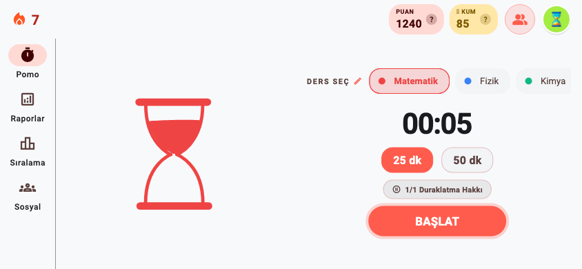
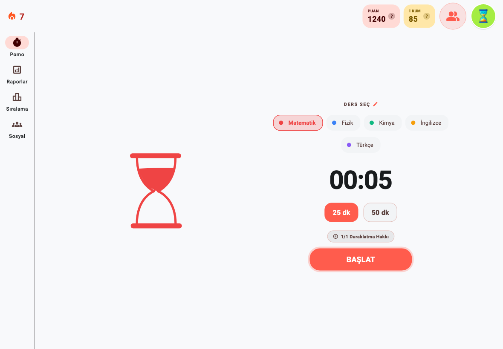

# PomoSprint — Uçtan Uca Analiz ve Düzeltme Raporu

**Tarih:** 3 Ekim 2026
**Kapsam:** Flutter uygulaması (`lib/`), canlı Supabase veritabanı ve edge function'lar, Android/iOS yapılandırması, landing sitesi (pomosprint.app) ve Cloudflare ayarları.
**Yöntem:** 8 alanlı çok ajanlı denetim → her bulgunun ayrı bir ajanla kodda çürütülmeye çalışılması → canlı veritabanının doğrudan incelenmesi → 8 paket halinde düzeltme → canlı veritabanına test edilerek uygulama → offline, sıralama, tüm işlevler ve güvenlik için bağımsız doğrulama turu.

> Bir sonraki geliştirici veya yapay zekâ için ayrıntılı çalışma rehberi: **[AGENTS.md](../AGENTS.md)**. Projede çalışmaya başlamadan önce okunmalı.

---

## 1. Özet

| | Önce | Sonra |
|---|---|---|
| Doğrulanmış bulgu | 245 (7 kritik, 28 yüksek) | Kod tarafındaki kritik ve yüksek bulgular kapatıldı. Kalanlar §7'de |
| `flutter analyze` | 0 sorun | 0 sorun |
| Otomatik test | 8 | **478** (hepsi geçiyor; 6 ekran boyutunda taşma testleri dahil) |
| Yatay telefon / tablet | Düzen yalnızca dikey telefona göreydi | Yan gezinme, iki sütunlu sayaç, ölçekli ekranlar |
| `main.dart` | 1.106 satır, 3 kopya yönlendirme | 82 satır; kabuk `lib/app/` altında 6 dosya |
| Canlı DB güvenlik uyarısı (anon) | 17 | 2 (bilinçli: sitedeki herkese açık sıralama) |
| Site | Kaldırılmış özelliği vaat ediyordu, mobil hata, SEO/güvenlik başlığı yok | Güncel içerik, mobil düzgün, CSP/HSTS, sitemap, 404, EN yasal sayfalar |
| destek@pomosprint.app | E-posta hiçbir yere gitmiyordu | Gmail'e yönleniyor |

**En önemli 5 sonuç:**
1. **Ekonomi ve sıralama hilesi kapatıldı.** Giriş yapmış herhangi bir kullanıcı tek satır kodla kendi `coins`, `lifetime_points`, `is_premium` ve `league_tier` değerlerini yazabiliyordu. Artık yazamıyor (canlıda test edildi).
2. **Çevrimdışı modül düzeldi.** Çevrimdışı biriken seanslardan yalnızca ilki kaydediliyordu, gerisi sessizce siliniyordu. Ayrıca uygulama kapanınca çalışan seans kayboluyordu. İkisi de düzeltildi.
3. **Sıralamalar doğru çalışıyor.** Lig sekmesi canlıda olmayan bir fonksiyonu çağırdığı için hiç çalışmıyordu. "Aylık" sekmesi aslında tüm zamanları gösteriyordu. Kimsenin çalışmadığı ligde herkes 0 puanla terfi edip 1.lik ödülü alıyordu. Ligler bir hafta geç işleniyordu. Hepsi düzeltildi.
4. **Çökme ve görünmez hatalar giderildi.** Avatar kataloğu boşken ana ekran çöküyordu. Android'de seans bitiş bildirimi hiç çıkmıyordu. Şifre sıfırlama hiç çalışmıyordu. Arkadaş listesi her zaman boş geliyordu.
5. **Site uygulamayla hizalandı ve yayında.** Ayrıca destek e-postası çalışır hale geldi.

---

## 2. En kritik bulgular ve nasıl düzeltildi

| # | Sorun (kanıt) | Etki | Düzeltme | Durum |
|---|---|---|---|---|
| 1 | `profiles` tablosunda istemcinin tüm kolonlara UPDATE/DELETE/INSERT yetkisi vardı | Sınırsız kum, premium, 1.lik; profil silinip istenen puanla yeniden açılabiliyordu | Kolon bazlı yetki: yalnızca ad, sosyal görünürlük, segment, günlük hedef, doğum yılı, onboarding, saat dilimi yazılabilir; silme yok; avatar sanitize | ✅ Canlıda, test edildi |
| 2 | `complete_study_session` çakışmayı son kaydın `completed_at = now()` değeriyle yapıyordu | Çevrimdışı kuyruktaki 2. ve sonraki seanslar "overlap" ile kayboluyordu | Sunucu: gerçek zaman aralığıyla çakışma, `completed_at = başlangıç + süre` (mevcut 9 kayıt da düzeltildi). İstemci: seans önce diske yazılıyor (outbox), kilitli kuyruk, reddedilenler kullanıcıya bildiriliyor | ✅ Canlıda + istemcide |
| 3 | Seans süresi doğrulanmıyordu (canlıdaki 9 seansın hepsi 6 saniye sürmüş ama 25/50 dk puanı almış) | Çalışmadan puan/kum toplanabiliyordu | Sunucu, bitmemiş seansı reddediyor (`session_not_finished`, 5 dk saat sapması toleransı) | ✅ Canlıda |
| 4 | İstemci canlıda olmayan `get_my_league_ranking`'i çağırıyordu | Lig sekmesi hiç çalışmıyordu | Fonksiyon canlıya eklendi; `get_league_ranking` artık yalnızca kendi ligini döndürüyor (önceden anonim olarak herkesin ligi okunabiliyordu) | ✅ Canlıda |
| 5 | Lig dönem sonu `rank()` kullanıyordu; 0 puanlılar berabere 1. sayılıyordu | Kimse çalışmadan herkes terfi edip ödül avatarı aldı (3 kullanıcı 0 puanla Elmas'a çıkmış) | Sıralama `row_number` + tie-breaker; terfi ve ödül için puan > 0; aynı koşuda taşınan üye ikinci kez işlenmiyor; küçük ligde kota | ✅ Canlıda, test edildi |
| 6 | Lig cron'u 20:59:00'da, ligler 20:59:59'da bitiyor | Her 14 günlük dönem 21 gün sürüyordu | Cron 21:01 UTC | ✅ Canlıda |
| 7 | Çalışan seans yalnızca bellekteydi; Android'de geri tuşu uygulamayı kapatıyordu | Uygulama kapanınca seans ve puan kayboluyordu | Kalıcı sayaç (`timer_persistence.dart`): açılınca kaldığı yerden sürer, süre dolduysa tamamlanıp gönderilir; geri tuşunda onay | ✅ İstemcide |
| 8 | Avatar kataloğu boşken `avatars.first` | Çevrimdışı ilk açılışta ana ekran çöküyordu | Gömülü yedek katalog, asla boş dönmeyen yardımcılar, cihaz önbelleği | ✅ |
| 9 | Android manifest'te bildirim receiver'ları yoktu, Android 13+ izni hiç istenmiyordu | Seans bitiş bildirimi Android'de hiç görünmüyordu | Receiver'lar, izinler, monokrom ikon; izin ilk "Başlat"ta isteniyor; profildeki Bildirimler anahtarı gerçekten çalışıyor | ✅ |
| 10 | Uygulama PKCE kullanıyordu, şifre sıfırlama sayfası `#access_token` bekliyordu | Şifre sıfırlama her zaman "Bağlantı geçersiz" diyordu | İstemci implicit akış, deep link'ten oturum alımı kapalı; sayfa hem implicit hem `token_hash` akışını destekliyor | ✅ İstemci + site |
| 11 | Avatar "açık" kontrolü bakiyeye bakıyordu; açılmış avatarlar her açılışta siliniyordu | Satın alma akışına ulaşılamıyordu; satın alınan avatarlar kilitli görünüyordu | Sahiplik = açılmış ya da ücretsiz; bakiye yeterse satın alma diyaloğu; tek kaynaklı kullanıcı modeli | ✅ |
| 12 | Arkadaş listesi başkalarının profilini doğrudan okuyordu (RLS engelliyor) | Arkadaş listesi ve gelen istekler hep boştu | `get_my_friends` / `get_incoming_friend_requests` RPC'leri (canlıda); canlı arkadaş listesindeki tekrar giderildi | ✅ |
| 13 | Herkese açık `ranking_updates` broadcast'i | Dünyadaki her seans tüm açık uygulamalarda tüm geçmişi yeniden çektiriyordu; anon anahtarla spam'lenebiliyordu | Uzak yayın kaldırıldı; yalnızca bu cihazdaki olaylarla yenileme; görünmeyen sekmeler durduruluyor | ✅ |
| 14 | "Aylık" sekmesi tüm zamanlar RPC'sini çağırıyor, "ben" satırı isimle eşleşiyordu | Yanlış sıralama; aynı isimli kullanıcı listeden siliniyordu | Gerçek aylık RPC, `is_me` ile eşleme (sunucu artık döndürüyor), ay sınırı Türkiye saati | ✅ |
| 15 | Hoş geldin e-postası JWT istiyor ama trigger başlıksız çağırıyordu; abonelikten çıkma kimlik doğrulamasız | Hiç hoş geldin e-postası gitmedi; e-posta adresini bilen herkes başkasını listeden çıkarabiliyordu | `unsubscribe_token` kolonu (canlıda); fonksiyonlar token'lı ve DB doğrulamalı yeniden yazıldı | ✅ Deploy edildi (unsubscribe v9, send-welcome-email v7); e-posta gönderimi Resend alan adı doğrulanınca başlar |
| 16 | Kategori yönetiminde yapılan değişiklikler sayaca yansımıyordu | Yeni kategori seçilemiyordu | `categoriesRevision` bildirimi; çalışan seansın kategorisi kilitli | ✅ |

Tam bulgu listesi (245 madde, alan alan) bu raporun ekidir: `analiz/denetim_bulgulari_2026-10-03.md`.

---

## 3. Karmaşıklık: ne sadeleştirildi

- **Uygulama kabuğu:** `main.dart` (1.106 satır; iş mantığı, 3 kopya yönlendirme kapısı, 310 satırlık build) 82 satıra indi. Yerine `lib/app/` altında tek görevli dosyalar geldi: `app_gate` (tek yönlendirme kapısı), `main_shell`, `theme_controller` (kalıcı tema), `session_feedback`, `category_cache`, `error_reporting`.
- **Tek doğruluk kaynağı:** Kullanıcı modeli önceden 4 farklı yerde 4 farklı biçimde kuruluyordu (seri tutarsızdı, avatarlar siliniyordu). Artık `SupabaseService.currentUser` (ValueNotifier) ve `fetchCurrentUserModel()` tek kaynak.
- **Çevrimdışı kuyruk:** Servisin içinden çıkarılıp test edilebilir `lib/services/session_queue.dart` sınıfına taşındı. İçinde kilit, outbox, hata sınıflandırması ve sunucu saat farkı tahmini (`server_clock.dart`) var.
- **İstatistik:** Üç ekranda kopyalanıp farklı sonuç üreten hesaplar `lib/utils/stats_calculator.dart` içinde birleştirildi. Gün sınırı (yerel 04:00) tek yardımcıda (`study_day.dart`) duruyor ve sunucuyla aynı kuralı izliyor.
- **Sıralama:** `ranking_screen.dart` 787 satırdan 344'e indi; parçalar `lib/widgets/social/` altına alındı. Saniyede bir tüm ekranın yeniden çizilmesi kaldırıldı.
- **Ölü kod:** Kullanılmayan iki ekran (`onboarding_screen`, `categories_screen`, ~800 satır), ikinci `MainActivity`, ölü servis metodları, kullanılmayan bağımlılıklar (`timeago`, `path`, `cupertino_icons`) silindi.
- **Hata metinleri:** Servis artık kullanıcıya ham/Türkçe exception metni göstermiyor; tipli hata kodları ekranlarda yerelleştiriliyor.
- **Site:** Header/footer 7 sayfada elle kopyalanıyordu; artık `_partials` ve `tools/sync_partials.py` ile tek kaynaktan üretiliyor. 218 KB'lık supabase-js kaldırıldı, sitede iki düz `fetch` çağrısı kaldı.
- **Veritabanı klasörü:** `_down` dosyaları CLI'ın yanlışlıkla uygulayabileceği `migrations/` klasöründen `rollbacks/` klasörüne taşındı. Uygulanmamış öneriler `proposed/` klasöründe; canlı durum `supabase/README.md`'de.

---

## 4. Offline çalışma modülü — doğrulama

Bağımsız bir doğrulayıcı seansın tüm yaşam döngüsünü kod üzerinden ve canlı sunucu kurallarını taklit eden sahte bir sunucuyla senaryo senaryo çalıştırdı. **15 senaryonun hepsi düzgün çalışıyor.** Çıkan 3 orta önemli sorun aynı gün düzeltildi.

| Senaryo | Sonuç |
|---|---|
| Çevrimiçi 25/50 dk seans, duraklatmalı | ✅ Seans önce diske yazılıyor, sonra gönderiliyor; duraklatma cezası sunucuda uygulanıyor |
| İnternet yokken biten seans | ✅ Kuyrukta kalıyor, üstte "bekleyen seans" bandı çıkıyor, bağlantı gelince otomatik gönderiliyor; puan ve istatistikler yenileniyor |
| Art arda 3 çevrimdışı seans | ✅ Sırayla gönderiliyor, hepsi kabul ediliyor (eskiden yalnızca ilki kaydediliyordu) |
| Senkron sürerken yeni seansın bitmesi | ✅ Kilitli kuyruk; çift gönderim ya da kayıp yok |
| Seans sırasında uygulamanın kapanması/öldürülmesi | ✅ Açılınca kaldığı yerden sürüyor; süre dolduysa aynı kimlikle gönderiliyor |
| Android geri tuşu | ✅ Seans sürerken onay penceresi çıkıyor; çıkılsa bile seans diskte kalıyor |
| Cihaz saati ±10 dk yanlış | ✅ Sunucu saatiyle fark hesaplanıp düzeltiliyor (ilk gönderim fark öğrenilmeden yapılmıyor; düzeltildi) |
| 24 saatten eski seans | ✅ Sunucu kuralı gereği reddediliyor ve kullanıcıya bir kez bildiriliyor |
| Silinmiş/yer tutucu kategori | ✅ Kategori isimle eşleniyor; yoksa ilk aktif kategoriye yazılıyor; seans kaybolmuyor |
| Çıkış yapıp başka hesapla giriş | ✅ Kuyruk kullanıcıya bağlı; başka hesaba asla gönderilmiyor |
| 15 sn zaman aşımı, aynı seansın iki kez gönderilmesi | ✅ Tekrar gönderim güvenli (sunucu aynı seansı ikinci kez yazmıyor) |
| Uygulama ön plana dönünce yeniden deneme | ✅ Eklendi (eskiden yalnızca bağlantı olayında deneniyordu) |
| Debug derlemedeki 5/10 sn'lik seanslar | ✅ Sunucu bilinçli olarak reddediyor |

Kalan küçük konular (düşük önem): zaman aşımına uğrayıp aslında sunucuya ulaşmış bir seans, kesinleşene kadar raporlarda geçici olarak çift görünebilir; çevrimdışıyken Raporlar ekranı cihazdaki bekleyen seansları göstermiyor.

## 5. Sıralamaların doğruluğu — doğrulama

Doğrulayıcı istemcinin gösterdiği her sıralamayı canlı SQL fonksiyonlarıyla satır satır karşılaştırdı. **14 kontrolün hepsi doğru.** Çıkan 4 orta önemli gösterim sorunu düzeltildi.

| Kontrol | Sonuç |
|---|---|
| Lig sırası | ✅ Sunucunun sırası (puan ↓, katılım zamanı ↑) birebir korunuyor; berabere puanda sıra bozulmuyor |
| Kendi satırın | ✅ Lig ve aylıkta yalnızca sunucunun `is_me` işaretiyle bulunuyor (isimle eşleme kaldırıldı) |
| Terfi/düşme bölgeleri | ✅ Sunucu kuralıyla aynı; 0 puanla terfi yok; artık podyumda da gösteriliyor |
| Henüz ligi olmayan kullanıcı | ✅ Sahte "#1 · 0 puan" yerine "ilk seansınla yerleşeceksin" görünümü |
| Geri sayım | ✅ Sunucunun dönem bitişinden (14 gün) hesaplanıyor |
| Lig ödül avatarları | ✅ 1. sıra şampiyonluk, 2–3. sıra podyum ödülü; adlar kurala uygun |
| Aylık sıralama | ✅ Gerçek aylık puan; her ayın 1'inde Türkiye saatiyle sıfırlanıyor |
| Arkadaşlar sekmesi | ✅ Tekrarsız, toplam puana göre |
| Puan/kum/dakika/seri gösterimi | ✅ Sunucu yanıtından güncelleniyor; günlük 16 seans tavanından sonra 0 puan/kum doğru gösteriliyor |
| Lig bilgi sayfası metinleri | ✅ Puan değerleri canlı `get_points_config`'ten geliyor; tavan metni sunucu kuralını tam anlatıyor |

Kalan küçük konular: dönem/ay bittiği anda geri sayım "Sıfırlanıyor…" yazısında bekliyor, liste ekran yenilenince güncelleniyor; arkadaşlar sıralamasında kendi puanın başka cihazda yapılan seanslar için birkaç saniye geç güncellenebilir.

## 6. Tüm işlevler — tek tek kontrol

Doğrulayıcı uygulamadaki her ekranı ve butonu kod üzerinden yürüttü: navigasyon, yükleniyor/hata durumları, çift tıklama, kapanmış ekrana yazma (setState after dispose), boş liste çökmesi ve canlı veritabanı yetkileriyle uyum kontrol edildi. **24 akışın hepsi çalışıyor.** Çıkan 1 yüksek ve 2 orta önemli sorun düzeltildi.

| Akış | Sonuç |
|---|---|
| Soğuk açılış (çevrimiçi / çevrimdışı / oturumsuz) | ✅ Çevrimdışı da açılıyor; başka hesabın önbelleği kullanılmıyor |
| E-posta ile kayıt, onay e-postası, yeniden gönderme | ✅ |
| E-posta, Google ve Apple (iOS) ile giriş | ✅ Ad artık sağlayıcının verdiği ad (eskiden e-postanın baş kısmıydı) |
| Şifremi unuttum → sitede yeni şifre | ✅ |
| Onboarding (yaş kapısı, segment, kategoriler, günlük hedef) | ✅ Çıkış butonu her zaman görünür (13 yaş altı kullanıcı takılıyordu; düzeltildi) |
| Sayaç: 25/50, 3-2-1, tek duraklatma, kategori kilidi, bildirim | ✅ Duraklatılmış seans süre seçimine dokununca artık onaysız silinmiyor |
| Kategoriler: ekle, düzenle, arşivle, geri al, sırala, 8/15 limiti | ✅ |
| Raporlar, geçmiş, günlük hedef | ✅ 04:00 gün dönümü, hata + tekrar dene, boş durumlar |
| Sıralama, sosyal (şu an çalışanlar), arkadaş ekleme/kabul/ret | ✅ |
| Koleksiyon: satın alma, kuşanma, yetersiz bakiye, premium, lig ödülü | ✅ |
| Profil: isim, karanlık mod, bildirimler, sosyal görünürlük, dil, yasal linkler TR/EN, çıkış, hesap silme | ✅ |
| Güvenlik ve gizlilik: Sentry'ye kişisel veri gitmiyor, çıkışta önbellek temizleniyor, yalnızca izinli kolonlar yazılıyor, 18 RPC'nin hepsi canlıda var | ✅ |

Kalan küçük konular (düşük önem, ayrı bir turda): kategori adında yalnızca büyük/küçük harf değişikliği kaydedilmiyor; sosyal sekmede arkadaşın kategori adı çevrilmiyor; hesap silmede Apple belirteç iptali için sunucu fonksiyonu gerekiyor (App Store şartı; geliştirici hesabı alınınca).

## 6.1 Yatay telefon ve tablet

Uygulama iPhone'da yatay modu ve iPad'i destekliyordu, ama düzen yalnızca dikey telefona göre yazılmıştı. Kodda yalnızca 3 yerde ekran boyutuna bakılıyordu. Tüm ekranlar ortak bir yardımcıyla (`lib/utils/responsive.dart`) yeniden düzenlendi. **Dikey telefon görünümü piksel piksel aynı kaldı.**

| Ekran | Yatay telefon | Tablet |
|---|---|---|
| Kabuk | Alt çubuk yerine yan gezinme (NavigationRail), sekme durumu döndürmede korunuyor | Yan gezinme |
| Sayaç | Kum saati solda; ders seçimi, süre, 25/50 ve BAŞLAT sağda (eskiden ders/süre seçimi yatayda gizleniyordu) | Kum saati ve kontroller ortada, ölçekli |
| Giriş, kayıt, onboarding | Klavye açıkken bile kaydırılabilir; onboarding adımları iki sütunlu | Form genişliğinde ortalı |
| Raporlar, geçmiş, aylık | Kaydırılabilir, grafik yüksekliği ekrana göre | Kartlar 2–3 sütun, pano genişliği |
| Sıralama, sosyal, profil, koleksiyon | Küçültülmüş podyum, kaydırılabilir | Podyum ve liste yan yana, avatar ızgarası genişliğe göre |
| Diyaloglar ve alt sayfalar | Kaydırılabilir | En fazla 640 px, ekrana yayılmıyor |

6 ekran boyutunda (390×844, 844×390, 568×320, 820×1180, 1180×820, 1366×1024) ve büyük metin ölçeğinde **taşma olmadığını doğrulayan** testler eklendi. Gerçek fontla çizilmiş örnekler: `analiz/ekranlar/uygulama-*.png`

---

## 7. Canlı sistemde yapılan değişiklikler

**Supabase (Pomodoro App, eu-north-1):** `20261003150000_live_audit_fixes` migration'ı uygulandı ve migration geçmişine kaydedildi. Öncesinde geri alınan bir işlemde sentetik kullanıcılarla 28 senaryoluk test çalıştırıldı; **28/28 geçti.** Uygulama sonrasında yetkiler, fonksiyonlar, cron ve veri düzeltmesi (9/9 seans) salt okunur sorgularla doğrulandı.
- Geri alma betiği: `supabase/rollbacks/20261003150000_live_audit_fixes_down.sql`
- Önemli not: Repodaki 2026-08 ve 28 Eylül migration dosyaları **canlıya hiç uygulanmamış**; canlı geçmiş farklı. Ayrıntı ve güvenli çalışma akışı `supabase/README.md`'de.

**Supabase Edge Functions:** `unsubscribe` (v9) ve `send-welcome-email` (v7) yeni sürümle deploy edildi ve güvenli isteklerle doğrulandı: GET 405, token'sız 400, geçersiz kayıt atlanıyor.

**Cloudflare:**
- pomosprint.app yeni sürümle yayında (`wrangler deploy`). Tüm sayfalar 200 dönüyor. `www` ve `http` adresleri 301 ile `https://pomosprint.app`'e yönleniyor. CSP, HSTS, X-Frame-Options ve Referrer-Policy aktif.
- Email Routing: `destek@pomosprint.app` → cayirtepeahmetfurkan@gmail.com. MX, SPF ve DKIM kayıtları eklendi.

**Site içeriği ve UI (iki tur):**
- Kaldırılan "Sanal Kütüphane" vaadi çıkarıldı.
- Özellikler sayfası, uygulama koduyla tek tek karşılaştırılarak yeniden yazıldı. Her özellik "ne işe yarar, nasıl çalışır" sorusunu yanıtlıyor: sayaç, **internet yokken çalışma**, **dersler ve günlük hedef**, raporlar, arkadaşlar, 14 günlük lig, dil, koleksiyon.
- SSS'ye gerçek sorular eklendi: uygulama kapanınca seans ne olur, bildirim, çevrimdışı kullanım, premium.
- İkinci turda 59 UI/içerik bulgusu çıktı (10 yüksek), kayıt gerektirenler dışında hepsi düzeltildi:
  - hero yatay telefonda ilk ekrana sığıyor
  - indirme butonu gibi görünen mağaza rozetleri yerine dürüst bir "Yakında" ve "Yayınlanınca haber ver" butonu
  - lansman öncesi boş sıralama bölümü kaldırıldı
  - sabit header anker hedeflerini kapatmıyor
  - mobil menü dışarı tıklanınca kapanıyor
  - SSS'de klavye odağı görünür
  - kontrast WCAG AA
  - yardımcı sayfalarda İngilizce metinler
  - Türkçe büyük harf (İ) hatası
- 320, 375, 768, 812 (yatay telefon), 1024, 1280 ve 1920 px genişlikte hiçbir sayfada yatay taşma yok. 349 iç bağlantının hepsi çalışıyor.
- Gizlilik politikası Sentry, Supabase, Cloudflare Web Analytics, herkese açık sıralamada kısaltılmış isim ve hesap silme konularında güncellendi. İngilizce gizlilik ve şartlar sayfaları, robots.txt, sitemap, 404, og görseli ve yapılandırılmış veri eklendi.

Ekran görüntüleri (önce/sonra): `analiz/ekranlar/`

---

## 8. Sizin yapmanız gerekenler

### Şimdi (geliştirici hesabı gerekmez)
1. **Resend alan adı (10 dk):** Resend panelinde `mail.pomosprint.app` alan adını ekleyip doğrulayın. Resend'in verdiği DNS kayıtlarını (MX/TXT/DKIM) Cloudflare → pomosprint.app → DNS'e ekleyin. Bu yapılmadan hoş geldin ve bülten e-postaları gönderilemez.
2. **DMARC (1 dk):** Cloudflare DNS → TXT kaydı. Ad `_dmarc`, içerik `v=DMARC1; p=none; rua=mailto:destek@pomosprint.app`.
3. **Supabase Auth ayarları (5 dk):**
   - Authentication → Settings → **Leaked password protection**'ı açın.
   - URL Configuration → Redirect URLs listesinde `https://pomosprint.app/reset-password` ve `https://pomosprint.app/confirmed` (ve `.html`'li hâlleri) olsun. `io.supabase.pomosprint://…` varsa silin.
   - (Önerilir) Email Templates → Reset Password bağlantısını `https://pomosprint.app/reset-password?token_hash={{ .TokenHash }}&type=recovery` yapın.
4. **Kök `.env` kontrolü:** Bu dosya uygulamanın içine gömülüyor. İçinde `SUPABASE_SERVICE_ROLE_KEY` **olmamalı**. Terminalde `grep -c SERVICE_ROLE .env` komutu 0 dönmeli; değeri ekrana yazdırmaz.
5. **Gerçek cihaz testi (bu makinede Android SDK yok):** Testleri §10'daki listeye göre yapın.

### Apple Developer hesabı alınca
1. Apple Developer → Identifiers → `com.pomosprint.app` için **Sign in with Apple** yeteneğini açın.
2. Supabase → Authentication → Providers → Apple'ı etkinleştirip Client IDs alanına `com.pomosprint.app` yazın.
3. iOS minimum sürüm 15.0 oldu (yeni Xcode şartı).
4. Ücretsiz Apple hesabıyla cihaza kurulumu bozmamak için **Debug derleme boş entitlements kullanıyor**; Sign in with Apple yalnızca Release/Profile derlemelerinde açık. Geliştirici hesabı olmadan Apple ile girişi cihazda deneyemezsiniz; bu normal.

### Uygulamanın ekran kayıtları (sitede kalan TEK iş)
Sitedeki metinler hazır. Aşağıdaki çerçeveler "görsel yakında" yazıyla kayıtlarınızı bekliyor. Eski arayüzü gösteren sıralama ve rapor videoları kaldırıldı. Giriş yapılmış ve biraz verisi olan bir hesapla, telefonda 10–15 saniyelik **dikey** ekran kaydı alın (iPhone: Denetim Merkezi → Ekran Kaydı):

| Dosya adı | Ne gösterilmeli |
|---|---|
| `offline.mp4` | Uçak modunda bir seansın bitmesi → "bekleyen seans" bandı → internet açılınca gönderilmesi |
| `categories.mp4` | Profil → Kategorilerim: ders ekleme, renk seçme, sıralama |
| `reports.mp4` | Raporlar: günlük → haftalık → aylık sekmeleri arasında geçiş |
| `leaderboard.mp4` | Sıralama: Lig → Aylık → Arkadaşlar sekmeleri |
| `friends.mp4` | Sosyal sekmesi: şu an çalışanlar, arkadaş kodu, gelen istek |

Dosyaları `landing/videos/` klasörüne bu adlarla koyup bana "videoları yayınla" demeniz yeterli. Yerleştirme, poster görseli üretimi ve yayın 5 dakikalık iş. Aynı kayıtlar App Store ve Google Play ekran görüntüleri için de kullanılabilir.

---

## 9. Kalan işler ve bilinçli olarak ertelenenler

| İş | Neden ertelendi | Öneri |
|---|---|---|
| **Çeviri sisteminin tekleştirilmesi** (`LanguageService` haritası → ARB) | Uygulamada üç ayrı çeviri yolu var: ARB, `LanguageService.translate` ve `isTurkish ? … : …`. Bugün eklenen tüm yeni metinler ARB'ye yazıldı. Eski metinlerin taşınması yüzlerce satıra dokunuyor ve tek başına bir iş. | Ayrı bir oturumda ekran ekran taşıma + kullanılmayan anahtarların silinmesi. Cihaz dilinden ilk dil seçimi de bununla gelecek. |
| `google_sign_in` 6 → 7 yükseltmesi | Major sürüm; Android Credential Manager'a geçiş, gerçek cihazda test ister | Geliştirici hesabı ve cihaz testleriyle birlikte |
| `SupabaseService`'in alan bazlı repository'lere bölünmesi | Kuyruk, hata tipleri ve saat ayrıldı; tam bölme yüksek riskli | Kademeli: Auth → Category → Social |
| Arkadaş silme, giden isteği iptal, toplu kategori sıralama RPC'leri | Canlıda yok; `supabase/proposed/11_audit_fixes_unapplied.sql` içinde hazır | İhtiyaç olunca aynı DRYRUN akışıyla canlıya |
| Kullanıcıya özel saat dilimi | Flutter cihazın IANA saat dilimi adını vermiyor (ek paket gerekir). Sunucu şu an herkes için Europe/Istanbul kullanıyor | `flutter_timezone` paketi + `profiles.timezone` (yazma yetkisi ve doğrulaması hazır) |
| Bekleme listesi için çift onay ve bot koruması | Backend gerektirir (sitede şimdilik honeypot ve süre kontrolü var) | Turnstile + Edge Function |
| Repodaki migration geçmişinin canlıyla eşitlenmesi (baseline) | Supabase CLI ve DB şifresi gerekiyor | `supabase/README.md` → Baseline adımları |
| macOS/Linux/Windows/Web klasörleri | Çalışmayan şablonlar; silinmedi | Kullanılmayacaksa silinebilir |
| `assets/league_award_avatars/` (9,6 MB) | Kullanılmıyor ama kaynak tasarım olabilir | Repo dışına ya da `design/` klasörüne taşıyın |

---

## 10. Gerçek cihazda test listesi

Bu makinede Android SDK olmadığı için Android derlemesi yapılamadı. iOS simülatör derlemesi başarılı. Gerçek cihazda şu senaryoları deneyin; sorun çıkarsa bana yazın:

1. **Kalıcı sayaç:** 25 dk'lık seansı başlatın, uygulamayı görev yöneticisinden kapatın. Süre dolmadan açınca sayaç kaldığı yerden sürmeli; süre dolduktan sonra açınca seans kaydedilip tebrik ekranı çıkmalı.
2. **Android geri tuşu:** Seans sürerken geri tuşuna basın; onay penceresi çıkmalı.
3. **Bildirim:** İlk "Başlat"ta izin istenmeli. Uygulama arka plandayken seans bitince bildirim gelmeli. Profil → Bildirimler kapatılınca gelmemeli.
4. **Çevrimdışı:** Uçak modunda 2 seans tamamlayın, interneti açın. İkisi de kaydedilmeli; puan ve kum artmalı.
5. **Sıralama:** Bir seans sonrası Lig ve Aylık sekmelerinde kendi satırınız vurgulu ve puanınız doğru görünmeli.
6. **Şifre sıfırlama:** "Şifremi unuttum" → e-postadaki bağlantı → pomosprint.app'te yeni şifre → uygulamada yeni şifreyle giriş.
7. **Avatar:** Kumunuz yetiyorsa 200 kumluk bir avatarı satın alıp kuşanın. Uygulamayı kapatıp açınca kilitli görünmemeli.
8. **Kategori:** Profil → Kategoriler'de yeni kategori ekleyin. Ana ekrana dönünce sayaçta seçilebilmeli.
9. **Karanlık mod:** Açıp uygulamayı yeniden başlatın; tercih korunmalı. Not: Varsayılan tema artık sistem teması.
10. **Döndürme ve tablet:** Sayaç ekranında telefonu yan çevirin; yan gezinme ve iki sütunlu düzen gelmeli, seans kesilmemeli. iPad varsa tüm sekmelere bakın.
11. **Debug derleme:** Sayaç 5/10 saniyedir ve sunucu bu seansları bilinçli olarak reddeder. Gerçek puan testi için `flutter run --release` kullanın.

